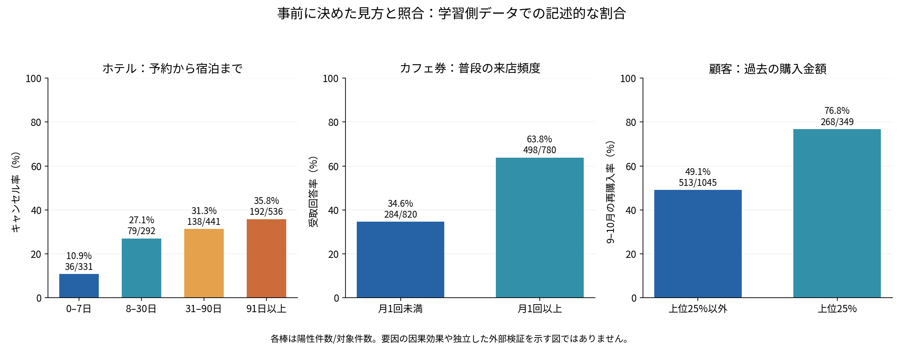

## 身近な疑問を、公開データで確かめる

「早めに予約したホテルは、キャンセルしやすいのか」「カフェ好きなら、カフェのクーポンを受け取りやすいのか」「たくさん買ってくれた人は、次も買ってくれるのか」。

こうした疑問を、公開データと自作の評価ツールDIY AutoMLで試してみました。既存の主要5モデルを使い、各テーマ最大2,000行のQuick & dirtyな試行です。結果が良くなかった例も、そのまま残しています。

この記事はビジネス向けの実験解説の下書きです。ファイルを渡してExcelを受け取る画面アプリは今後の実装です。[ツール全体を紹介する親記事の下書き](https://github.com/okamasaya/DIY_AutoML/blob/recovery/reimplemented-0.4.0a1-post1/articles/diy-automl-evaluation-framework.md)と、[実装ブランチ](https://github.com/okamasaya/DIY_AutoML/tree/recovery/reimplemented-0.4.0a1-post1)も参照できます。

## ここでいう「誤差」とは？

まずは「予測をどれだけ外したか」です。カフェ券の例では、受け取ると判定した205回答のうち139件が受取回答、66件が拒否回答でした。受取回答だったのに拾えなかったものも57件あります。「正解率69.3%」を、実際の失敗の件数まで開いて見ると、何に困りそうかを考えやすくなります。

もう一つは「その数字自体が、調べたデータによってどれくらい揺れるか」です。400件で調べた成績を、そのまま今後の全員に当てはめられるとは限りません。最後に「調べた相手や時期に偏りがないか」も確認します。回答者が偏っていれば、件数を増やすだけでは解消しないことがあります。

最初から統計の数式を覚える必要はありません。**何件間違えたか、数値にはどんな揺れがあるか、自分が使いたい場面とデータが合っているか**の3点から読みます。

## 最初に、実際に観察した割合を見る

この図は、モデルを学習する側のデータにどんな傾向があったかを示しています。予測の正解率や、要因の因果効果を示す図ではありません。

| テーマ | 一般的に置きやすい見方 | 今回の学習側での観察 |
| --- | --- | --- |
| ホテル予約 | 宿泊日が遠いほど、予定が変わる余地もありそう | 宿泊まで0〜7日はキャンセル10.9%、91日以上は35.8% |
| カフェ券 | 普段からカフェへ行く人ほど受け取りそう | 月1回未満は受取回答34.6%、月1回以上は63.8% |
| 再購入 | 過去によく買った顧客ほど、次も買いそう | 購入額上位25%は次の2か月の再購入76.8%、他は49.1% |

方向はおおむね事前の見方と合っています。ただし、個々の人や予約を予測するとなると、話はもう少し難しくなりました。

## ホテル：傾向が見えても、予測が上手とは限らなかった

[ポルトガルの実ホテル2施設の予約データ](https://pmc.ncbi.nlm.nih.gov/articles/PMC6297060/)を使いました。完全一致レコードや必要な数値列の欠損を除き、2,000行を固定抽出しています。

学習側では、宿泊までの日数が長い群ほどキャンセル率が高くなりました。0〜7日の群は36/331件、91日以上の群は192/536件がキャンセルです。これは、日程が遠い予約ほど予定が変わりやすそうだ、という業務上の仮説と同じ方向でした。

しかし、学習側で選ばれた決定木を、保留した400件で評価するとAccuracyは62.5%。キャンセル111件のうち拾えたのは34件で、77件を見逃しました。

このtestでは、全件に「キャンセルなし」と答えるだけでもAccuracyは72.3%になります。キャンセルを1件も拾えない方法なので、それが良い予約管理という意味ではありません。多数派が多いデータでは、正解率だけを見ると目的を見失います。

今回の決定木は、単純に「予約から宿泊まで49日以上ならキャンセル」とする参考ルールにも、両クラスを重視するmacro F1で及びませんでした。49日は学習側の中央値で、testを見て選んだ値ではありません。

この結果から考えられるのは、今回使った9数値列・小規模データ・既定設定だけでは、予約管理に採用できる根拠が得られなかったということです。ほかの列を使えば改善する可能性はありますが、今回はtestの結果を見てやり直していません。

また、元資料は到着前日の情報抽出を説明しています。予約結果が分かる列は除外しましたが、「予約受付時点で予測できる」と検証したわけではありません。

## カフェ券：普段の習慣と、その場の条件は手がかりになった

[クーポンの調査データ](https://archive.ics.uci.edu/dataset/603/in+vehicle+coupon+recommendation)から、Coffee Houseの回答を使いました。運転中の状況を提示し、すぐ、または期限までにクーポンを使うと答えたかを分類します。実際の来店・購買記録ではありません。

学習側では、月1回未満のカフェ利用者は284/820件=34.6%、月1回以上の利用者は498/780件=63.8%が受取回答でした。有効期限2時間の群は41.4%、1日の群は58.5%。寄り道15分以上の群は45.1%、それ未満は52.8%でした。

普段の好み、期限の余裕、移動の負担という見方に合う結果です。[Wangらの研究](https://jmlr.org/papers/v18/16-003.html)も、カフェに行く頻度とその場の状況を組み合わせた、短いルールを提示しています。

今回選ばれたのはロジスティック回帰で、test400件のAccuracyは69.3%。受取回答196件のうち139件を拾い、拒否204件のうち66件を受取と誤判定しました。文献を参考にした固定ルールのAccuracyは66.3%でした。点では上回りましたが、これだけで学習モデルの実用的な優位を結論していません。

この調査では、同じ人が複数の状況に回答しています。配布CSVに回答者IDがなく、学習とtestを回答者単位で分けられていません。新しい人への予測力は、今回の数字だけでは確かめられません。

「期限を長くすれば売上が増える」「クーポンを配れば来店が増える」という効果も、この回答データの比較だけからは分かりません。

## 再購入：優良顧客ほど戻りやすいが、全員が戻るわけではなかった

[英国の通販企業の購入履歴](https://archive.ics.uci.edu/dataset/352/online+retail)を、顧客1人につき1行へ集計しました。2011年6〜8月の購入履歴を入力にし、9〜10月に購入記録があったかを正解にしています。正解を架空で作ったのではなく、後の期間の実記録から付けています。

対象は、観測期間に正の購入があった英国の1,743顧客です。取消などを除いた正の売上を扱っており、返品を相殺した純売上ではありません。

顧客分析では、いつ買ったか・何回買ったか・いくら買ったかというRFMの見方が使われます。[この公開データに結び付く先行研究](https://link.springer.com/article/10.1057/dbm.2012.17)も、RFMによる顧客理解を扱っています。

今回の学習側では、購入1回の顧客は344/795人=43.3%、2回以上は437/599人=73.0%が9〜10月にも購入していました。最終購入が30日以内の群は65.4%、それより前の群は47.8%でした。

購入額が上位25%の顧客も、268/349人=76.8%が再購入していました。反対に、その層でも81人=23.2%は、後の2か月にこの通販での購入記録がありませんでした。購入額だけで一律に「次も買ってくれる」とは決められません。

選ばれたランダムフォレストのtest macro F1は0.624。「過去に2回以上買った人は再購入する」という単純ルールは0.613で、差は約0.011でした。モデルの導入前に、こうした説明しやすい判断と比較する価値があります。

購入額上位25%だけを「再購入する」と予測する別の固定ルールは、そう予測した人の80.2%が実際に再購入していました。一方、再購入した人全体のうち拾えた割合は37.2%です。少人数へ絞って案内したいのか、買う人を広く拾いたいのかで、見るべき結果も変わります。

今回の「購入記録なし」は永久離反や他店での非購入ではありません。また、将来の別時期で使えるかは、別の期間でも確認する必要があります。

## 予測の数字を読むための条件

モデルは決定木、ランダムフォレスト、ロジスティック回帰、SVM、k-NNの5種類です。約80%を学習側にし、その中の共通5foldでmacro F1が高いモデルを選び、保留した約20%は選んだ1モデルだけに使いました。

| テーマ | 学習 / test件数 | 選定モデル | test Accuracy | test macro F1 |
| --- | --- | --- | ---: | ---: |
| ホテル | 1,600 / 400 | 決定木 | 62.5% | 0.527 |
| カフェ券 | 1,600 / 400 | ロジスティック回帰 | 69.3% | 0.692 |
| 再購入 | 1,394 / 349 | ランダムフォレスト | 62.8% | 0.624 |

macro F1は、陽性・陰性の両側を重視する指標で、1が最大です。正解率とは別の量です。異なるテーマの点数を並べても、業務上の価値やデータセットの優劣の順位にはなりません。

同じ保存結果には、macro F1の「95%区間」もあります。0.4.0a6では保存済み予測から標準誤差も計算し、Excelにまとめました。標準誤差は、評価値の揺れの大きさを推定した値です。

| テーマ | 今回のmacro F1 | 標準誤差 | 条件付き95%区間 |
| --- | ---: | ---: | ---: |
| ホテル | 0.527 | 0.0263 | 0.477〜0.576 |
| カフェ券 | 0.692 | 0.0233 | 0.647〜0.739 |
| 再購入 | 0.624 | 0.0254 | 0.573〜0.672 |

[3テーマの誤差評価Excelと図](https://github.com/okamasaya/DIY_AutoML/tree/recovery/reimplemented-0.4.0a1-post1/validation/metric-uncertainty-0.4.0a6)を保存しています。モデルは学習し直さず、元の評価結果も残しました。

これは学習済みモデルを固定し、保留したデータから、正解クラス別の件数を保って重複を許して行を取り出し直す計算で求めた幅です。各行を独立な評価単位として扱えることなどが前提で、学習データやモデル選びのやり直し、将来の変化は含みません。F1=0.692は「69.2%の確率で当たる」という意味でもありません。

特にカフェ券は同じ人の複数回答を含み、回答者IDがありません。この幅は行単位で計算した参考値で、新しい人への性能を保証する幅としては使えません。**幅が狭いほど、データの品質が良いと決めることもできません。**

## 自分のデータを持ち込むなら、ここを対比する

今回の公開データを、自分のデータを見るための見本にします。データに詳しくない場合も、まず次を埋めるところから始められます。

| 確認すること | 今回の例 | 持ち込んだデータで確認すること |
| --- | --- | --- |
| 何を当てたいか | 通販の次の2か月の購入記録 | 対象と期間、予測結果を何の判断に使うか |
| 1行は何か | 通販は1顧客、カフェ券は1回答 | 同じ顧客が何行も含まれないか。識別できなければ不明とする |
| 予測するときに分かる情報か | 通販の入力は6〜8月、正解は9〜10月 | 結果が出た後の情報が入力に入っていないか |
| どんな間違いが困るか | 受取回答の見逃し57件、拒否回答への誤判定66件 | 見逃しと誤案内の件数を、業務上許容できるか |
| 簡単な判断でも足りるか | ホテルでは単純ルールがモデルを上回った | 現在の判断や事前に決めたルールと比較できるか |
| 別の対象・時期でも使うか | 通販の別期間、カフェ券の新しい回答者は未検証 | 別期間や別顧客のデータで確認できるか |

ビジネス向けは、主要モデル・少ない列・小規模な計算から使う構成を目指します。ここでいう簡易版は、計算量と説明を絞るという意味です。最初のExcelには件数、単純ルールとの比較、数値の揺れと注意点をまとめ、詳しい条件は後ろで確認できるようにします。この持ち込み用の画面や対比シートの自動生成は、今後の実装です。

区間だけを見て「データ不足だから増やす」とは決めません。同じ人の繰返しなのか、正解ラベルは確かか、使いたい時期のデータなのかで、次に確認すべきことが変わります。専門的な推定条件と検証方法は、[DS向けの詳細下書き](https://github.com/okamasaya/DIY_AutoML/blob/recovery/reimplemented-0.4.0a1-post1/articles/diy-automl-ds-uncertainty.md)へ分けています。

見ているのは限られた公開データでの試行です。一般的な見方との方向の照合、条件を決めたモデル選定、単純な判断との比較までを行いました。施策の利益、実運用の効果、最新モデルとの差は検証していません。

数値列の抽出、意味を固定した二値化、購入履歴の集計は、この実験用の加工です。汎用的なカテゴリ/欠損処理をツールへ追加したわけではありません。[加工条件・区間・参考ルール・保存結果の詳細](https://github.com/okamasaya/DIY_AutoML/blob/recovery/reimplemented-0.4.0a1-post1/docs/BUSINESS_QUICK_RESULTS.md)と、[再実行手順](https://github.com/okamasaya/DIY_AutoML/blob/recovery/reimplemented-0.4.0a1-post1/experiments/business_quick_20261108/README.md)を残しています。
