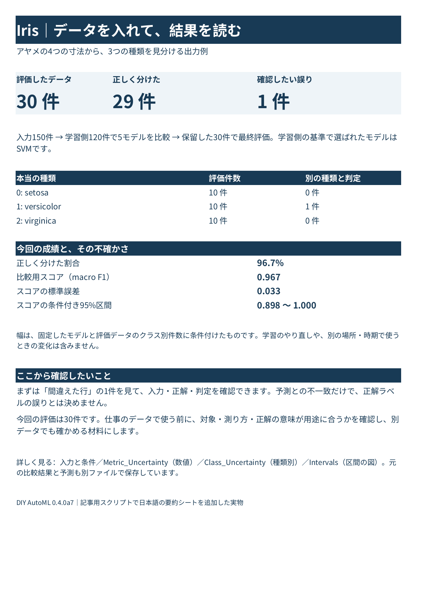
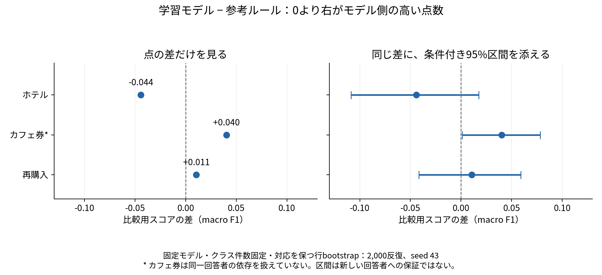

## 仕事で知りたいのは、点数の先にあること

「キャンセルしそうな予約を見つけたい」「クーポンの案内先を考えたい」「次も買ってくれそうな顧客を知りたい」。機械学習を使うなら、結果をこうした判断につなげたいところです。

そのとき、正解率が何%だったかに加えて、どんな間違いがあったか、その成績をどこまで信用できそうか、使いたい場面でも同じように働きそうかが気になります。

**誤差を添えたいのは、何が不確実なのかを見える形にしたいからです。** どこまで分かったかが見えれば、もう少しデータを集めるのか、正解の付け方を確認するのか、実際の運用に近い条件で試すのかを考えやすくなります。

この記事では、自作の評価ツールDIY AutoMLで作ったExcelの実物と、ホテル・カフェ券・買い物の公開データで、その読み方を紹介します。自社データの活用を考える担当者が、分析する人と次の確認を相談するための入口を目指しています。[全体を紹介する親記事](https://zenn.dev/okamasaya/articles/diy-automl-evaluation-framework)も参照できます。

## まず、データを入れると何が出るかを見てみる

出力を想像しやすいように、定番のIris（アヤメ）で見本を用意しました。がくと花びらの長さ・幅から、3種類のアヤメを見分けるデータです。仕事への効果を実証する題材ではなく、受け取る結果の見本として使います。

150件のCSVを読み、120件の学習側で5モデルを比較し、そこで選んだSVMを、取っておいた30件で評価しました。ここは親記事のMLPとは別の学習例です。流れは「CSV → 学習側で比較 → 選んだモデルを評価 → 結果と条件をExcelへ」です。

*ダウンロードできるExcelの「まず読む」シートを表示したもの。入力150件のうち、最終評価に使ったのは30件。*

[日本語の要約付きExcelを開く](https://raw.githubusercontent.com/okamasaya/DIY_AutoML/main/validation/business-output-20261112/iris/iris_business_report.xlsx) ／ [先頭シートだけのPDF](https://raw.githubusercontent.com/okamasaya/DIY_AutoML/main/validation/business-output-20261112/iris/summary.pdf) ／ [入力したCSV](https://raw.githubusercontent.com/okamasaya/DIY_AutoML/main/validation/business-output-20261112/iris/input.csv)

最初に見えるのは、**30件中29件を正しく分類し、1件を別の種類と判定した**という結果です。その下に、種類ごとの件数、比較用スコア、その不確かさ、次に確認する箇所を並べました。

| 最初に開くシート | 分かること |
| --- | --- |
| まず読む | 今回の結果、成績の幅、そこから確認したいこと |
| 間違えた行 | 入力CSVの何行目を、どの種類と判定したか |
| 入力と条件 | 入力件数、欠損・重複の件数、モデルの選び方、評価条件と未確認事項 |

「間違えた行」には、入力CSVの79行目がversicolorからvirginicaと判定された記録が残っています。元の寸法や正解へ戻れるので、点数だけでは分からない箇所を調べられます。予測との不一致だけで、正解ラベルの誤りとは決めません。

この例の正解率は96.7%です。別の比較用スコアであるmacro F1は0.967、標準誤差は約0.033、条件付き95%区間は約0.898〜1.000でした。これは今回のモデルと評価データをもとに計算した成績の幅で、次の花をその確率で正しく分類できるという意味ではありません。

要約シートは、現行の学習・評価処理を呼ぶ**Iris専用の記事用スクリプト**で追加したものです。元の数値表や図もExcelに残しています。一般のCSVを渡す画面アプリや、業務に合わせた説明をすべて自動で作る機能が完成した、という見本ではありません。[作成手順と確認記録](https://github.com/okamasaya/DIY_AutoML/blob/main/docs/BP_OUTPUT_EXAMPLE.md)から再現できます。

## 3つの視点で、何が不確実かを読む

Irisのように「29件を正しく分けた」と分かっても、そこから確かめたいことは残ります。

| 見るところ | 知りたいこと |
| --- | --- |
| 今回の間違い | 何を何件、取り違えたのか。仕事で困る間違いはどれか |
| 成績の不確かさ | 限られた評価データから、成績をどれくらい精密に測れたのか |
| データと使い道の対応 | 同じ人の繰返し、正解の定義、対象や時期の違いが影響しないか |

区間が狭いことだけで、データ品質が良いとは決められません。同じ人の回答を多数集めた場合と、別々の人から集めた場合では、行数が同じでも情報の重なり方が違います。ラベルの基準がずれていれば、数値を精密に計算しても、その基準の正しさは別に確かめたい問題です。

詳しい統計の手順は[DS向けの記事](https://zenn.dev/okamasaya/articles/diy-automl-ds-uncertainty)に置き、ここでは件数と結果の読み方を見ていきます。

## 身近なデータでは、どんな結果になったか

次は、ホテル予約のキャンセル、カフェ券の受取回答、通販の再購入です。既存の主要5モデルを使い、各テーマ最大2,000行の小規模な試行をしました。

*学習に使う側のデータで観察した割合。予測の正解率や、施策の因果効果を示す図ではない。*

| 題材 | 今回の学習側で見えた傾向 |
| --- | --- |
| ホテル | 宿泊まで0〜7日はキャンセル10.9%、91日以上は35.8% |
| カフェ券 | 月1回未満のカフェ利用者は受取回答34.6%、月1回以上は63.8% |
| 通販 | 購入額上位25%の顧客は後の2か月に再購入76.8%、他は49.1% |

身近な見方と合う傾向はあります。ただ、その傾向を使って個々の予約や顧客を予測すると、点数だけでは見えにくい違いがありました。

## ホテル：見逃しを減らすと、誤った警戒も増える

[ポルトガルの実ホテル2施設のデータ](https://pmc.ncbi.nlm.nih.gov/articles/PMC6297060/)から2,000行を抽出しました。学習側で選ばれた決定木は、評価用400件のキャンセル111件中34件を拾い、77件を見逃しました。キャンセルしなかった予約を、キャンセルすると判定したものも73件あります。

参考にしたのは「予約から宿泊まで49日以上ならキャンセル」とするルールです。49日は学習側で求めた中央値で、評価結果を見て選び直していません。このルールはキャンセル72件を拾い、見逃しは39件でしたが、キャンセルしなかった予約への誤判定も123件ありました。

今回の点数では参考ルールが上でした。ただし後で見る差の不確かさを含めると、優劣の方向を言い切れる結果ではありません。実務でも、見逃しを減らしたいのか、誤った警戒を減らしたいのかによって、重視する結果が変わります。費用を含む採用判断は、今回していません。

正解率にも注意が要ります。決定木の正解率は62.5%ですが、全件に「キャンセルなし」と答えるだけなら72.3%です。後者はキャンセルを1件も拾わないため、高い正解率だけでは目的に合うか分かりません。

**次に確認したいのは、いつの時点で予測するかです。** 元資料は到着前日の情報抽出を説明しています。結果が分かる列は除外しましたが、予約受付時点で使えると検証したわけではありません。使いたい時点で分かる情報と、必要な判断を揃えるところから進めたい例です。

## カフェ券：多く拾うことと、案内を絞ることの違い

[クーポンの調査データ](https://archive.ics.uci.edu/dataset/603/in+vehicle+coupon+recommendation)のCoffee Houseへの回答を使いました。状況を提示して、クーポンを使うか尋ねたものです。実際の来店や購買の記録ではありません。

学習側では、月1回未満のカフェ利用者は284/820件、月1回以上は498/780件が受取回答でした。有効期限2時間では41.4%、1日では58.5%でした。普段の習慣と状況を組み合わせた短いルールは、[Wangらの研究](https://jmlr.org/papers/v18/16-003.html)でも紹介されています。

選ばれたロジスティック回帰と、文献を参考にした固定ルールを、同じ400回答で比べました。

| 方法 | 受取回答を拾えた件数 | 受取回答の見逃し | 拒否回答を受取と誤判定 |
| --- | ---: | ---: | ---: |
| 学習モデル | 139 | 57 | 66 |
| 参考ルール | 98 | 98 | 37 |

モデルは受取回答を多く拾った一方、拒否回答への誤判定も増えています。案内先を広く拾いたいのか、絞りたいのかを考える材料です。正解率はモデル69.3%、ルール66.3%でしたが、その差だけで実用性は決まりません。

**次に確かめたいのは、新しい人にも同じ傾向が出るかです。** 同じ人の複数回答を含みますが、CSVに回答者IDがなく、人ごとに学習と評価を分けられませんでした。行単位の計算でモデル側に正の差があっても、新しい回答者への優位は確かめられていません。来店や売上への効果を知りたいなら、その実記録も必要になります。

## 通販：小さな点数差から、導入の価値まで言えるか

[英国の通販企業の購入履歴](https://archive.ics.uci.edu/dataset/352/online+retail)を1顧客1行に集計しました。2011年6〜8月の情報から、9〜10月に購入記録があったかを予測します。対象は観測期間に正の購入があった英国の1,743顧客で、取消等を除いた正の売上を使っています。

学習側では、購入1回の顧客は344/795人、2回以上は437/599人が後の期間にも購入していました。購入額上位25%では268/349人、76.8%が再購入し、残る81人には後の2か月の購入記録がありませんでした。最近・頻度・金額を見る[RFMの研究](https://link.springer.com/article/10.1057/dbm.2012.17)とも関係する観点です。

選ばれたランダムフォレストは、評価用349人の再購入196人中127人を拾い、69人を見逃しました。比較用スコアは0.624。「過去に2回以上購入した人は再購入する」というルールは0.613で、差は約0.011でした。この差からモデルの優位は確認できておらず、ルールで十分だという同等性の証明でもありません。

購入額上位25%だけを対象とする別の固定ルールでは、対象者の80.2%に再購入記録がありました。一方、再購入した人全体の37.2%しか拾っていません。案内できる人数が限られる場合と、幅広く拾いたい場合では、比べたいものも変わります。

**次は、別の期間でも働くかを確かめたい例です。** 今回は、同じ観測・正解期間の別顧客で学習と評価を分けています。後の購入を正解に使っていますが、予測時点をずらした時系列の検証ではありません。「購入記録なし」も、永久離反や他店での非購入を意味しません。

## 点数の差に、幅を添えると何が変わるか

ここまでの比較用スコアはmacro F1です。それぞれの種類の分類成績を同じ重みで平均した指標で、1が最大です。正解率とは別の量で、異なる業務の価値を順位付けするものでもありません。

次の図は「学習モデルのスコア − 参考ルールのスコア」です。0より右ならモデル側の点数が高く、左なら参考ルール側が高いという読み方になります。

*固定したモデルとルールについて、同じ評価行の対応とクラス別件数を保って取り出し直した、記事用の補足集計。2,000反復・seed 43。行の独立性などが前提で、ホテルの同じ顧客・団体などの依存も扱っていない。まず差の全範囲−1〜1を確認し、左右共通の−0.13〜0.13へ拡大表示した。*

点だけなら、ホテルはルール側、カフェ券と通販はモデル側が高く見えます。幅を添えると、ホテルと通販は0の両側へ広がっており、今回の条件では差の方向を明確に判断できるだけの根拠が得られていないと読めます。同じくらいだと証明されたわけでもありません。

カフェ券は、行を独立に扱う仮定の下ではモデル側に正の差があります。ただし、同じ回答者の依存を扱えていないため、新しい人への優位としては使えません。

この幅に、学習やモデル選びをやり直す変動、別時期・別集団への変化、施策の利益は含まれていません。図は、保存済み予測を使って記事用に追加したもので、パッケージの標準的なモデル間比較機能とは区別しています。[計算条件と反復値](https://github.com/okamasaya/DIY_AutoML/blob/main/validation/business-output-20261112/comparison/comparison.json)も残しています。

誤差を添えることで、点数の良し悪しに加えて、何をまだ判断できないかが見えてきます。

## 自分のデータなら、何を一緒に確認したいか

公開データの結果をそのまま自社へ当てはめるより、問いと条件を照らし合わせる見本にします。

| 確認すること | 自分のデータで考える問い |
| --- | --- |
| 何の判断に使うか | 案内先を絞るのか、見逃しを減らすのか。どの間違いが困るか |
| 入力と正解の意味 | どんな測定・記録か。正解ラベルは何をもとに付いたか |
| 1行の意味 | 1人・1予約・1回答のどれか。同じ対象が繰り返し入らないか |
| 情報の時点 | 予測を出すときに分かる情報か。結果が出た後の情報が混ざらないか |
| 普段の判断との比較 | 今のルールや、事前に決めた簡単な方法と比べてどう違うか |
| 次に使う場面 | 別の顧客・場所・時期でも使いたいか。確かめるデータはあるか |

何も分からないデータからでも、分布や欠損・重複を調べ、記録の意味や対象を確認すると、次に調べる箇所を相談しやすくなります。区間幅だけで「データ不足」「品質が悪い」と自動判定するものではありません。IrisのExcelにも、今回の入力と、まだ確認していない条件を残しました。

## トレンド分析や時系列への対応は、今後の予定

仕事では、売上や問い合わせの増減、季節性を見たい場面も多そうです。そのため、時間方向のデータを扱う版も今後検討したいと考えています。

過去の推移や傾向を整理するトレンド分析と、将来を予測して範囲を示すことは、別の課題です。まず日時・集計単位・欠測・記録の定義を確認し、そのうえで時間順の検証や、予測する先ごとの性能・不確かさを扱う方向です。キャンペーン前後の変化も、そのまま施策の効果とは判断しません。

現行版は、数値特徴量・欠損なし・ラベル付きの分類CSV向けです。トレンド解析や時系列予測の機能は未実装で、[ロードマップ](https://github.com/okamasaya/DIY_AutoML/blob/main/docs/ROADMAP.md)と[DS記事](https://zenn.dev/okamasaya/articles/diy-automl-ds-uncertainty)に今後の課題を記載しています。

今回のように、結果と不確かな部分、元へ戻れる記録を一緒に受け取れる入口を整えたいと思っています。将来のビジネス向けアプリも同じ評価処理へ接続する方針で、提供方法や価格は今後です。

3テーマは限定した公開データの試行で、業務効果や利益を実証したものではありません。[加工条件・出典・元の保存結果](https://github.com/okamasaya/DIY_AutoML/blob/main/docs/BUSINESS_QUICK_RESULTS.md)、[再実行手順](https://github.com/okamasaya/DIY_AutoML/blob/main/experiments/business_quick_20261108/README.md)、[今回の出力見本の確認記録](https://github.com/okamasaya/DIY_AutoML/blob/main/docs/BP_OUTPUT_EXAMPLE.md)へ進めるようにしています。
