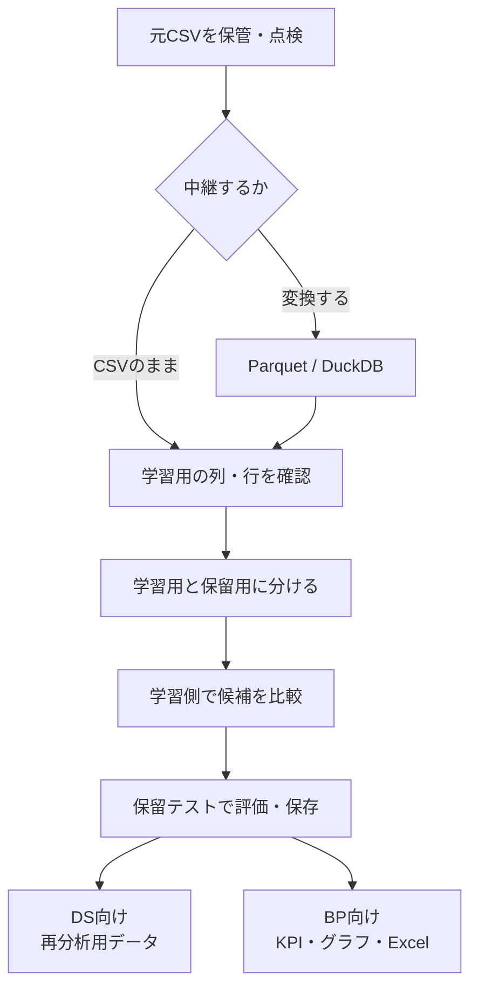

モデルをいくつか動かすと、どれが一番高い点数だったかは分かります。その点数をあとから読み直すには、どんなデータを使い、どこで候補を選び、何を最後に評価したのかも一緒に残しておきたい。そう考えて、DIY AutoMLでは学習前の点検から結果の保存までを一つの流れにしました。 [DIY AutoMLを作り始めた理由](https://zenn.dev/okamasaya/articles/diy-automl-evaluation-framework)

この開発メモでは、手元のWindows PCでIrisのCSVを点検し、5つの分類モデルを比較して結果を読むところまでたどります。

## どんな環境で動かしているか

検証に使ったのは、メモリ16 GBのWindows PCです。Python 3.13.17の仮想環境（`.venv`）で、表の読み込みにpandas、分類モデルと交差検証にscikit-learn、Excel出力にopenpyxlを使いました。今回のIrisは数値の特徴量が4列、正解ラベルが1列で、CPUで試せます。セットアップとコードはリポジトリにまとめています。 [セットアップ](https://github.com/okamasaya/DIY_AutoML#セットアップ)

:::details Windowsでの初回セットアップ
Python 3.13を導入してリポジトリを取得したら、ルートのフォルダーで実行します。

```powershell
py -3.13 -m venv .venv
.\.venv\Scripts\python.exe -m pip install -e .
```
:::

## CSVから評価結果までの流れ



元のCSVは保管し、点検で学習に必要な列やラベルに問題が見つかれば、内容を見直してから進みます。何度も読み直すデータなどでは、指定に応じて作業用のParquetやDuckDBファイルを作ります。中継した場合は、学習に使う列を取り出したあとにも件数・欠損・ラベルの内訳を点検します。Irisは150行なので、今回は元のCSVをそのまま使います。図はFull Paperの図1を記事向けに簡略化しました。 [Full Paper（図1）](https://github.com/okamasaya/DIY_AutoML/blob/9b6b22c/docs/papers/DIY_AutoML_Full_Paper_20261119/DIY_AutoML_Full_Paper_20261119.pdf)

## Irisを点検し、5つの候補を比較する

リポジトリのルートから、コアのライブラリを導入した `.venv` で実行します。`target` が正解ラベルです。再実行する場合は、出力先に新しいフォルダー名を指定します。

```powershell
.\.venv\Scripts\python.exe -X utf8 -m diy_automl audit-data --csv data/reference/iris.csv --target target --row-unit "アヤメ1個体" --output runs/zenn-development-note-01-iris/audit
.\.venv\Scripts\python.exe -X utf8 -m diy_automl select --csv data/reference/iris.csv --target target --output runs/zenn-development-note-01-iris/selection
```

**点検する。** Irisは3クラス各50件で、全列の値が一致する重複が1件ありました。同じ観測が重複登録されたかどうかは、元の記録に戻って確かめる項目です。今回は動作確認として150行を使いました。

**学習側で候補を比べる。** 150行を学習用120行と保留テスト用30行に分けます。学習側の120行を共通の5分割で使い、決定木、ランダムフォレスト、ロジスティック回帰、SVM、k近傍法を比較します。検証のたびに学習部分から標準化の設定を求め、モデルの選定には各クラスのF1を同じ重みで平均した「macro F1」を使います。

**保留した30行で確かめる。** 選んだモデルを学習側の120行全体で学習し直し、取り置いた30行で評価します。今回の実行結果は次のとおりでした。

| 確認したこと | 今回の値 |
| --- | --- |
| 学習側の比較で選んだモデルと平均macro F1 | SVM、0.967 |
| 保留テストの結果 | 30件中29件が正解、macro F1は0.967 |
| 保留テストのmacro F1の95%区間 | 0.898〜1.000 |

表では丸めた点数が同じですが、上段は候補を選ぶための交差検証の平均で、中段は最後に保留した30行で測った値です。95%区間は、学習済みモデルを固定し、保留行を正解クラスごとに取り直したときの評価値のばらつきを表します。 [モデル比較と評価の手順](https://github.com/okamasaya/DIY_AutoML/blob/main/docs/DATA_AUDIT.md#画面からのモデル比較)

## 結果を受け取る二つの入口

DS（データサイエンティスト）向けには、CLIやNotebookから評価を実行し、あとから分割や予測を読み直せるようにしています。今回の `select` では、比較表・保留テスト・評価区間が `report.xlsx`、分割と予測が `arrays.npz`、実行設定と入力の照合情報が `manifest.json` に入ります。

BP（ビジネス利用者）向けのWindows画面では、同じ分類評価を使い、評価した件数・正解・誤分類を先に表示します。候補モデルの棒グラフや評価Excelを開けて、日付順で評価したときは月別推移も確認できます。 [BP画面の使い方](https://github.com/okamasaya/DIY_AutoML/blob/main/docs/DATA_AUDIT.md#データ点検の画面を使う)

モデル候補の順位と採用の判断も分けています。たとえば、順位の下の候補を運用上の理由で採用する場合は、共通の交差検証で測ったスコアの差を判断材料にできます。

次回は、TensorFlowとPyTorchで分類結果と予測確率を比べた話と、AutoGluonで同じデータ分割を使って評価を照合した話を取り上げます。
