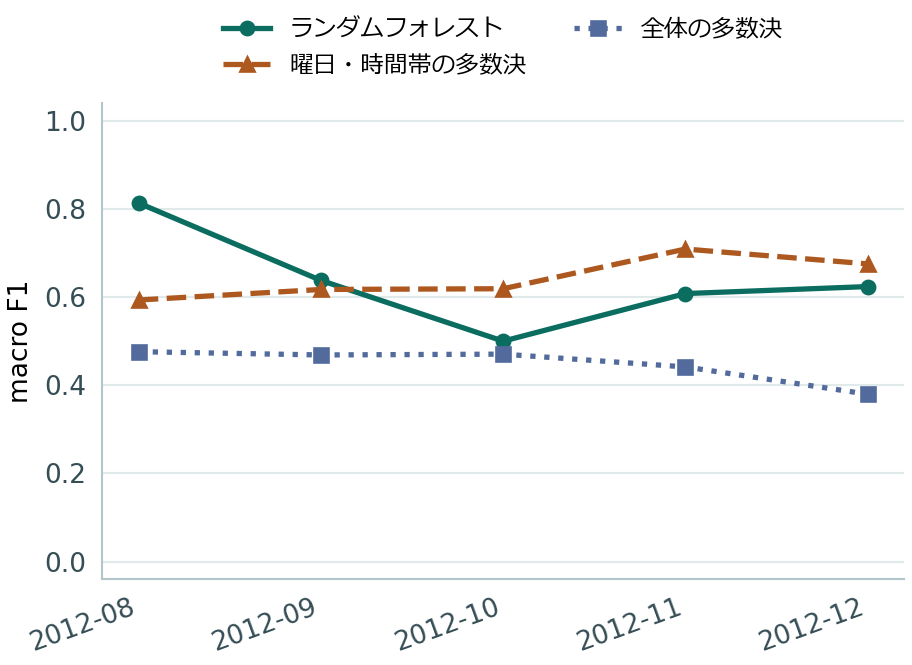

DIY AutoMLで比較したモデルの結果を、Pythonに不慣れな人も手元のPCで確認できるようにしたい。そこでBP（ビジネス利用者）向けに、**CSVを選ぶ → データを点検する → モデルを比べる → 結果をExcelやグラフで見る**という流れをWindowsの試作画面につなぎました。分類編の最終回では、この画面でどこまで試せるかを紹介します。

## IrisのCSVを開き、5モデルを比較する

Tcl/Tk付きのPythonでDIY AutoMLを導入した `.venv` を使います。WindowsのPowerShellで、リポジトリのルートから実行すると、見本のIrisを選んだ状態で画面が開きます。 [セットアップと画面の操作手順](https://github.com/okamasaya/DIY_AutoML/blob/9b6b22c/docs/DATA_AUDIT.md#データ点検の画面を使う)

```powershell
.\.venv\Scripts\python.exe -X utf8 -m diy_automl bp-preview --csv data/reference/iris.csv
```

1. 正解列に `target` を選び、**「点検する」**を押します。欠損や重複の件数、品種ごとの内訳を確認します。別のUTF-8 CSVを使うときは、**「CSVを選ぶ」**から開きます。
2. **「使う列を選ぶ…」**で、がくと花びらの長さ・幅の4列を残し、**「抽出して再点検」**を押します。元CSVを保管したまま、正解列も含む学習用CSVが別に保存されます。大きなCSVを繰り返し扱う場合は、ストレージ用の追加ライブラリを導入し、点検時に**「作業用Parquetも保存」**を選べます。今回のIrisは150行なので、そのまま進めます。
3. **「5モデルを比較する」**を押します。学習側の120行で5候補を比べ、選ばれたSVMを、取り置いた30行で評価します。

試作画面で比較できるのは、欠損のない数値の特徴量と、分類の正解ラベルがそろったデータです。同じ顧客の行が複数ある場合は、点検前に「IDでまとめる」を選ぶと、同じ顧客の行を学習側と評価側にまたがらせずに済みます。過去の記録を使って後の時期を評価したい場合は「日付順で分ける」を選びます。 [CSVと分割方法の条件](https://github.com/okamasaya/DIY_AutoML/blob/9b6b22c/docs/DATA_AUDIT.md#画面からのモデル比較)

## 点数を見たあと、件数と間違い方を見る

Irisの評価画面には **評価30件・正解29件・誤分類1件** と表示されました。**「評価Excelを開く」**で `bp_report.xlsx` を開くと、「まず読む」に主要指標があり、「ラベル別」で品種ごとの見逃しと誤検知が分かります。**「グラフを見る…」**の棒グラフは、候補を選ぶときの学習側の成績です。選んだモデルの保留テストの成績は、評価画面とExcelで確認します。

日付順で評価すると、グラフに**「保留テストの月別推移」**が加わります。例として、公開データBike Sharingで、ある時間の自転車貸出が200件以上なら「混雑」、200件未満なら「通常」と分類しました。観測日のうち新しい約2割（2012年8月7日〜12月31日、582行）を取り置き、選んだランダムフォレストと、学習期間に同じ曜日・時間帯で多かったラベルを返すルールを比べました。 [Bike Sharingの出典](https://archive.ics.uci.edu/dataset/275/bike%2Bsharing%2Bdataset) · [入力データの作り方と比較条件](https://github.com/okamasaya/DIY_AutoML/blob/9b6b22c/docs/DATA_AUDIT.md#日付順の分割)


*BP画面と同じ作図処理で描いた保留テストの月別推移。横軸は観測月、縦軸は「混雑」と「通常」のF1を同じ重みで平均した値です。*

保留期間全体のmacro F1は、曜日・時間帯のルールが **0.656**、ランダムフォレストが **0.638** でした。「通常」の109件を拾えた数は、ルールが72件、モデルが80件です。ルールと比べて、モデルでは「通常」の**見逃しが8件減り**、「混雑」を「通常」と答える**誤検知が28件増えました**。

月別に見ると、8・9月はモデルのF1が高く、10〜12月はルールの方が高くなりました。今回の保留期間の集計値で、時間のつながりを考慮した評価区間は今後の課題です。Excelの「単純ルール比較」「月別」「月別・ラベル別」を開くと、どの時期にどんな間違いを減らしたいかを件数に戻って考えられます。 [月別の成績と単純ルール](https://github.com/okamasaya/DIY_AutoML/blob/9b6b22c/docs/DATA_AUDIT.md#月別の成績と単純ルール) · [Full Paperの自転車貸出実験](https://github.com/okamasaya/DIY_AutoML/blob/main/docs/papers/DIY_AutoML_Full_Paper_20261119/sections/experiments.tex#L50)

評価Excelは外部のBI・作図ツールでも利用できます。

:::details 無料のBI・作図ツールに結果を持ち込む

標準の画面で見られるのは、主要指標、候補比較の棒グラフ、日付順評価の月別折れ線です。グラフを開き直すときは保存済みの評価表を読みます。軸を変えたり、ほかの集計と並べて見たりしたいときは、評価Excelの必要なシートを外部ツールで直接読み込むか、シートをCSVに書き出して使えます。

| ツール | 用途と保存・共有 |
| --- | --- |
| Tableau Desktop Free Edition | Excelを読み込み、PCで作図・保存。業務にも利用できます。ワークブックの共有やオンライン公開は対象外です。 [公式FAQ](https://help.salesforce.com/s/articleView?id=005316652&language=en_US&type=1) |
| Tableau Desktop Public Edition | 非商用向け。公開データで練習し、作品をTableau Publicで公開できます。PC保存も可能です。公開した図は誰でも閲覧できます。 [版の比較](https://help.tableau.com/current/pro/desktop/ja-jp/desktop_comparison.htm) · [公開時の仕様](https://help.tableau.com/current/pro/desktop/en-us/public_faq.htm) |
| Power BI Desktop | WindowsでExcelなどからレポートを作り、PCに保存。Power BIサービスでの共有には別途ライセンスや組織の容量条件があります。 [製品とライセンスのFAQ](https://learn.microsoft.com/ja-jp/power-bi/personas/business-user/end-user-faq) |
| Google Data Studio（旧Looker Studio） | Googleスプレッドシートなどから、ブラウザーで共有用ダッシュボードを作成。クラウド上のデータとレポートの共有設定を確認します。 [公式ドキュメント](https://docs.cloud.google.com/data-studio/welcome) |
| RAWGraphs | CSVから図を1枚作って画像で保存したいときに使えます。読み込んだデータはブラウザー内で処理されます。 [公式サイト](https://rawgraphs.io/) · [CSVの読み込み方](https://rawgraphs.io/learning/how-to-load-and-format-your-data-for-rawgraphs) |

たとえばTableauを試すなら、Excel接続でIrisの `bp_report.xlsx` を開き、`SL_CV_Mean` シートの `Model` と `F1` で棒グラフを作れます。ここで使う `F1` は、候補を選んだときの学習側の平均macro F1です。 [TableauでExcelに接続する手順](https://help.tableau.com/current/pro/desktop/ja-jp/examples_excel.htm)

:::

## BP向けアプリの次の段階

BP向けの試作画面は、入力ファイルの指定からモデル比較、主要指標の確認、Excelとグラフを開くところまで、一つの入口で進められるWindowsアプリにしていきます。手元で結果を見たい場合は標準の棒グラフや折れ線を使い、普段からBIツールを使っている場合は同じ評価表を活用できます。

画面内の標準グラフで足りない場合に備えて、**PyGWalkerをStreamlitに組み込み、保存した評価表からグラフの種類・軸・系列を選ぶ**機能を検討しています。今は、WindowsのPython 3.14.7とPyGWalker 0.5.0.1で、Irisの評価表を使ったローカル用HTMLの生成までを確認しています。 [PyGWalkerのStreamlit連携](https://docs.kanaries.net/pygwalker/api-reference/streamlit) · [試作の記録](https://github.com/okamasaya/DIY_AutoML/blob/9b6b22c/docs/THREAD_SUMMARY_20261119.md)

構想では、Pythonを導入済みのWindowsで、初回だけバッチファイルを使って作図用の仮想環境を作り、必要なライブラリをインストールします。初回の取得にはネット接続が必要です。2回目以降はその環境を再利用し、BP画面の「詳細グラフ」ボタン一つで、表示中の評価結果をローカルのブラウザーに開く想定です。Streamlitとの連携、バッチでの導入、ボタンからの起動は今後の検証項目です。 [詳細グラフの開発予定](https://github.com/okamasaya/DIY_AutoML/blob/9b6b22c/docs/ROADMAP.md#bp向けの詳細グラフto-do)

分類編の全5回では、手元のPCでデータを点検してモデルを比較し、その結果がどのデータと条件から得られたかを残すところまでを紹介しました。BP向けの画面とExcelでも、成績を示す数字から、評価した件数や間違い方に戻れるようにしています。次回からは、過去のデータで方法を選び、後の期間で確かめる考え方を、将来の観測値を予測する時系列の例に広げます。
