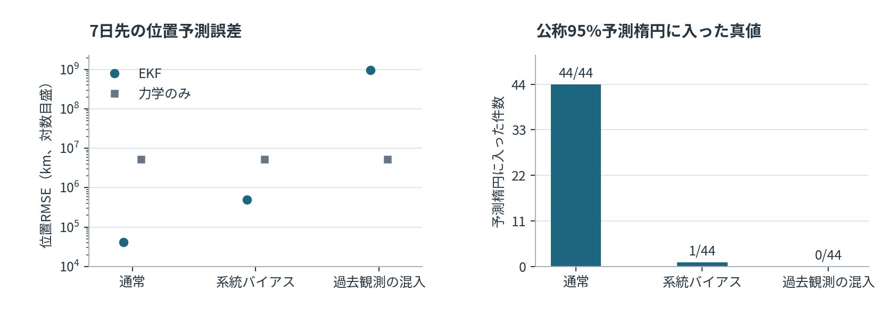

来月の航空旅客数を予測するとき、前の月の実績をそのまま使う方法と、カルマンフィルタで水準と傾きを推定する方法。どちらを使うか、過去のどの区間で決めるとよいでしょうか。今回は、先に取り置いた期間で、その選択がどれくらい効いたかを確かめます。

前編では、CSVの点検から分類モデルの選定、保留テスト、Excel出力までを扱いました。時系列編では、**予測する時点までに得られた情報で予測し、あとから実測値で採点する**という順番を守って、モデルと単純な予測を比べます。 [前編の開発メモ (5)](https://github.com/okamasaya/DIY_AutoML/blob/a2680757e1f8a328c42c8d10f5c73fa2a80eece4/articles/diy-automl-development-note-05-bp-preview.md)

## 公開時系列で、カルマンを続けるか決める

使ったのは、月ごとの航空旅客数 **AirPassengers** と、30分ごとのニューヨークのタクシー乗客数 **NYC Taxi** です。航空は1か月先、タクシーは30分先を予測しました。どちらも時刻順に三つに分け、先頭で設定を決め、次の区間で手法を選び、最後の保留区間で採点しました。保留期間に入ってからも、次の予測の直前までに観測された値は使います。 [AirPassengersの出典](https://stat.ethz.ch/R-manual/R-devel/library/datasets/html/AirPassengers.html) · [NYC Taxiの出典](https://github.com/numenta/NAB/blob/master/data/realKnownCause/nyc_taxi.csv)

今回の `kalman-track` では、選定区間のRMSEが**直近値より5%以上下がったときだけ**カルマンを続ける設定にしました。直近値は「次の値は、いま観測した値と同じ」とする予測です。両系列で直近値が選ばれました。カルマンを最後まで続けた場合と比べ、保留RMSEは航空で約27%、タクシーで約13%下がりました。

| 方式 | AirPassengers 保留RMSE（千人、48時点） | NYC Taxi 保留RMSE（人、6,288時点） |
| --- | ---: | ---: |
| カルマンを最後まで継続 | 65.69 | 1,962.19 |
| 現行のDIY AutoMLが選んだ直近値 | 48.04 | 1,708.36 |
| DIYの季節候補を含む追加試験 | 27.89 | 1,708.36 |
| AutoGluon Tabular | 27.49 | 1,115.22 |
| H2O AutoML | 42.34 | 1,171.83 |

航空では、候補に前年同月の値を使う方法を加えました。この追加試験では「前年同月 × 過去の平均成長倍率」が選ばれ、保留RMSEは **27.89千人** でした。AutoGluonは **27.49千人** で、RMSEでは0.40千人程度の差です。一方、絶対誤差の平均（MAE）は、季節候補が22.09千人、AutoGluonが22.61千人でした。大きな誤差を強く反映するRMSEと、各時点の絶対誤差を平均したMAEでは、同じ予測でも順位が変わります。

タクシーでは、前日や前週の同時刻も試しましたが、DIY側の追加試験でも直近値が選ばれました。保留区間全体のRMSEはAutoGluonとH2Oの方が低い結果です。さらに同じ時刻ごとに直近値とH2Oの絶対誤差を比べると、直近値の誤差が小さかったのは **6,288時点中2,056時点** です。平均のスコアを見たあと、どの時点で差が開いたかまで戻れるよう、時刻ごとの予測を保存しました。 [選定区間・候補・再実行手順](https://github.com/okamasaya/DIY_AutoML/blob/ed140060386a199725b0348479778883261c1ff6/experiments/seasonal_forecast_crosscheck/README.md) · [時点別の集計記録](https://github.com/okamasaya/DIY_AutoML/blob/ed140060386a199725b0348479778883261c1ff6/docs/development-notes/time-series-crosscheck-draft.md)

## 力学と観測があると、何が変わるか

もう一つ作ったのは、ボイジャーを題材にした**合成軌道**です。太陽の重力で動く二次元の探査機を作り、地球からの距離と距離変化率を観測します。その値から7日先の位置を予測しました。拡張カルマンフィルタ（EKF）には軌道生成と同型の力学モデルを与え、表形式モデルには過去の正解位置を学習データとして渡しました。同じ保留時点で評価していますが、各手法が使う情報は異なります。 [NASAのVoyager 1ミッション解説](https://science.nasa.gov/mission/voyager/voyager-1/) · [合成軌道と比較条件](https://github.com/okamasaya/DIY_AutoML/blob/ed140060386a199725b0348479778883261c1ff6/experiments/voyager_crosscheck/README.md)

観測をそのまま使った場合と、距離・距離変化率に一定のずれを加えた場合、過去の観測ペアを取り違えた場合を比べました。通常観測では、EKFの位置RMSEは **41,982 km** で、観測で更新しない力学モデルの **5,240,893 km** を下回りました。過去観測が混ざるとこの関係が逆転し、比較した候補のうち力学モデルのみの予測が最も小さい誤差でした。

*7日先位置の予測と、公称95%予測楕円に真値が入った件数。保留の44時点は1本の合成軌道から得ています。*

## 誤差が増えたとき、予測区間も確認する

EKFは予測した位置とともに、どの方向にどれくらいずれそうかを表す共分散を出します。そこで毎時点で公称95%の予測楕円を作り、真値が中に入った回数を数えました。入力側でも、距離の変化が距離変化率の記録と整合するかを点検しました。

| 保留44時点での点検 | 通常 | 系統バイアス | 過去観測の混入 |
| --- | ---: | ---: | ---: |
| EKFの予測楕円に真値が入った | 44/44 | 1/44 | 0/44 |
| 観測の整合性が閾値を超えた | 2/44 | 6/44 | 42/44 |

系統バイアスを入れたとき、位置RMSEは通常時の約12倍でした。予測楕円の平均長半径は約30万kmのままで、真値が入ったのは44時点中1時点です。入力の点検でも、この条件で拾えたのは6時点でした。過去観測の混入は42時点で拾えたので、この点検で見つけやすい異常の種類も分かりました。 [予測楕円・入力点検の計算方法](https://github.com/okamasaya/DIY_AutoML/blob/ed140060386a199725b0348479778883261c1ff6/experiments/voyager_crosscheck/README.md#ekf自身が見積もった誤差の評価)

## 次の判断に使えるよう、比較を残す

「カルマンを続けるか」は、直近値や季節候補を同じ保留時点で採点して判断します。予測区間を使いたいなら、実測が入った割合と区間の幅を合わせて確認します。点予測が外れたときは入力の整合性も追えるようにしておきます。今回の数値はいずれも、各系列で指定した予測時間、候補、分割で得られた結果です。

DIY AutoMLでは、線形カルマンを `kalman-track`、非線形の比較を `ekf-benchmark`、`ukf-benchmark`、`particle-benchmark` で試せます。季節候補や他ライブラリとの比較は、実験ディレクトリの手順で再実行できます。次は、同じ時点で得られた性能差に、時系列のつながりを考慮した区間を付けるところを詰めます。 [状態推定の実行例](https://github.com/okamasaya/DIY_AutoML/blob/ed140060386a199725b0348479778883261c1ff6/README.md#カルマンフィルタによる時系列の予測と推定) · [誤差評価の設計](https://github.com/okamasaya/DIY_AutoML/blob/ed140060386a199725b0348479778883261c1ff6/docs/UNCERTAINTY_DESIGN.md)
