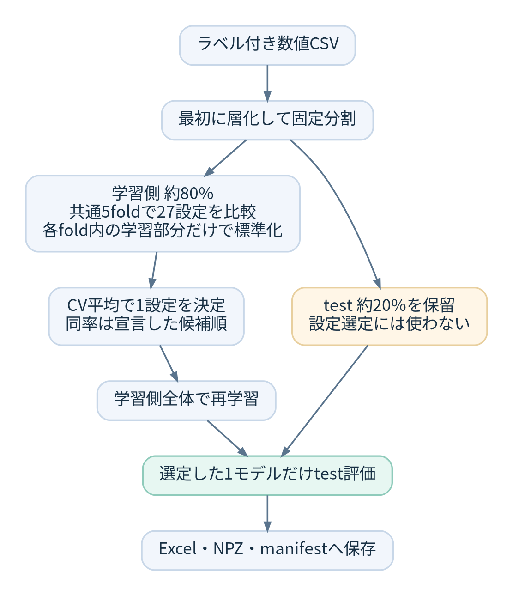
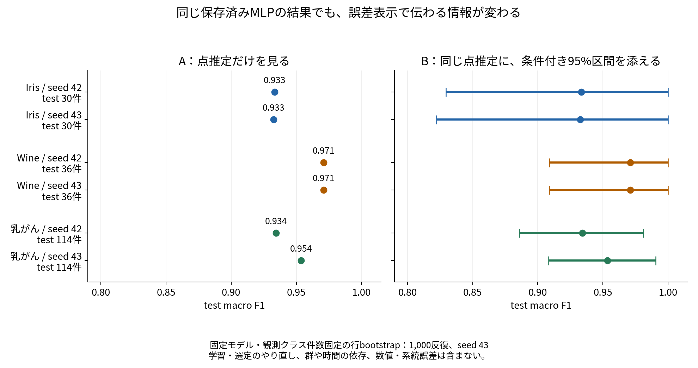
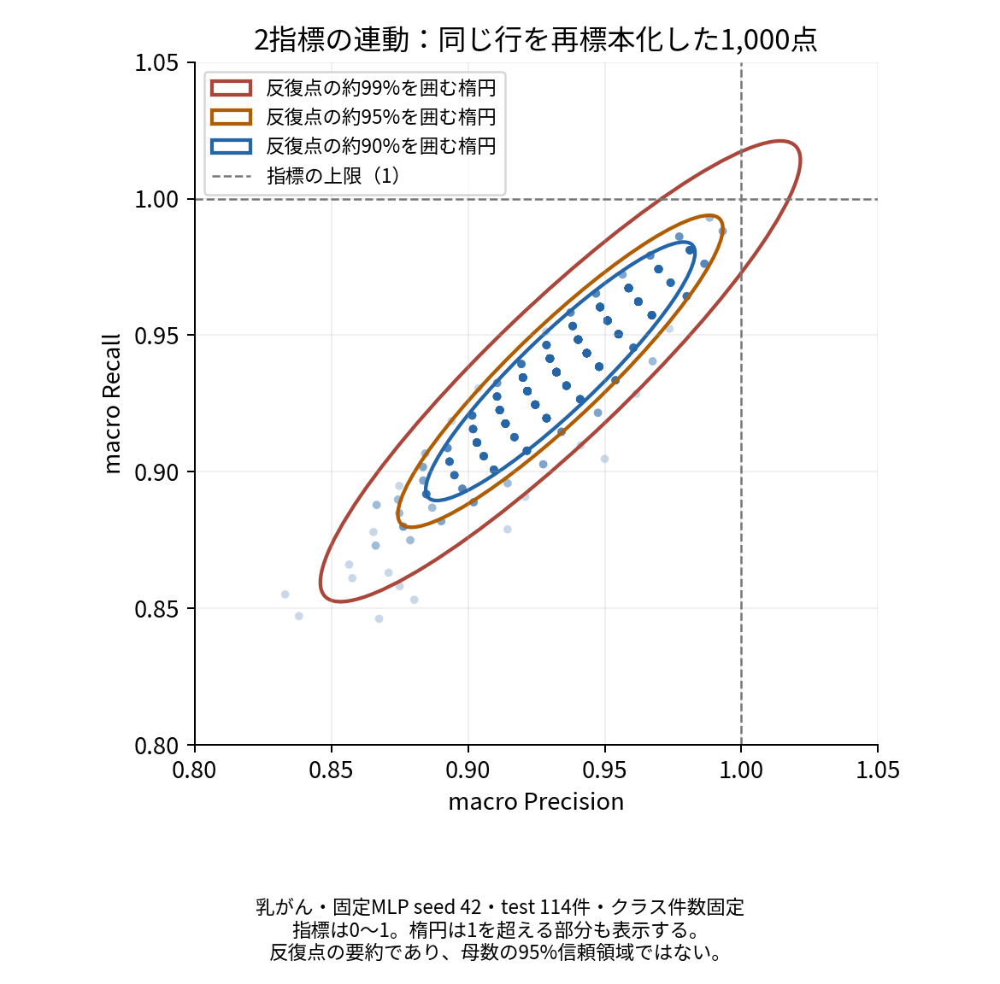
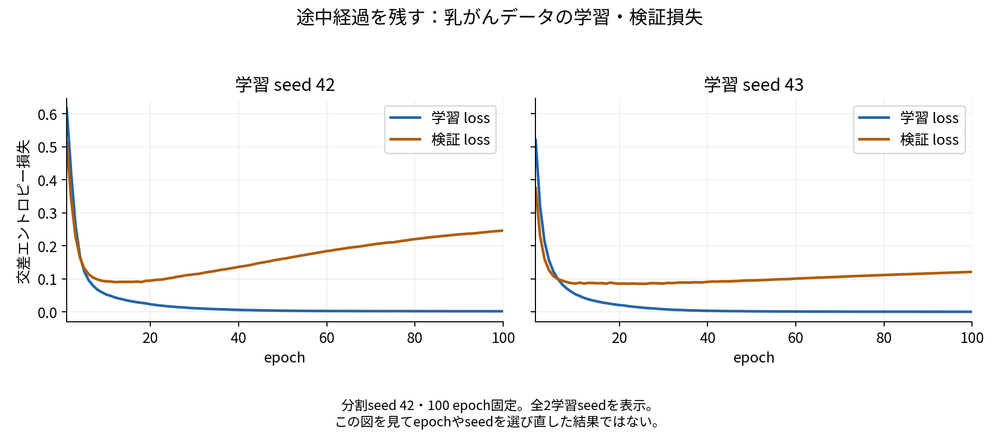

## スコアの隣に、何の誤差かを書く

「F1は0.933でした」と「F1は0.933、bootstrap標準誤差は0.047、条件付き95%区間は0.829〜1.000でした」では、読み取れる情報が変わります。ただし、後者も誤差をすべて評価した結果ではありません。何を固定し、何を変えて求めた数字かを確認する必要があります。

[親記事](https://zenn.dev/okamasaya/articles/diy-automl-evaluation-framework)では、scikit-learnの定番データとTensorFlowのMLP（多層パーセプトロンというニューラルネットワーク）から、点数に誤差と途中経過を添える意味を紹介しました。この記事では、その裏付けとなる分類・計算・表示方法を、DSを目指す方にも追える順序で説明します。[ビジネス向けの記事](https://zenn.dev/okamasaya/articles/diy-automl-business-three-experiments)は、身近な実験と誤りの件数から読む入口です。

まず誤差の由来と既存ライブラリの機能を整理し、次に親記事の図を数式と実行できるコードでたどります。最後に、Notebook・CLIでの実行と保存結果の検証につなげます。SE（standard error、標準誤差）は推定値の標本変動の大きさ、SD（standard deviation、標準偏差）は指定した値の集合のばらつきを表します。何の集合に対するSDかによって、意味が変わります。

対象は開発中の **0.4.0a7** です。現在の`uncertainty`は、保存済みの固定モデルの正解と予測から、指標の標準誤差・区間を計算します。学習・モデル選定全体の変動、入力からの誤差伝搬、数値・系統誤差の包括的な評価は、今後の範囲です。

## 統計誤差・計算誤差・系統誤差の3つでよいのか

この3つは、**何が結果の信頼性に関わるかを考え始める入口**として使えます。ただし、機械学習の誤差を、独立な3成分へ完全分解する普遍的な公式ではありません。

| 観点 | 機械学習で確かめたいこと | 具体的な評価の例 |
| --- | --- | --- |
| 統計的な不確かさ | 有限のデータから推定した性能が、標本によってどれくらい変わるか | 固定モデルのtest指標のbootstrap、目的に合う反復評価 |
| 数値計算の誤差 | 有限精度、近似、収束の打切りが結果へ影響していないか | 入力・分割・初期条件を固定した精度や許容値の比較 |
| 系統誤差・系統的な偏り | 測定・ラベル・集め方・評価設計などに、結果を偏らせる要因がないか | 校正やラベルの照合、群・時期・施設を分けた評価 |
| 学習手順の変動 | 初期化、shuffle、分割や選定を変えると、どれくらい結果が変わるか | 動かす条件を決めたseed反復、学習・選定からの反復 |
| モデルの表現・仮定と、残る予測困難さ | 採用したモデルや観測した特徴量で、どこまで関係を表せるか | 残差や誤分類の構造、学習曲線、異なるモデルの比較 |

最後の2行を加えたのは、学習の乱数変動やモデルの限界を、すべて「計算誤差」へ押し込まないためです。例えば、真の関係が曲線なのに直線だけで表現すれば、計算を精密にしても関係を捉えきれない場合があります。観測した特徴量だけでは説明できない、予測対象のばらつきも残りえます。

scikit-learnの[bias–variance分解の例](https://scikit-learn.org/stable/auto_examples/ensemble/plot_bias_variance.html)は、回帰の期待二乗誤差をbias・variance・noiseから説明しています。ここでのbiasは、学習標本を取り直したときの平均的な予測と真の回帰関数のずれです。測定器の系統誤差や、公平性で使うbiasとは同じ定義ではありません。また、この二乗誤差の分解を、そのままmacro F1の誤差へ適用はできません。

ここでは誤差を一つの総合点へまとめず、**推定したい量・固定した条件・動かす条件・未評価の要因**を記録する方針を取ります。

## 系統誤差は、モデルごとに評価済みなのか

**モデルの論文やベンチマークで検証されていても、自分のデータと用途に対する系統的な偏りまで評価済みとは置けません。** 数学的な性質や検証済みの条件は参考になりますが、モデル名だけで「この用途の系統誤差はこれだけ」と決まるわけではありません。

同じモデルでも、次のように確認する対象と方法が変わります。

| 気になる要因 | 確認する方法の例 |
| --- | --- |
| 学習時と運用時で測定器の校正や単位が違う | 校正記録、基準試料、同じ対象の測り直しを照合する |
| 正解ラベルの定義や付け方に偏りがある | 原票や独立した再判定と照合し、点検した件数も記録する |
| 同じ患者や顧客が学習とtestの両方にいる | IDで重複を点検し、目的が新規対象への予測なら対象単位で分離する |
| 予測時点では分からない情報を特徴量に使っている | 列の取得時点を確認し、利用可能な情報だけで評価を組み直す |
| 特定の施設・期間・集団だけで評価している | 使いたい対象に合う施設外・時間外・集団別の評価を設計する |
| モデルの仮定が関係を捉えきれない | 誤りの構造を点検し、学習・検証側で仮定やモデルを比較する |

例えば、ラベルを同じ誤った基準で付けたデータだけを学習とtestへ分けても、その基準自体の正しさは検証できません。繰り返し分割した結果が安定していても、共通する偏りは残る場合があります。

scikit-learnの[データリークの説明](https://scikit-learn.org/stable/common_pitfalls.html#data-leakage)も、予測時に利用できない情報の混入によって、評価が楽観的になりうることを説明しています。[群・時系列に対応する交差検証](https://scikit-learn.org/stable/modules/cross_validation.html)は、同じモデルでもデータ構造に合わせて分割を設計するための仕組みです。モデル単体の検査に加え、データと評価手順を含めた確認が必要になります。

モデルと正解ラベルの不一致だけでラベル誤りと判定せず、未確認の偏りを0として誤差へ合成しません。系統的な影響を数値化する際も、何を基準とし、どの条件をどれだけ変えた比較なのかを添えます。

## AutoGluonのstddevは、何の標準偏差か

既存ライブラリにも、不確かさや反復の結果を扱う機能があります。「誤差が出るか」だけでなく、「何を反復して得た誤差か」を確認します。

AutoGluonでは、確認した公式実装 **v1.4.0** の`TabularPredictor.feature_importance()`が、`importance`・`stddev`・`n`などを返します。特徴列を行間でシャッフルし、固定モデルの性能がどれだけ下がるかを測るpermutation importance（置換重要度）です。

- `importance`：その特徴をシャッフルしたことによる性能低下の反復平均。
- `stddev`：その置換重要度を反復計算した値の標準偏差。
- `n`：シャッフルの反復数。元の評価データの行数とは異なる。
- `p95_low/high`など：指定した信頼水準で計算される、重要度の平均に対する区間。

この`stddev`は、F1などのtest指標そのものの標準誤差や、入力データ全体の品質を示す値ではありません。`fit`中の別のログで見た同名の値まで、同じ意味とは断定しません。

同版の[区間を計算するコード](https://github.com/autogluon/autogluon/blob/v1.4.0/tabular/src/autogluon/tabular/predictor/predictor.py#L3501)は、反復平均を$\bar{I}$、反復SDを$s_I$、反復数を$R$とすると、次の形です。

$$
\bar{I}\ \pm\ t_{R-1,\,1-\alpha/2}\frac{s_I}{\sqrt{R}}
$$

これはシャッフル反復の平均に対する計算です。後で説明する「bootstrap反復値のSDを、性能指標のSEの近似に使う」計算とは、推定対象が違います。反復を増やすことだけで、未知の集団への一般化や系統的な偏りまで確認できるわけではありません。

[公式APIの定義](https://github.com/autogluon/autogluon/blob/v1.4.0/tabular/src/autogluon/tabular/predictor/predictor.py#L3376)と、scikit-learnの[置換重要度の説明](https://scikit-learn.org/stable/modules/permutation_importance.html)を確認できます。本稿ではAutoGluon自体を導入・実行した比較は行っていません。また、利用者全体がこの機能をどの程度使っているかも、この資料からは判断できません。


## 評価したい量と、動かすものを分ける

以下ではSLを教師あり学習、ULを教師なし学習、DLを深層学習の入口の略称として使います。これらは排他的な分類ではなく、今回のDLも正解ラベルを使った教師あり学習です。

| 問い | 変化させるもの | 現状 |
| --- | --- | --- |
| 固定モデルのtest指標をどの程度精密に推定できるか | クラス件数固定、または通常のtest行の再標本化 | select/tuneの区間と、uncertaintyのSE・全体/クラス別区間を実装 |
| 学習手続きから得る性能はどれほど変動するか | 学習データ、前処理fit、候補選定、再学習 | 手続き全体の反復評価は今後 |
| 同じデータでも学習結果が変わるか | 初期化・shuffle等の学習seed | DL/ULの指定した反復を実装 |
| 数値計算条件へ敏感か | dtype、収束許容値、ソルバ、計算基盤 | 一部の診断・条件保存まで。感度評価は今後 |
| 実際に使う集団や時期で評価できているか | 顧客・施設・時期、測定・ラベルの照合 | 個別実験で制約を記載。汎用の監査・分割は今後 |

予測誤り、性能推定の標本変動、アルゴリズムの乱数、数値計算誤差、系統的な偏りは同じ量ではありません。この表も、それらを独立な成分へ完全分解したものではありません。相互作用や、データだけでは識別できない要因が残ります。

## 選定と最終評価の境界

`select`は固定5モデル、`tune`は宣言した27設定が対象です。約20%を層化testとして最初に分離し、学習側で共通の層化5foldを使います。CVは交差検証で、ここでは学習側を5つの部分（fold）に分け、評価する部分を交代させます。層化はクラスの比率をおおむね保つ分け方です。各foldのStandardScalerはfoldの学習部分だけでfitします。既定主指標はmacro F1です。



図は`tune`の27設定を示しています。`select`は同じ手順で固定5モデルを比較します。

候補$j$のfoldスコアを$s_{jk}$とすると、選定に使う値は次です。

$$
\bar{s}_j=\frac{1}{5}\sum_{k=1}^{5}s_{jk}
$$

プールしたout-of-fold予測のF1とは一般に一致しません。最大値との差が絶対許容値$10^{-12}$以内（`rtol=0`）の候補を同率として残し、宣言した候補順の先頭を採用します。testや時間で同率を解消しません。選定後は学習側全体でscalerとモデルをfitし直し、その1モデルだけをtestで評価します。

fold SDは標本SD（`ddof=1`）を保存します。foldは学習データを共有しているため、SDを$\sqrt{5}$で割って、そのまま性能のSEMや信頼区間にはしません。選定に使ったCV最大値には選定による楽観性もあります。独立したtestによる評価と、探索過程の記述を分けます。[nested CVの参考資料](https://scikit-learn.org/stable/auto_examples/model_selection/plot_nested_cross_validation_iris.html)

## 親記事の図を、数値と条件で書き表す


*Iris・Wine・乳がんデータの固定MLP、学習seed 42/43。右の線は観測クラス件数固定・行単位bootstrapの95% percentile区間。1,000反復、bootstrap seed 43。*

Iris・学習seed 42なら、次のように書けます。

> test macro F1 = **0.933**、bootstrap SE = **0.047**、条件付き95% percentile区間 = **[0.829, 1.000]**。test 30件。学習済みMLPと観測クラス別件数を固定し、行をクラス別に復元抽出した。1,000反復、seed 43。

「0.933 ± 0.047」とだけ書くと、その±がSD・SE・95%区間のどれか分かりません。この例の区間は点推定の周りに対称でもないので、**点推定・SE・下限/上限を別々に記す**方が明確です。

図の凡例や脚注にも、次の情報を添えます。

| 項目 | 今回の記載例 |
| --- | --- |
| 何を評価したか | 固定MLPのtest macro F1 |
| 単位と件数 | test行、30件。実際の評価では独立性と対象との対応を別に確認 |
| 誤差表示の意味 | SEと95% percentile区間 |
| 何を固定したか | 学習済みモデル、分割、観測クラス別件数 |
| 何を変えたか | 正解と予測の対応を保った、クラス別の行再標本化 |
| 条件と範囲 | 1,000反復、seed 43。学習・選定の変動、数値・系統誤差は含まない |

別のデータセットの点数を総合順位として読まず、2本の区間の重なりだけでモデル間の差を判定しません。同じ評価行で方法を比べるなら、同じ再標本化indexを使って「指標の差」そのものを評価する設計が必要です。現在の標準機能は、各固定モデルの指標の区間です。


## 条件付きpaired percentile bootstrapの実装

testの正解・予測を$(y_i,\hat{y}_i)$、クラス$c$の行index集合を$I_c$、その件数を$n_c$とします。各反復$b$では、各$I_c$から$n_c$行を復元抽出し、それらを結合した$I^{*(b)}$を使います。

$$
T^{*(b)}=T\left(\{(y_i,\hat{y}_i):i\in I^{*(b)}\}\right)
$$

正解と予測は同じindexで取り出します。ここでのpairedはその対応であり、モデル間差の検定を実装した意味ではありません。既定$B=1000$、seed=43、信頼水準95%で、区間端点は次の経験分位点です。

$$
\left[Q_{0.025}(T^*),\;Q_{0.975}(T^*)\right]
$$

現在の実装はpandasの既定の線形補間による分位点を使います。Accuracyとmacro Precision/Recall/F1を計算し、macro対象クラスを点推定と反復でそろえ、`zero_division=0`とします。これはクラス別F1の平均であり、macro Precision/Recallの調和平均ではありません。

`uncertainty`は同じ線形補間をNumPyで計算し、bootstrap SEも保存します。

$$
\widehat{\mathrm{SE}}_{\mathrm{boot}}(T)=\sqrt{\frac{1}{B-1}\sum_{b=1}^{B}\left(T^{*(b)}-\bar{T}^{*}\right)^2}
$$

これは評価指標の標準誤差のbootstrap近似で、SD/√Bではありません。後者はbootstrap平均を有限反復で近似するMonte Carlo誤差に関係する量です。反復数を増やすことと評価標本を増やすことは別です。クラス別Precision/Recall/F1も計算し、すべての再標本化indexとクラス別反復値をNPZへ保存します。

`--resampling ordinary`では各反復で全test行から同数を復元抽出し、クラス件数も変動します。macroのクラス集合と`zero_division=0`は固定です。反復内でクラスが消える場合もあり、通常方式にすればクラス不足や行の依存が解消するわけではありません。各指標の周辺区間であり、複数モデルや指標に対する同時被覆を主張しません。

既定のクラス件数固定方式について、主な解釈条件は次です。

- **学習済みモデルを固定**。学習・選定・再学習をやり直した変動は含みません。
- **観測クラス別件数を固定**。クラス割合が変わる変動は含みません。あるクラスのtest観測が0なら、そのクラスの情報は復元できません。
- **行単位の再標本化**。顧客や回答者の繰返し、時系列依存へ自動対応していません。必要な再標本化単位が行とは限りません。
- **有限反復のpercentile法**。被覆率が常に名目95%になる保証はなく、離散性・小標本・退化によるゼロ幅も起こりえます。反復数を増やしても、独立した評価データは増えません。

この区間を個別予測の確率、将来の観測値の予測区間、学習手続き全体の区間と読み替えません。1つの区間を計算した後で「真の値が95%の確率でここに入る」とする解釈も使いません。

実装は[selection.py](https://github.com/okamasaya/DIY_AutoML/blob/main/src/diy_automl/selection.py)、分割・保存との接続は[selection_workflow.py](https://github.com/okamasaya/DIY_AutoML/blob/main/src/diy_automl/selection_workflow.py)で確認できます。

## 保存済み予測から、Irisの区間を再計算して描く

次の例は、親記事のIris・学習seed 42について、保存した正解と予測から同じ1,000反復を作り、scikit-learnでmacro F1を計算するコードです。学習は行いません。下の導入手順にあるコア依存を使い、リポジトリのルートで実行します。

出力先`runs/ds-iris-bootstrap`は未作成のフォルダにしてください。図はまず指標全体が見える広めの軸で確認し、必要に応じて範囲を絞ります。

```python
# ds-example: iris-bootstrap
import json
from pathlib import Path

import matplotlib.pyplot as plt
import numpy as np
from sklearn.metrics import f1_score

source = Path("validation/dl-backend-preparation-0.4.0a7/iris-uncertainty")
manifest = json.loads((source / "manifest.json").read_text())
with np.load(source / "arrays.npz", allow_pickle=False) as saved:
    truth = saved["evaluation_0__truth"]
    prediction = saved["evaluation_0__predictions"]

classes = np.arange(len(manifest["classes"]))
groups = [np.flatnonzero(truth == c) for c in classes if np.any(truth == c)]
rng = np.random.default_rng(43)
draws = np.array([
    np.concatenate([rng.choice(g, len(g), replace=True) for g in groups])
    for _ in range(1000)
])
values = np.array([
    f1_score(truth[i], prediction[i], labels=classes,
             average="macro", zero_division=0)
    for i in draws
])
estimate = f1_score(truth, prediction, labels=classes,
                    average="macro", zero_division=0)
se = values.std(ddof=1)
lower, upper = np.quantile(values, [0.025, 0.975], method="linear")
print(f"F1={estimate:.3f}, SE={se:.3f}, 95% interval=[{lower:.3f}, {upper:.3f}]")

output = Path("runs/ds-iris-bootstrap")
output.mkdir(parents=True, exist_ok=False)
np.savez_compressed(output / "bootstrap.npz", values=values, indices=draws)
fig, ax = plt.subplots(figsize=(7, 2.5))
ax.errorbar(estimate, 0, xerr=[[estimate - lower], [upper - estimate]],
            fmt="o", capsize=5)
ax.set(xlim=(0, 1.05), ylim=(-0.5, 0.5), yticks=[],
       xlabel="test macro F1", title="Fixed Iris MLP: conditional 95% interval")
ax.grid(axis="x", alpha=0.2)
fig.tight_layout()
fig.savefig(output / "interval.png", dpi=180)
plt.close(fig)
```

表示される値は`F1=0.933, SE=0.047, 95% interval=[0.829, 1.000]`です。再標本化indexと反復値も保存するので、後から図の数値へ戻れます。反復数1,000を元データの件数と読み替えない点にも注意してください。


## 相関の楕円は、何%を囲んでいるのか


*各点は、同じ再標本化indexで求めたmacro Precisionとmacro Recallの組。広い軸で全体を確認後、両軸0.80〜1.05へ拡大した。指標の上限1は破線。楕円を0〜1で切り落としてはいない。*

2指標を別々に描くと、それらが同じ再標本化でどう連動するかは分かりにくくなります。ここでは、1,000組の反復値を$\mathbf z_b=(P_b,R_b)^\top$として、一緒に描きます。

楕円は、反復点の平均$\bar{\mathbf z}$と標本共分散行列$S$から、各点の距離を求めて作っています。

$$
d_b^2=(\mathbf z_b-\bar{\mathbf z})^\top S^{-1}
      (\mathbf z_b-\bar{\mathbf z})
$$

距離の経験$p$分位点を$q_p$とし、同じ距離が$q_p$になる輪郭を描きます。この保存例では$S$が正定値なので逆行列を使えます。完全な直線や全点一致などで特異になれば、同じ式で通常の楕円を描けるとは限りません。

`render_evaluation_article_figures.py`はNumPyの`method="higher"`で分位点を取り、距離がその値以下の点を囲みます。同点も含むため、実際に囲む割合は90%用が90.5%、95%用が95.2%、99%用が99.1%でした。

この図の「約95%」は、**得られた反復点の約95%を囲む**という記述です。母数の95%信頼領域や、将来の評価値の95%予測領域を構成したという主張ではありません。楕円は幾何学的な要約なので1を超える部分もありますが、その範囲の指標が観測された意味でもありません。

正規分布を仮定する場合、2次元の共分散で標準化した半径$r$の内部確率は$1-\exp(-r^2/2)$です。1σで約39.3%、2σで約86.5%、3σで約98.9%となり、1次元の68.3%・95.4%・99.7%とは異なります。今回の図は正規分布の分位点を使わず、上記の経験分位点を使っています。

点群の形と楕円を併記し、非対称性や離散性も確認します。細長い楕円は強い連動を示す場合がありますが、長い方向には揺れが残るので、相関の強さをそのままデータ品質の高さとは読みません。

[親記事の再描画コード](https://github.com/okamasaya/DIY_AutoML/blob/main/scripts/render_evaluation_article_figures.py)と[描画値・入力ハッシュ](https://github.com/okamasaya/DIY_AutoML/blob/main/docs/figures/evaluation-article-data.json)から、この図を再現できます。楕円描画は記事用の追加処理で、現行パッケージの標準出力ではありません。


## seed反復と数値計算の検証を混同しない

`repeat-dl`ではtrain/validation/testのindexとtrainだけでfitしたscalerを共有し、学習seedを変えます。初期化やshuffleに対する感度の観察であり、最高test値のseedを採用しません。`repeat-ul`は固定データのKMeans/GMM初期化感度、`subsample-ul`は部分集合ごとに標準化からやり直すデータ摂動です。

ULでは正解とのTarget ARIと、割当どうしのAssignment ARIを分けます。10seedから得る45対はseedを共有するため、45独立標本としてSEM/CIを作りません。高い割当一致だけで、クラスタの業務上の有用性も決まりません。

数値計算については別の検証が必要です。今後は、同じ入力・分割・学習seedで、比較可能な範囲の計算精度や収束許容値を変え、目的関数・収束状態・予測・指標の変化を対応付ける方針です。異なるソルバは収束先も変えうるため、観測差をすべて丸め誤差と呼びません。現在は一部の収束診断と失敗状態の保存までで、この比較は実装していません。

開発環境と独立wheel環境の配列一致は、実装・配布の再現確認です。同じ問題設定に共通する数値誤差や偏りの不在、他OS/GPUでの一致まで証明するものではありません。

浮動小数点の演算順序や計算基盤によって結果が変わりうることは、[PyTorchの数値精度の説明](https://github.com/pytorch/pytorch/blob/v2.9.0/docs/source/notes/numerical_accuracy.rst)でも確認できます。ここでは数値計算の参考資料として用いており、DIY AutoMLにPyTorchを実装・導入した意味ではありません。再現できる計算にも共通の近似や偏りは残りえます。


## 学習履歴の曲線も、役割を添えて読む


*固定100 epochの履歴。学習seed 42/43を両方表示し、testは曲線へ使っていない。*

seed 42では、検証損失の最小値は12 epoch目の約0.090で、100 epoch目には約0.246へ増えました。学習損失はその間も下がっています。過学習を疑って調べる手掛かりですが、この曲線だけで原因は確定しません。

ここで描いたのはepochに対する損失の推移です。学習データの件数を増やしたときの性能を見る「学習曲線」とも区別します。損失は予測確率に反応し、F1はクラス判定から求めるので、両者は必ずしも同じ動きをしません。

今回、図を見て最小のepochや良いtest値のseedを採用し直したわけではありません。早期終了を使うなら、ルールを学習・検証側で決めた手順として評価します。保存履歴は、結果を選び直すためのtestの代用ではなく、次に確かめる条件を考える記録です。


## 公開例でも、評価単位の制約は残る

公開データの3テーマでも、具体的な制約がありました。

| データ | 現在の制約 | 次に必要になる検証 |
| --- | --- | --- |
| ホテル | 到着前日の情報抽出。行分割では予約受付時点・別施設での妥当性は未確認 | 予測時点で利用可能な列を確定し、施設や期間を分ける |
| カフェ券 | 同一回答者の複数回答だが回答者IDがない | 回答者単位で分離できるデータ。実購買を問うなら別の正解も必要 |
| 通販 | 1顧客1行、1つの観測・追跡期間 | 予測時点をずらす時間外評価。取消を除いた正の売上という集計定義も点検 |

カフェ券のF1=0.692、行単位の条件付き区間0.647〜0.739を、新しい回答者に対する妥当な95%区間とは扱いません。[実験条件と結果](https://github.com/okamasaya/DIY_AutoML/blob/main/docs/BUSINESS_QUICK_RESULTS.md)に、取得元・加工・評価単位を残しています。

## NotebookでもCLIでも、同じ評価経路を使う

現在の開発版はGitHubから導入します。以下はPython 3.12/Linux CPUで確認した構成です。コア用ロックにはTensorFlowを含めず、まずSL/ULを使える環境を作ります。

```sh
git clone --single-branch --branch main https://github.com/okamasaya/DIY_AutoML.git
cd DIY_AutoML
python3.12 -m venv .venv
.venv/bin/python -m pip install -r requirements-core.lock.txt
.venv/bin/python -m pip install --no-deps -e .
.venv/bin/python -m pip check
```

DLを学習する場合は、[README](https://github.com/okamasaya/DIY_AutoML/blob/main/README.md)にある全依存用ロックを使います。ここからのコマンドはリポジトリのルートで実行し、出力先は未作成のフォルダにします。PyPI公開後の導入例は、公開レジストリからの手順を検証してから追加します。

```sh
.venv/bin/python -m diy_automl select --csv data/reference/wine.csv --target target --output runs/ds-select
.venv/bin/python scripts/validate_selection_run.py runs/ds-select
.venv/bin/python -m diy_automl report --run runs/ds-select --output runs/ds-select-figures
.venv/bin/python scripts/validate_excel_report.py runs/ds-select-figures
```

保存済み予測の誤差評価は、次の入口で別出力します。`uncertainty`の`report.xlsx`には最初から区間図を埋め込みます。

```sh
.venv/bin/python -m diy_automl uncertainty --run runs/ds-select --output runs/ds-uncertainty
.venv/bin/python scripts/validate_uncertainty_run.py runs/ds-uncertainty
```

Notebookで同じ選定を呼ぶ場合は、同じ環境をkernelにして、リポジトリのルートを作業ディレクトリにします。

```python
from diy_automl import select_csv

result = select_csv(
    "data/reference/wine.csv", target="target", output="runs/ds-select-notebook",
    seed=42, metric="F1", bootstrap_repeats=1000,
    bootstrap_seed=43, confidence=0.95,
)
```

CLIの`select`もこの関数を呼びます。上の例は同じ設定ですが、今回の原稿更新でも実行・保存結果を検証しました。既存の[実行済み比較Notebook](https://github.com/okamasaya/DIY_AutoML/blob/main/notebooks/Local_Comparison.ipynb)は探索的なSL/UL/DL比較で、`select`のCV選定とは入口が異なります。

`select`のschema 3では、7シートの数値Excel、分割・foldのindex、test正解と予測、scaler情報、設定とハッシュを保存します。bootstrapの全反復値はExcelへ残します。`report`は別のschema 8成果物として図付きExcelを作り、元の評価結果を上書きしません。検証器は保存結果の整合性を確認するもので、標本の代表性や業務での妥当性まで認定するものではありません。`python -O`でassertを無効にせず実行します。

## 今後の課題：時系列の予測区間と性能評価

時系列では、台風の予報円のように、先の時点ごとに予測の範囲を示すイメージが役立ちます。ただし、**予測誤差の最大値を保証する範囲ではありません。** 例えば90%を目標に構成した区間でも、その外に観測値が出る場合があります。幅は予測する先の長さやモデル、利用できる情報によって変わり、常に単調に広がるとも限りません。

評価したいものは、次の2つに分けます。

| 問い | 評価するもの |
| --- | --- |
| 明日や7日先の値は、どの範囲になりそうか | 将来の観測値に対する予測区間 |
| この予測方法のMAEやRMSEを、どれくらい精密に評価できたか | 予測性能の推定に対する区間 |

MAEは予測と実測の差の絶対値の平均、RMSEは二乗誤差の平均の平方根です。時系列では、隣接時点や重なる予測期間の誤差が依存する場合があるため、これらの性能指標の区間にも、時間方向の依存を考慮する必要があります。

今後は、次の条件と出力を整えることを課題にします。

- **時点と情報を記録する。** 予測を出す時点、予測する先の長さ、時間間隔、対象系列、予測時点で利用できる特徴量を明示する。
- **過去から未来へ検証する。** 過去で学習して後の期間を予測し、その境界をずらすrolling-origin評価を設計する。前処理や設定の選択にも未来の情報を混ぜない。[時間順の分割](https://scikit-learn.org/stable/modules/cross_validation.html)を出発点にし、必要な間隔や重複も点検する。
- **予測する先ごとに確かめる。** MAE/RMSEに加え、予測区間へ実測が入った割合（経験被覆率）と区間幅を、先の長さ・期間・系列別に確認する。幅を広げればよいという評価にはしない。
- **性能指標の不確かさも評価する。** 連続した時点をまとめて再標本化するblock bootstrapなどを候補とし、ブロック長、十分な期間、定常性などの前提を検討する。現在の行単位bootstrapをそのまま適用しない。

各時点の90%予測区間と、全時点の経路を同時に90%で覆う領域は同じではありません。また、これらの区間を表示しただけで、将来の分布変化や系統的な偏り、数値計算誤差まで評価済みにはなりません。

**時系列の予測・区間出力・上記の検証は、現行DIY AutoMLでは未実装です。** 現在の分類CSV向け評価との違いを明示し、[ロードマップ](https://github.com/okamasaya/DIY_AutoML/blob/main/docs/ROADMAP.md)に今後の課題として記録します。

## 検証できた範囲と、次に拡張する評価

今回のIrisの例は、保存済みの全1,000反復値・再標本化indexとの一致を照合しました。CLIとPython APIの実行例も検証しています。既存3図と元の実験出力は変更していません。

既存ライブラリの説明は、公式ソースの版を固定して確認しました。確認した主張と資料、実行した例、未実施の範囲は[裏付けと検証記録](https://github.com/okamasaya/DIY_AutoML/blob/main/docs/DS_UNCERTAINTY_EVIDENCE.md)にまとめています。個別のarXiv新着論文や利用者の活用率を調査した記事ではありません。

優先するのは、性質をまだ十分に知らないデータについて、出典・列の意味・ラベル・群・時点を確認し、統計量と誤差を用途に照らして議論する流れです。欠損・重複・分布の点検、群や時間に合う評価、学習量を変える学習曲線、選定を含む手続き全体の反復を順に整えたいと考えています。入力の測定不確かさを学習・予測へ伝える評価も、固定予測のbootstrapとは別の今後の課題です。

低い性能で曲線が頭打ちになっても、品質不良と一意に診断はできません。特徴量・モデルの適合、ラベル、観測した特徴量で残る予測困難さなどを照合します。確率を判断へ使う場合は、[校正](https://scikit-learn.org/stable/modules/calibration.html)と[判定閾値](https://scikit-learn.org/stable/modules/classification_threshold.html)も別に評価します。Brier/log lossは校正だけの尺度ではありません。現行では確率校正・費用・閾値の最適化は未実装です。

DSを目指す段階でも、「何の指標か」「どの単位で評価したか」「何を固定し、何を動かしたか」「どの誤差が未評価か」を図の横に書くところから始められます。そこへ戻れる正解・予測・条件・過程を残すことが、DIY AutoMLで整えたい評価の入口です。

[評価設計](https://github.com/okamasaya/DIY_AutoML/blob/main/docs/UNCERTAINTY_DESIGN.md)と[ロードマップ](https://github.com/okamasaya/DIY_AutoML/blob/main/docs/ROADMAP.md)に、現在と未実装の範囲を記録しています。比較対象を広げる際も、推定対象・分割・計算予算をそろえ、testを見て目的・候補・seedを選び直しません。


:::details 配布・学習バックエンドの現状と将来の方針

### DS版の完成形は、PyPIで配布するPythonパッケージ

DS版は、Pythonから駆動するパッケージとして整え、**PyPIへ公開してpipで導入できる形**を目指します。Notebook・CLI・Python APIのどれを使っても、共通の前処理・学習・評価・保存処理につながる構成です。

完成条件は、公開版を新しい環境へ導入し、ドキュメントの手順に沿って、モデル比較・誤差評価・Excel/NPZ/manifestの保存と結果検証まで進められることです。利用者が呼ぶAPI、版更新時の互換性方針、対応環境、誤差評価の対象と限界も明示します。

ビジネス向けは、同じ評価コアに接続する使い勝手重視の廉価版アプリを目指します。主要モデル・小規模な計算・少ない操作に絞り、持ち込んだデータを平易な説明と対比しながらExcelへ出す入口です。DS向けでは、設定・反復・計算条件・全保存値を詳しく検査できる入口を用意します。提供方法や価格は未確定です。

現在、wheelの作成と独立環境での導入・検証まで確認しています。PyPI/TestPyPIへの公開は今後です。配布名候補の`diy-automl`がPyPIで利用可能かは未確認で、コードのライセンスも未選定です。本稿の実行例は、引き続きGitHubから導入する開発版を対象にします。

配布は次の段階で進める方針です。

1. 公開名、ライセンス、配布メタデータ、対応環境、APIとサンプル手順を整える。
2. コアの導入と、TensorFlowを任意依存として追加する導入を確認する。
3. TestPyPIでクリーンな環境への導入と、評価・出力・検証の手順を確認する。
4. PyPIへα版を公開し、宣言した機能・API・配布手順が安定した段階で正式版へ進む。

最新モデルをすべてそろえることを公開条件にはしません。各版で対応する評価とその前提を明示し、追加の重いモデルは引き続き後続のTo Doとして扱います。

### TensorFlowを基準に、PyTorchの追加へ備える

現在のDLはTensorFlow/Kerasです。元のNotebookと引継ぎがこの構成で、そのMLPを再実装しながら、分割・初期化・shuffle・履歴と重みの保存を検証してきました。PyTorchと比較してTensorFlowの方が高精度だった、という採用理由ではありません。

PyTorchも使えるようにしていくことを見据え、0.4.0a7では共通のデータ準備・結果検査と、TensorFlow固有の学習処理を分離しました。返す予測、分割、seed、履歴、重みの形状と指標の対応を共通側で検査します。既存のTensorFlowの学習条件は維持し、今は追加実装が接続する境界を整える段階です。

PyTorchの学習実装・選択用CLI・追加依存はまだありません。次に同じ小規模MLPから接続し、初期化、Adamの設定、dtype、データ順などを記録して確認する方針です。同じseed番号だけで初期重みや学習順序が一致するとは扱いません。[PyTorchの再現性資料](https://docs.pytorch.org/docs/stable/notes/randomness.html)も参考にします。

### JAX・Julia・Rustも、将来の視野に入れる

JAXにも関心があります。自分自身はまだ未経験なので、[公式資料](https://docs.jax.dev/en/latest/)を手がかりに、自動微分やJITを使う別の実装として検討したいと思っています。本プロジェクトで実装・比較済みという意味ではありません。

Julia版やRust版も、今後の情勢や必要性を見ながら考えたい候補です。Juliaでは[MLJ](https://juliaai.github.io/MLJ.jl/stable/)のようなモデル比較の仕組みを参考にできます。Rustでは独立した版を作る案に加え、[PyO3](https://pyo3.rs/)などでPythonのAPIを保ちながら一部処理を実装する案もあります。全体の移植と一部の実装変更は、別の範囲として考えます。

これらは将来展望で、対応時期や実装方式は未定です。言語やframeworkが変わっても、評価単位・前処理・指標・不確かさの意味をどうそろえるかを確認していきたいです。[現在の準備と今後の条件](https://github.com/okamasaya/DIY_AutoML/blob/main/docs/DL_BACKENDS.md)に整理しています。
:::
