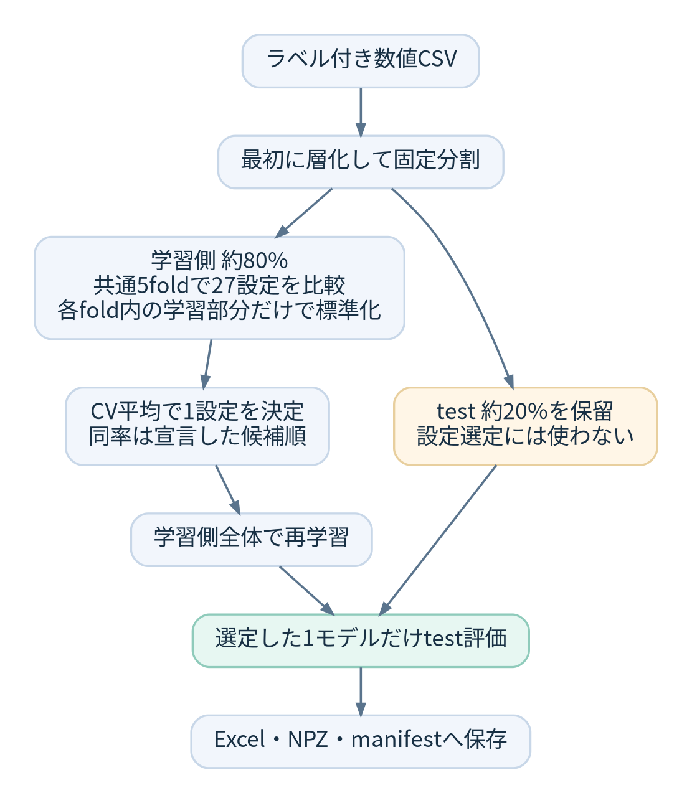

## 比較結果を、あとから説明できるようにしたい

分類モデルをいくつか実行すると、AccuracyやF1を並べた表は作れます。ただ、その値を見て判断するには「どこで標準化したか」「何を基準に選んだか」「どのデータを評価に使ったか」も必要です。

Notebookで進めていた教師あり学習（SL）・教師なし学習（UL）・深層学習（DL）の比較を、Codexと作業しながらPythonパッケージにまとめています。名前は **DIY AutoML** です。

[GitHubリポジトリのmainはこちらです](https://github.com/okamasaya/DIY_AutoML/tree/main)。

「一番よさそうなモデルを自動で出す」ことより、**比較の手順と判断材料を残すこと**に重点を置いています。Excelに加えて、分割index・予測・クラスタ割当などのNPZと、設定・版・ハッシュを記録するmanifestを保存します。

DIYした主な理由は、**MLの結果に誤差評価まで含めたい**からです。「データを増やせば改善しそうか」「特徴量や正解ラベルを調べるべきか」を、スコアの大小だけで終わらせず議論したいと考えています。

平均や確率が表示されても、「別のデータで調べたら、どの程度変わるのか」「計算や学習手順に左右されていないか」「集め方に偏りがないか」は残ります。自分が試した範囲では、こうした説明まで一緒に確認できる入口が欲しくなりました。それなら、統計的な不確かさ、計算・学習過程の変動、系統的な偏りを整理して記録するところまで、自前で作ってみようと考えました。

さらに、データを使えるかという判断から、**何を測れば用途に合うモデル活用へ進めるか**を考えます。見逃しや誤案内をどこまで許容するかを先に決め、目的に合う指標で比較すること、DS以外の人にも誤りの件数と限界が伝わることを、これからの設計の軸にしています。[評価指標と目的の対応](https://scikit-learn.org/stable/modules/model_evaluation.html)も参考にしています。現状は既定macro F1等での選定までで、業務の費用や判定閾値まで最適化する機能は未実装です。

この記事は開発中の **0.4.0a6** を対象としています。現在の実装と案内先はmainです。移行前の復旧ブランチも履歴保管のため残しています。元のクラウド環境のソース一式は取得できず、手元に残った元資料と引継ぎ仕様から再実装したものです。以前の制作物をそのまま復元したという扱いにはしていません。

## 完成形は、使う人に合わせた2つの入口

目指すのは、共通の学習・評価処理を、利用者に合う形で使えるようにすることです。

| 利用者 | 目指す完成形 | 使い方 |
| --- | --- | --- |
| ビジネスパーソン | 使い勝手を重視した廉価版アプリ | データファイルを渡し、主要モデルの結果と誤差の説明が付いたExcelを受け取る |
| データサイエンティスト | Pythonで駆動し、PyPIで配布するパッケージ | pipで導入し、Notebook・CLI・Python APIから評価条件や反復を指定して使う |

ビジネス向けは、主要モデルと小規模な計算から始め、導入・操作・運用の負担を抑えます。誤差は件数と身近な例で説明し、自分が持ち込むデータと対比できる形にします。提供方法や価格はこれから決めます。

DS向けの完成条件は、**PyPIから導入し、説明どおりにモデル比較・誤差評価・結果の保存と検証まで実行できること**です。詳しい推定条件や保存配列を追える構成にし、ビジネス向けアプリも同じ評価コアを呼ぶ設計にします。

現在はGitHubから導入する開発版です。アプリと、このプロジェクトのPyPI公開は今後で、公開名・ライセンス・対応環境を整え、TestPyPIでの導入確認から進めます。現行版の導入手順は、後述のGitHubからの方法を使います。

## このツールで扱いたい「誤差」

まず、予測が何件外れたかと、その性能の数値をどこまで確かに推定できるかを分けます。たとえば「400件のうち123件を外した」という結果にも、集めた対象や評価方法という条件が付いています。

| 観点 | 確認したいこと | 現状と、これから |
| --- | --- | --- |
| 統計的な不確かさ | 調べる標本や学習データが変わると、性能はどの程度変わるか | 固定モデルのSE・区間を実装。クラス件数固定/通常の行bootstrapを選択。学習曲線や選定からの反復は今後 |
| 学習手順による変動 | 初期値や学習順序を変えても、似た結果になるか | DL/ULの初期化反復などを実装。データ自体の変動とは分ける |
| 数値計算の誤差 | 丸め、計算精度、収束の判定が結果へどう影響するか | 一部の収束情報・失敗状態は保存。精度や収束許容値を変えた系統的な比較は未実装 |
| 系統的な偏り | 測定、ラベル、対象の選び方や時期に、片寄ったずれがないか | 分割や予測時点を点検し、実験ごとの制約を記載。汎用監査や群・時間を分ける評価は今後 |

これは、すべてを1本の「±」にまとめる設計ではありません。初期値によるばらつきは丸め誤差とは別ですし、データの集め方にある偏りを、同じデータの再標本化だけで補正できるとも限りません。偏ったデータが増えると、狭い区間で偏った対象について答えることもあります。

このため、**何を動かして確かめたか、何を固定したか、何が未確認か**を結果と一緒に残します。外部の正解や別期間のデータがなければ分からないことも、そのまま示す方針です。現在の機能だけで、これら全部の誤差を評価できるという意味ではありません。

## 入口を目的ごとに分ける

| コマンド | 確認したいこと |
| --- | --- |
| `run` | SL・UL・DLを探索的に比較する |
| `select` | SLの固定した5モデルから、学習側CVで1モデルを選ぶ |
| `tune` | SLの27設定から、学習側CVで1設定を選ぶ |
| `repeat-ul` | 同じデータでKMeans/GMMの初期化seedを変えたときの違い |
| `repeat-dl` | 分割を固定してMLPの学習seedを変えたときの違い |
| `subsample-ul` | データの一部を取り除いたとき、クラスタ構造が保たれるか |
| `report` | 保存済みの結果から、再学習せずに図付きExcelを作る |
| `uncertainty` | 保存済みSL/DL指標の標準誤差・区間・クラス別結果を、図付きExcelへ出す |

SLはDecision Tree、Random Forest、Logistic Regression、SVM、k-NNです。ULはKMeans、GMM、階層法4種類で、既定k=2〜10の54候補。DLは32-16-8のMLPを使っています。

SL/DLの予測指標とULのクラスタ指標を混ぜた総合ランキングは作りません。たとえばSilhouetteが高いことと、正解ラベルによく一致することは、別の性質だからです。

## 新しいモデルで、どこまで結果は変わるか

新しいモデルを使っても、手元のデータでは改善が小さいことがあります。改善幅はデータの性質、評価方法、探索に使う計算予算などによって変わります。モデルの新しさだけで、業務上の効果が大きくなるとは判断できません。

Grinsztajnらの2022年の研究では、中規模の表形式データのベンチマークで木系モデルが強い結果を示しました。ただし、これは当時の手法と実験条件での報告です。[Why do tree-based models still outperform deep learning on tabular data?](https://arxiv.org/abs/2207.08815)

2025年のTabArenaの論文では、勾配ブースティングが引き続き有力である一方、計算予算を増やしたアンサンブルでは深層学習も競争力を持ち、基盤モデルは小規模データで強いと報告されています。[TabArena: A Living Benchmark for Machine Learning on Tabular Data](https://proceedings.neurips.cc/paper_files/paper/2025/hash/1697e3fb412da11dc9488249f9e7bbc9-Abstract-Datasets_and_Benchmarks_Track.html)

また、TabPFNの2025年の論文には、小規模から中規模のデータで既存手法から大きく改善した結果があります。新しい手法の効果が小さいという一般則があるわけではありません。[Accurate predictions on small data with a tabular foundation model](https://www.nature.com/articles/s41586-024-08328-6)

これらは文献での知見です。このリポジトリで勾配ブースティングやTabPFNを比較検証した結果ではありません。同梱3データでの検証から、最新モデルと同等の性能だと主張することもできません。追加モデル、特に計算負荷の高いものの検証は今後のTo Doにしています。

実際の利用では、許容できる誤りや運用負荷を先に整理し、学習側で比較・選定したうえで保留したtestを評価します。精度の差に加え、実行時間、必要なメモリ、結果の説明や再実行のしやすさも、採用を考える材料になります。

## モデルを選ぶ前にtestを分ける

`select` と `tune` では、最初にtestを約20%分離します。残りの学習側だけで、共通の層化5foldを使います。各foldのStandardScalerはそのfoldの学習部分だけでfitし、validationにはtransformだけを適用します。



図は`tune`の27設定を示しています。`select`では同じ手順で固定5モデルを比較します。

主指標は既定でmacro F1です。5foldの値を単純平均し、差が絶対許容値1e-12以内なら同率として残し、宣言した候補順で採用します。testの値や学習時間で同率を解消しません。

`tune` の探索範囲は固定・小規模です。木の深さや葉の最小件数、Logistic Regression/SVMのC、SVMのkernel、k-NNの近傍数・重み付けを変える計27設定で、全パラメータを出力します。Random Forestの木の数は100本に固定しています。あらゆる設定を探索する汎用最適化器ではありません。

探索に使ったCVの最大値は、選定後の楽観的な値になりえます。CV平均自体を「未知データへの不偏な性能推定」として扱わないようにしています。

## 「ばらつき」を同じ意味にしない

予測を外すことと、その誤り率やF1をどれくらい正確に推定できているかは別の問題です。区間が広いだけでデータ不足、低いスコアで頭打ちだから品質不良、と原因を決められるわけではありません。

testの区間は、固定した学習済みモデルに対して、正解クラス別の観測件数を固定したpaired percentile bootstrapで計算します。既定は1,000反復・95%・seed=43です。点推定と区間でmacro平均の対象クラスをそろえています。

この区間には、学習データやモデル選定をやり直したときの変動は含まれません。区間がゼロ幅でも、未知の不確かさがゼロという意味にはなりません。

0.4.0a6の`uncertainty`では、保存済みの`run`のSL/DL、`select`、`tune`、全seedの`repeat-dl`にも評価値の誤差評価を適用できます。4指標とクラス別指標のbootstrap標準誤差・percentile区間を、図付きExcelへ出します。標準誤差は反復値の標本SDで、反復数の平方根では割りません。通常の行bootstrapを選ぶとクラス件数も変わりますが、行の独立性・代表性は引き続き確認が必要です。

```sh
.venv/bin/python -m diy_automl uncertainty --run runs/wine-select --output runs/wine-uncertainty
.venv/bin/python scripts/validate_uncertainty_run.py runs/wine-uncertainty
```

開くのは`runs/wine-uncertainty/report.xlsx`です。元の学習結果を保持し、正解/予測の対応・全再標本化index・反復値を別に保存します。[評価対象と出力の詳しい説明](https://github.com/okamasaya/DIY_AutoML/blob/main/docs/METRIC_UNCERTAINTY_GUIDE.md)を用意しました。

ULの反復では、正解との一致である **Target ARI** と、割当どうしの一致である **Assignment ARI** を分けています。10seedから得る45対は互いにseedやデータを共有するので、独立標本としてSEMや信頼区間を作りません。

`subsample-ul` は80%の行を重複なしで抽出し、その部分集合だけで標準化と学習をやり直します。元の行indexで対応付け、反復間は共通行だけを比較します。比較範囲が単一クラスタになるケースや、共通行が少ないケースは状態を明示して未採点にします。非復元抽出なのでbootstrapとは呼びません。

`repeat-dl` はtrain/validation/testとscalerを共有し、初期化とshuffleを制御する学習seedだけを変えます。最高test値のseedを採用する処理はありません。

データ量を議論する次の段階は、学習件数を増やしたときのtrain/validationの性能とばらつきを見る学習曲線です。再学習・選定をやり直す変動や、顧客・時間を分けた評価も加えていきたいと考えています。これらは未実装です。曲線が低いままでも、特徴量・モデル・ラベル・予測対象の難しさなど複数の原因候補があるため、品質を自動判定したとは説明しません。[学習曲線の参考資料](https://scikit-learn.org/stable/auto_examples/model_selection/plot_learning_curve.html)

既存AutoMLにも、[H2OのCV指標の安定性確認](https://docs.h2o.ai/h2o/latest-stable/h2o-docs/cross-validation.html)や、[AutoGluonの時系列予測の分位点](https://auto.gluon.ai/stable/tutorials/timeseries/forecasting-quick-start.html)など、不確かさを扱う仕組みがあります。予測値の区間と評価指標の区間を区別しつつ、本ツールでは不確かさの由来・前提・保存記録を追えることを重視します。[現在の範囲と次の設計](https://github.com/okamasaya/DIY_AutoML/blob/main/docs/UNCERTAINTY_DESIGN.md)に整理しています。

## TensorFlowなしで試す

まずSL/ULだけを動かせるよう、コア用のロックを分けました。以下はPython 3.12/Linuxで確認する手順です。PyPIからのパッケージ名によるインストールではなく、リポジトリを取得して導入します。

```sh
git clone --single-branch --branch main https://github.com/okamasaya/DIY_AutoML.git
cd DIY_AutoML
python3.12 -m venv .venv
.venv/bin/python -m pip install -r requirements-core.lock.txt
.venv/bin/python -m pip install --no-deps -e .
.venv/bin/python -m pip check
```

同梱のWine CSVで、まず固定モデルの選定を試します。

```sh
.venv/bin/python -m diy_automl select --csv data/reference/wine.csv --target target --output runs/wine-select
.venv/bin/python scripts/validate_selection_run.py runs/wine-select
```

設定探索を試す場合も、入力と出力の指定は同じです。

```sh
.venv/bin/python -m diy_automl tune --csv data/reference/wine.csv --target target --output runs/wine-tune
.venv/bin/python scripts/validate_tuning_run.py runs/wine-tune
```

`report.xlsx` には候補の設定、各foldの結果、平均・SD、選定した1モデルのtest結果、bootstrapと区間などが入ります。`arrays.npz` と `manifest.json` も一緒に残すことで、保存後に分割の混入や指標・設定の対応を検査できます。出力先は新規フォルダだけを使い、既存の実行を上書きしません。

0.4.0a5では、この保存結果から図付きExcelも作れます。

```sh
.venv/bin/python -m diy_automl report --run runs/wine-tune --output runs/wine-tune-illustrated
.venv/bin/python scripts/validate_excel_report.py runs/wine-tune-illustrated
```

開くファイルは `report_with_figures.xlsx` です。元の数値セル・シート名・順序を保ち、選定済みモデルのconfusion matrixと全候補の学習側CV平均・fold SDを埋め込みます。元の数値Excelも残します。

探索的なSL/UL比較だけなら `run --methods sl ul` も使えます。DLも実行する場合は、READMEにある全依存用のロックでTensorFlow CPU/Kerasを導入します。

## 身近な3テーマを小さく試す

ビジネス向けの入口として、ホテル予約のキャンセル、カフェ券の受取回答、通販顧客の再購入を既存5モデルで試しました。最大2,000行に絞り、数値列の抽出・固定した意味の二値化・顧客集計を実験用スクリプトで行っています。汎用的なカテゴリ/欠損処理や新モデルを本体へ追加した意味ではありません。

学習側CVで選定し、選んだ1モデルだけを保留testで評価した結果です。参考ルールも事前に決めています。

| テーマ | 学習/test件数 | 選定モデル | test macro F1 | 参考ルールのtest macro F1 |
| --- | --- | --- | ---: | ---: |
| ホテル | 1,600/400 | Decision Tree | 0.527 | 予約日数が学習中央値以上: 0.571 |
| カフェ券 | 1,600/400 | Logistic Regression | 0.692 | カフェ利用習慣と状況の文献ルール: 0.652 |
| 再購入 | 1,394/349 | Random Forest | 0.624 | 過去2回以上購入: 0.613 |

学習側の記述統計では、早期のホテル予約ほどキャンセルが多く、普段カフェに行く人ほど受取回答が多く、過去の購入頻度・金額が高い顧客ほど次の期間も買う傾向がありました。業務で置きやすい仮説や、文脈ルール・RFMという先行研究の観点と方向は合っています。[ホテルの元資料](https://pmc.ncbi.nlm.nih.gov/articles/PMC6297060/)、[クーポンの研究](https://jmlr.org/papers/v18/16-003.html)、[RFMの研究](https://link.springer.com/article/10.1057/dbm.2012.17)を参照しました。

ただし、ホテルの選定モデルは単純ルールに及ばず、再購入での差も約0.011にとどまりました。差の有意性や施策の利益は検証していません。傾向が見えることと、モデルを採用できることは別です。これは既存モデルでの小規模試行で、最新モデルでも結果が変わらないことの実証ではありません。

クーポンは実購買ではなく複数回答の調査で、回答者単位の分離ができていません。ホテルの予約受付時点・別施設、再購入の将来の別期間での性能も未検証です。[ビジネス向けの詳しい解説下書き](https://github.com/okamasaya/DIY_AutoML/blob/main/articles/diy-automl-business-three-experiments.md)に、観察した割合と一般的な見方の比較をまとめました。[加工・評価条件と保存結果](https://github.com/okamasaya/DIY_AutoML/blob/main/docs/BUSINESS_QUICK_RESULTS.md)も確認できます。

## どこまで確認したか

Iris、Wine、Breast Cancerの同梱CSVを、繰り返し参照する開発用データとして使っています。これらを未見の外部検証データとは扱っていません。

SLの探索では、開発環境と独立したwheel環境で、全候補のCV結果・選定・予測・保存配列などを照合しています。テスト件数や実行条件は、版ごとの検証資料と機械可読な記録に残しています。

[SL探索の検証記録](https://github.com/okamasaya/DIY_AutoML/blob/main/docs/VALIDATION_SL_TUNING.md)

[DL反復の検証記録](https://github.com/okamasaya/DIY_AutoML/blob/main/docs/VALIDATION_DL_REPEAT.md)

[UL部分抽出の検証記録](https://github.com/okamasaya/DIY_AutoML/blob/main/docs/VALIDATION_UL_SUBSAMPLE.md)

[図付きExcelとNotebookの検証記録](https://github.com/okamasaya/DIY_AutoML/blob/main/docs/VALIDATION_EXCEL_REPORT.md)

[評価値の誤差評価の検証記録（0.4.0a6）](https://github.com/okamasaya/DIY_AutoML/blob/main/docs/VALIDATION_METRIC_UNCERTAINTY.md)

同じCPU環境での一致確認であり、他OS・GPU・ライブラリ版での完全一致を保証するものではありません。また、指標が高いという理由だけで、そのモデルを実用途に使えると判断する機能はありません。

## 今後整えたいところ

現在はラベル付き・欠損なし・数値特徴量の分類用CSVが対象です。回帰、欠損やカテゴリ特徴量への一般的な前処理、ラベルなしULには対応していません。Web画面、Windows実機・exe化、ライセンスの選定も残っています。

この記事を入口として、詳しさの違う2つの子記事を用意しています。

- [ビジネスパーソン向け：旅行・カフェ・買い物の実験と、誤差の読み方](https://github.com/okamasaya/DIY_AutoML/blob/main/articles/diy-automl-business-three-experiments.md)。誤りの件数、数値の揺れ、データの偏りを平易に説明し、自分のデータでは何を確認するかへつなぎます。主要モデルと小規模な計算から使う入口を目指します。
- [DS向け：選定・条件付き区間・反復の設計を検査する](https://github.com/okamasaya/DIY_AutoML/blob/main/articles/diy-automl-ds-uncertainty.md)。PyPIで配布するPythonパッケージを完成形とし、Notebook/CLIからの使い方、推定対象、数式、再標本化単位、保存配列、計算条件、系統的な偏りの検証まで掘り下げます。

ビジネス向けは、説明と計算量を必要なところから使える構成にします。重要な評価条件や限界も、短い言葉で添えます。ファイルを渡してExcelを受け取るアプリと、その画面を使う手順は今後の実装です。両記事とも下書きで、未実装の評価は今後の設計として区別しています。

開発中の小さな道具ですが、学習・評価・表示を分け、結果の根拠を後から追える形にする過程も含めて紹介していきたいと思います。
