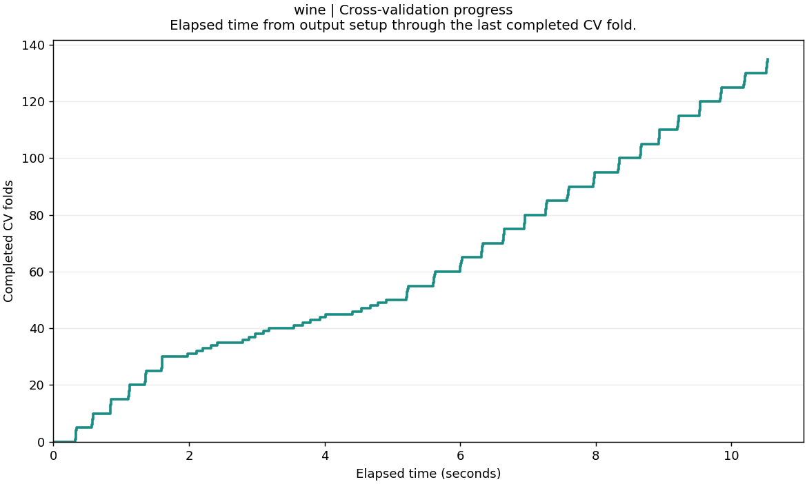
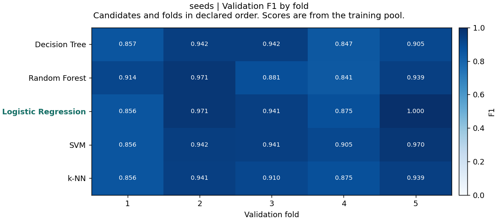

Wineの分類で、設定の探索範囲を広げると交差検証のmacro F1は0.9865から0.9927に上がりました。同じ保留36件では、正解が35件から34件に減りました。最終スコアを見たあとで、どの候補をどのデータで評価し、どこで予測が変わったかをたどれるように、DIY AutoMLに途中経過の保存を加えました。

## 候補と分割ごとに記録する

Wine、UCI Seeds、Breast Cancer Wisconsinを使いました。各データの約2割をクラス比を保って先に保留し、残りを5分割します。`select` は固定した5モデル、`tune` は既定の27設定を、同じ学習側の分割で比較します。各クラスのF1を等しく平均したmacro F1を分割ごとに求め、その5分割平均から候補を選びます。選んだモデルを学習側全体で学習し直してから、保留分を採点します。 [Wine](https://scikit-learn.org/stable/modules/generated/sklearn.datasets.load_wine.html) · [UCI Seeds](https://archive.ics.uci.edu/dataset/236/seeds) · [Breast Cancer Wisconsin](https://scikit-learn.org/stable/modules/generated/sklearn.datasets.load_breast_cancer.html)

`--progress both` を付けると、候補名、交差検証の分割番号、macro F1、経過時間がコンソールに表示されます。同じ進捗は処理中に `progress.jsonl` へ追記され、完了後のExcelに `Progress` シートができます。`--progress` には `off`、`console`、`excel`、`both` があり、途中で処理が止まった場合はファイル保存を有効にした実行のJSONLを読み返せます。



Wineの `tune` では27設定×5分割で135回の交差検証を行いました。交差検証の開始から再学習までは10.714秒、各分割の `fit` 区間の合計は2.337秒でした。グラフの横軸は出力先を準備してからの経過時間です。Windows 11の端末でCPUスレッドとランダムフォレストの並列数を各1にした、1回の実測です。

## 交差検証と保留データを照合する

以下は同じ保留行で評価した結果です。F1は小数第4位まで表示し、保留の正解数を併記しています。

| データ | 交差検証F1 `select` → `tune` | 保留F1 `select` → `tune` | 保留の正解数 |
| --- | ---: | ---: | ---: |
| Wine | 0.9865 → 0.9927 | 0.9710 → 0.9407 | 35 → 34 / 36 |
| Seeds | 0.9286 → 0.9517 | 0.8731 → 0.9007 | 37 → 38 / 42 |
| Breast Cancer Wisconsin | 0.9764 → 0.9811 | 0.9812 → 0.9716 | 112 → 111 / 114 |

交差検証の平均は3データで上がり、保留の正解数はSeedsで1件増え、WineとBreast Cancer Wisconsinで1件ずつ減りました。Wineの混同行列では、クラス2をクラス1と予測した件数が1件から2件に増えています。今回は保留分割1回の結果です。探索による差が別の分割でも現れるかを調べるには、分割を変えた評価が必要です。



図のSeedsでは、行がモデル、列が学習側の検証分割です。選ばれたロジスティック回帰も、分割1では0.856、分割5では1.000でした。候補平均と合わせて分割別の値を見れば、どの分割で候補間の差が出たかを確認できます。

## AutoGluonとH2Oのログも見る

別の実験では、Seedsの学習168件・保留42件を3方式でそろえました。各方式の候補と内部の交差検証の設定はそれぞれの実験条件に従います。DIYとAutoGluonは保留42件の予測がすべて一致し、macro F1はともに0.8731でした。H2Oは0.9277で、正解が2件多くなりました。同じ保留行をクラスごとに再標本化したH2OとDIYの差の条件付き95%区間は0.0000〜+0.1359で、ゼロを含みました。

AutoGluonでは学習ログとモデル別のleaderboard、H2Oでは `event_log` と `training_info` を取得できました。DIYの候補・分割別の進捗と合わせて、各方式でどこまで学習が進み、どの候補で最終評価したかを確認できます。日常の回帰検証はDIYで回し、分割や前処理、候補モデルを変えたときに外部の結果とも照合します。 [AutoGluon TabularのAPI](https://auto.gluon.ai/stable/api/autogluon.tabular.TabularPredictor.html) · [H2O AutoMLのログ](https://docs.h2o.ai/h2o/latest-stable/h2o-docs/automl.html#automl-log)

## 手元で確認する

以下は、進捗と詳細図を加えたDIY AutoML 0.4.0a8開発版を導入した `.venv` でのPowerShell例です。実測環境はWindows 11、Python 3.13.17、scikit-learn 1.8.0。PyPIに向けた配布の準備中で、以下では開発環境からWineの同梱CSVを使います。 [実行例に対応する開発版](https://github.com/okamasaya/DIY_AutoML/tree/2948e1dc1448e1a26a48b36ff6899c8de29377cc) · [分類サンプルCSV](https://github.com/okamasaya/DIY_AutoML/tree/2948e1dc1448e1a26a48b36ff6899c8de29377cc/data/reference)

```powershell
$run = "runs/zenn-wine-$(Get-Date -Format yyyyMMdd-HHmmss-fff)"
$python = '.\.venv\Scripts\python.exe'
& $python -X utf8 -m diy_automl tune --csv data/reference/wine.csv --target target --cpu-threads 1 --forest-jobs 1 --progress both --output "$run/tune"
& $python -X utf8 -m diy_automl report --run "$run/tune" --charts detail --output "$run/report"
& $python -X utf8 scripts/validate_excel_report.py "$run/report"
```

進捗は `tune/progress.jsonl`、図は `report/report_with_figures.xlsx` にあります。`report` は保存した結果から図を作るので、図の量を `none`、`summary`、`detail` で変えても学習をやり直す必要がありません。検証スクリプトでは、Excelに埋め込まれた画像と元のセル値の保持を確認できます。

まず保留のスコアを確認し、気になる差があれば、保留予測、選定に使った分割別スコア、進捗の順に戻って調べます。結果とその根拠が同じ実行記録にあると、追加でどのデータや条件を確かめるかを決めやすくなります。
