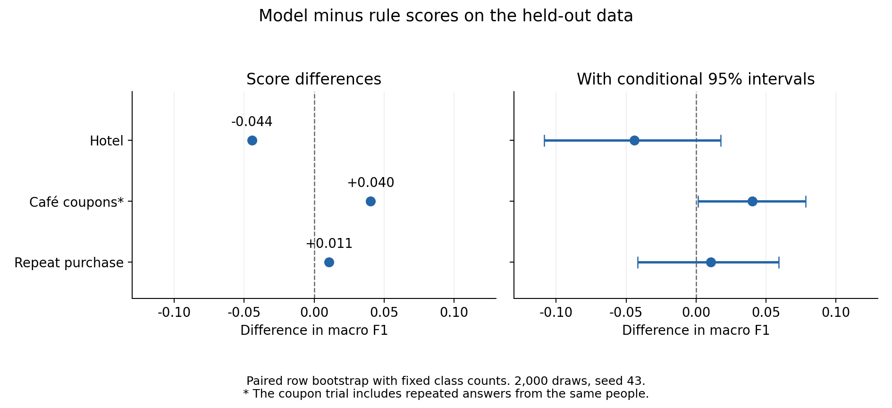

# DIY AutoML Guide for Business Users

If you want to flag hotel bookings that might be cancelled or decide which customers to contact, start by asking what a missed case or a false alarm would cost. DIY AutoML lets you try five classifiers on past records and see the counts behind their scores. Use those counts to decide what to investigate before using a model in your work. [English overview](../README.en.md) · [Japanese article with business examples](../articles/diy-automl-business-three-experiments.md)

## Try the Windows preview with Iris

The preview and its summary worksheets currently use Japanese. The labels below match the buttons and sheets you will see. Install the core package using Python with Tcl/Tk, then run this command from the repository root in PowerShell. It opens the preview with the bundled Iris CSV selected. [Windows setup](../README.en.md#windows-powershell)

```powershell
.\.venv\Scripts\python.exe -X utf8 -m diy_automl bp-preview --csv data/reference/iris.csv
```

1. Under **正解列（任意）** (*Actual outcome column*), select `target`. For Iris, this column contains the recorded flower species. Use **CSVを選ぶ…** (*Choose CSV*) to open another UTF-8 file.
2. Click **点検する** (*Inspect data*). Review the row count, missing values, repeated rows, and counts for each outcome. If you need the audit details, click **Excelを開く** (*Open Excel*).
3. Click **使う列を選ぶ…** (*Choose input columns*). For Iris, keep all four measurements and click **抽出して再点検** (*Extract and inspect again*). The preview saves a separate training CSV, including the outcome column.
4. Click **5モデルを比較する** (*Compare five models*). The preview chooses a model using the training portion and checks it on rows held back from that comparison. Use **評価結果を見る** (*View evaluation results*) to return to the results.
5. Click **評価Excelを開く** (*Open evaluation workbook*) for `bp_report.xlsx`, or **グラフを見る…** (*View charts*) for the saved comparison chart.

The Iris run used 120 rows to compare candidates and held back 30 rows to evaluate the selected model. It classified **29 of 30 correctly**, with **one error**. The sample demonstrates what the report looks like and how to find the error counts. [Preview guide (Japanese)](DATA_AUDIT.md#データ点検の画面を使う)

## Read the evaluation workbook

| Where to look | What it tells you |
| --- | --- |
| **まず読む** (*Start here*) | The selected model, how many rows it was evaluated on, the numbers correct and incorrect, and the F1 score and interval when available. It also shows how many answers a simple majority rule got right. |
| **ラベル別** (*By outcome*) | Read **見逃し** (*Missed cases*) and **誤検知** (*False alarms*) for the outcome you care about. For cancellations, a miss is a booking that was cancelled but went unflagged. A false alarm is a booking that was flagged but went ahead. |
| `SL_CV_Mean` and **候補モデルの比較** (*Candidate comparison* in the chart window) | The scores used to choose a model on the training data. Use **まず読む** for the selected model's performance on the held-back rows. |
| **単純ルール比較** (*Simple rule comparison*), **月別** (*By month*), **月別・ラベル別** (*By month and outcome*) | In a date-ordered evaluation, compare the selected model with simple rules and check the dates and row counts behind each month's scores. |

Accuracy is the share of answers that were correct. The majority rule always predicts the outcome that occurred most often in the training data. Macro F1 balances how many cases of each outcome were found and how often those flags were right, giving each outcome equal weight.

For Iris, macro F1 was **0.967** and its 95% interval was **0.898 to 1.000**. The interval describes how the score varies when the held-back rows are resampled while the fitted model and the number of rows per outcome are held fixed. Read it alongside the actual error counts and the data used in the evaluation. [Evaluation intervals and what they cover](DATA_SCIENCE_GUIDE.en.md#interpret-an-uncertainty-estimate)

## Compare mistakes that matter to your decision

Three small trials used recorded outcomes from public datasets. In each trial the model and the reference rule predicted the same held-back cases. The result is a starting point for deciding which errors to investigate and which records to collect next. [Trial setup and saved results (Japanese)](BUSINESS_QUICK_RESULTS.md)

### Hotel cancellations

Of 111 cancellations in 400 bookings, the decision tree caught **34** and missed **77**. It also flagged **73** bookings that went ahead. A rule that flagged bookings made at least 49 days in advance caught **72** cancellations and flagged **123** bookings that went ahead.

The tree's accuracy was 62.5%. Predicting that every booking would go ahead scored 72.3% accuracy and flagged zero cancellations. Check the missed cases and false alarms against the work your team would do after a flag. For a decision at booking time, check which fields were available then. The trial used a snapshot taken before arrival.

### Café coupon offers

Of 196 positive answers in 400 survey responses, the model caught **139** and incorrectly flagged **66** negative answers. The reference rule caught **98** and incorrectly flagged **37**. That is a trade-off between finding more potential takers and sending fewer offers to people who said they would decline. The outcomes were survey answers about accepting an offer. To estimate sales impact, collect actual visit or purchase records. To evaluate new people, use data with respondent IDs so each person's answers can stay together.

### Repeat purchases

The model caught **127** of the **196** customers who bought again, with **61** false alarms. A rule based on two or more past purchases caught **107**, with **46** false alarms. Their macro F1 scores were **0.624** and **0.613** on the same 349 customers. To judge whether the change is worthwhile, consider contact costs and test the methods again at a later prediction date. This trial used one observation and follow-up window for all customers.

### Read the gap alongside its interval

In the figure, the dot gives the model's macro F1 minus the rule's. A dot to the right of zero means the model scored higher on those held-back cases. The lines show 95% intervals calculated from the same cases with the fitted models and rules held fixed. The hotel and repeat-purchase intervals cross zero, so the direction of the difference is unresolved in these trials. The coupon interval is above zero under the row-based calculation. Repeated answers from the same person limit what that calculation can say about new respondents. [Saved comparison data](../validation/business-output-20261112/comparison/comparison.json) · [Calculation notes (Japanese)](BP_OUTPUT_EXAMPLE.md#業務3テーマの差の区間)



## Before using your own CSV

- **Name the decision.** Decide which outcome to flag, when the decision will be made, and what action a flag would trigger.
- **Check the records.** State what one row represents and where the recorded outcome comes from. Use only features available at the decision time. Keep an original copy of the CSV. If you need to reuse a large input, the optional **作業用Parquetも保存** (*Save a working Parquet copy*) checkbox is available with the storage dependencies. [Setup and optional dependencies](../README.en.md#try-it-on-iris)
- **Choose how to split the evaluation.** Under **評価の分割方法** (*Evaluation split*), select a method before clicking **点検する**. For new customers with repeated records, choose **IDでまとめる** (*Group by ID*) with the customer column. For later records, choose **日付順で分ける** (*Split by date*) with the observation date column. The date-ordered view shows scores for past months held back for evaluation.
- **Compare with your current rule on the same cases.** Review missed cases, false alarms, and the number of cases your team can handle. Use a further check on the customers or period where you plan to act before making a rollout decision.

The preview can inspect a file before it is ready for training. Model comparison requires numeric input columns, complete values, recorded outcomes, and enough examples of each outcome for the chosen split. The current workflow evaluates past labeled records. Measuring the value of a business decision calls for additional evidence about outcomes, costs, and how the decision will be used. [Input and split requirements (Japanese)](DATA_AUDIT.md#データ点検の画面を使う)

A Windows installer, a view for choosing chart types and axes, and a Japanese and English display option are possible extensions. [Roadmap (Japanese)](ROADMAP.md) · [Development note on the Windows preview (Japanese)](../articles/diy-automl-development-note-05-bp-preview.md)
