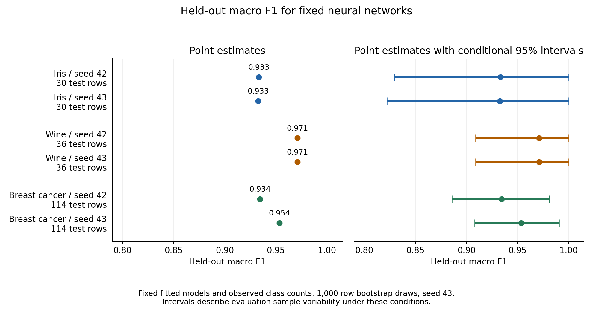
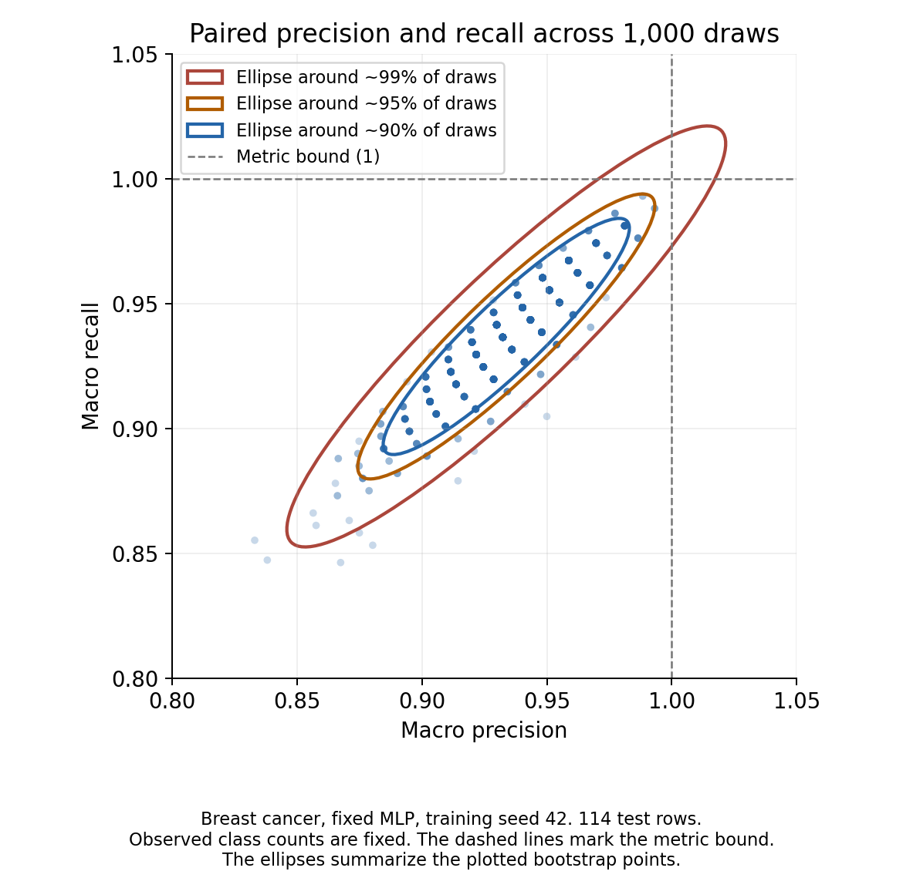
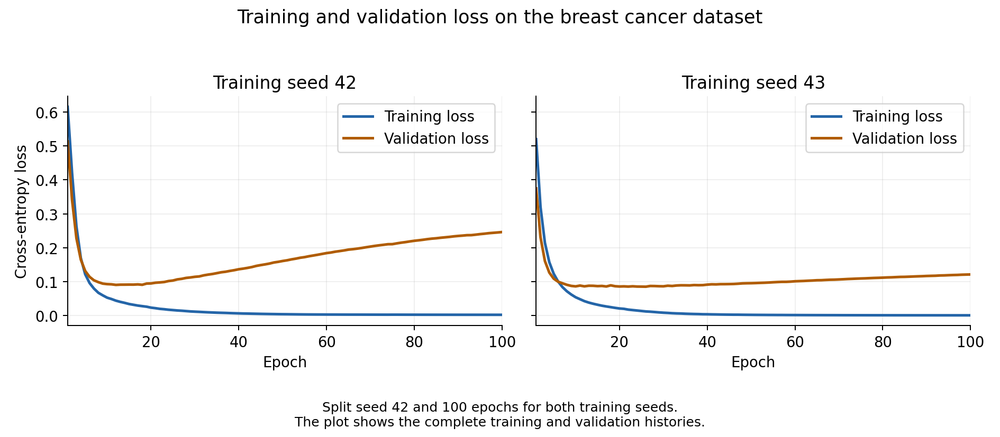

# DIY AutoML Guide for Data Scientists

This guide covers the 0.4.0a7 development version. Use it to compare classifiers, reproduce an evaluation from the saved files, and explain what a reported interval covers. [English overview](../README.en.md) · [Japanese article on uncertainty](../articles/diy-automl-ds-uncertainty.md)

## Reproduce a classification evaluation

The example uses the bundled Wine CSV and the core environment. Run it from the repository root. Training takes a UTF-8 CSV with finite numeric features and a class label column. If you prepare data in Parquet or DuckDB, extract the training columns to CSV before running the evaluation. Use a fresh output directory for each run. [Installation](../README.en.md#try-it-on-iris) · [Data preparation guide (Japanese)](DATA_AUDIT.md)

### Command line

The audit records the row count, missing values, duplicate rows, and class counts. Review that output before running `select` on a new dataset. `uncertainty` reads the saved predictions and adds overall and per-class bootstrap results. The optional `report` command creates a separate illustrated workbook for the selection run.

```powershell
$python = ".\.venv\Scripts\python.exe"
$work = "runs/ds-guide-wine"

& $python -X utf8 -m diy_automl audit-data --csv data/reference/wine.csv --target target --output "$work/audit"
& $python -X utf8 scripts/validate_data_audit.py "$work/audit" --csv data/reference/wine.csv
& $python -X utf8 -m diy_automl select --csv data/reference/wine.csv --target target --output "$work/selection"
& $python -X utf8 scripts/validate_selection_run.py "$work/selection"
& $python -X utf8 -m diy_automl uncertainty --run "$work/selection" --output "$work/uncertainty"
& $python -X utf8 scripts/validate_uncertainty_run.py "$work/uncertainty"
& $python -X utf8 -m diy_automl report --run "$work/selection" --output "$work/figures"
& $python -X utf8 scripts/validate_excel_report.py "$work/figures"
```

On macOS or Linux, set `work=runs/ds-guide-wine` and replace `& $python -X utf8` with `.venv/bin/python -X utf8`. Use ordinary Python when running the validators so their assertions are enabled.

### Python API and notebooks

The CLI calls the same functions available from Python. This example uses the same selection and bootstrap settings as the CLI example. The functions return paths to their output directories.

```python
from diy_automl import evaluate_uncertainty, select_csv

selection = select_csv(
    "data/reference/wine.csv",
    target="target",
    output="runs/ds-guide-wine-api/selection",
    seed=42,
    metric="F1",
    bootstrap_repeats=1000,
    bootstrap_seed=43,
    confidence=0.95,
)
uncertainty = evaluate_uncertainty(
    selection,
    output="runs/ds-guide-wine-api/uncertainty",
    bootstrap_repeats=1000,
    bootstrap_seed=43,
    confidence=0.95,
    resampling="stratified",
)
print(uncertainty / "report.xlsx")
```

In a notebook, use the project environment as the kernel and the repository root as the working directory. The bundled comparison notebook calls `run_csv` for an exploratory supervised, clustering, and neural-network run. For cross-validated classifier selection in a notebook, use the `select_csv` example above. To work directly with in-memory predictions, use `evaluate_metric_uncertainty` and pass integer-encoded truth and predictions together with the full encoded class set. [Comparison notebook](../notebooks/Local_Comparison.ipynb) · [Metric uncertainty guide (Japanese)](METRIC_UNCERTAINTY_GUIDE.md)

## Select candidates before scoring the holdout

With the default row split, `select` and `tune` set aside about 20% of the rows using a stratified split. On the remaining rows, `select` compares five fixed classifiers and `tune` compares 27 configurations, each on shared stratified five-fold cross-validation. In each fold, the scaler is fitted on that fold's training portion. After selection, the scaler and selected classifier are refitted on the full training partition and scored on the holdout. [Selection implementation](../src/diy_automl/selection.py) · [scikit-learn guidance on data leakage](https://scikit-learn.org/stable/common_pitfalls.html#data-leakage)

The default selection criterion is mean fold macro F1. For candidate $j$, it is $\bar{s}_j = \frac{1}{5}\sum_{k=1}^{5}s_{jk}$, where $s_{jk}$ is the score on fold $k$. Pooled out-of-fold predictions can give a different F1. For `select` and `tune`, scores within an absolute tolerance of $10^{-12}$ of the maximum enter the tie set and candidate order determines the selection. Fold standard deviation describes the spread across folds that share training observations. Treat the best CV score as a selection result and the held-out score as the final evaluation for that run. [Tuning guide (Japanese)](SL_TUNING_GUIDE.md)

Choose the split to match the intended prediction task. A split that holds out new customers answers a different question from a split that holds out dates.

| Evaluation unit | `select` option | Held-out evaluation |
| --- | --- | --- |
| Rows | Default | Stratified holdout and stratified row bootstrap. |
| Groups | `--group-column customer_id` or `--group-identical` | Groups stay together across training and holdout and within cross-validation. The workbook reports intervals from resampling whole held-out groups. |
| Observation dates | `--time-column observed` | Training and validation advance in date order. The latest fifth of observed dates, rounded up, is held out. Scores and monthly baseline comparisons are point estimates. |

The group and date options are mutually exclusive. Use the grouped run's own `SL_Test_Intervals` sheet for its group bootstrap. The separate `uncertainty` command uses a row bootstrap and accepts supported row-based classification runs. [Group splits (Japanese)](DATA_AUDIT.md#グループ単位の分割) · [Date-ordered splits (Japanese)](DATA_AUDIT.md#日付順の分割)

## Interpret an uncertainty estimate

Start by naming the quantity, the evaluation unit, and what varied. Predictive errors, sampling variation, randomness in training, numerical effects, and systematic bias each call for different checks.

| Question | What to vary or inspect |
| --- | --- |
| How precisely did this sample estimate the fixed model's performance? | Resample the held-out evaluation units and recompute the metric. |
| How sensitive is training to initialization or shuffling? | Fix the split and training-only preprocessing, then vary the training seed with `repeat-dl`. |
| How stable is clustering? | Vary initialization with `repeat-ul` or refit preprocessing and clustering on subsets with `subsample-ul`. |
| How sensitive are the results to numerical precision or a possible measurement shift? | Compare exact and floating-point metric arithmetic, round the test inputs, or apply a declared offset. |
| Could the evaluation be systematically biased? | Check measurement and label definitions, feature availability at prediction time, and coverage of the intended groups, sites, or periods. |
| Is the model missing a relationship in the data? | Inspect the structure of errors and compare model assumptions using the training and validation data. |

A narrow metric interval can coexist with systematic bias. For example, a random split can preserve the same labeling error across training and test. An independent label review or a comparison against a measurement standard can address that question. The familiar bias–variance decomposition addresses expected squared prediction error under a particular regression setup. Treat it as a separate result from this classification bootstrap. [Evaluation design (Japanese)](UNCERTAINTY_DESIGN.md) · [scikit-learn's bias–variance example](https://scikit-learn.org/stable/auto_examples/ensemble/plot_bias_variance.html)

### The fixed-model bootstrap

For a held-out row $i$, keep its truth $y_i$ and prediction $\hat y_i$ together. In the default stratified bootstrap, each replicate draws $n_c$ rows with replacement from the rows with observed class $c$, where $n_c$ is that class's observed count. Each draw produces one value $T^{*(b)}$ of the metric. The default settings are 1,000 replicates, seed 43, and a 95% percentile interval.

$$
\left[Q_{0.025}(T^*),\ Q_{0.975}(T^*)\right],
\qquad
\widehat{\mathrm{SE}}_{\mathrm{boot}} =
\sqrt{\frac{1}{B-1}\sum_{b=1}^{B}\left(T^{*(b)}-\overline{T^*}\right)^2}.
$$

The endpoints use linearly interpolated quantiles. Bootstrap SE is the sample standard deviation of the replicate metric values. Dividing that SD by $\sqrt{B}$ would address the Monte Carlo precision of the mean of the replicates. Report the point estimate, SE, and two interval endpoints separately, since a percentile interval can be asymmetric.

`uncertainty` computes accuracy and macro precision, recall, and F1, along with per-class precision, recall, and F1. Macro F1 averages the class-level F1 scores. The class set is fixed across replicates and the metric convention is `zero_division=0`. The `--resampling ordinary` option draws from all test rows, so class counts can vary. An unobserved class contributes no new observations in either method.

These intervals describe sampling variability conditional on the fitted model and, for stratified draws, the observed class counts. Interpret each interval for its own metric. The evaluation unit must reflect dependence, such as repeated observations from one customer. Small or discrete samples can produce degenerate intervals. To quantify changes from retraining, model selection, or population shifts, use separate evaluations that vary those conditions. [Bootstrap implementation](../src/diy_automl/metric_uncertainty.py)

When two methods predict the same rows, resample those rows together and calculate the difference within each replicate. For `rank-sl`, `--comparison-fraction 0.25` sets aside 25% of the non-test pool for this paired comparison. The separate comparison split compares each candidate with the CV leader. The final holdout remains reserved for the candidate selected by CV. A difference interval containing zero leaves its direction unresolved. [Ranking implementation](../src/diy_automl/sl_ranking.py)

The repeated measurements matter when reading another library's output. For example, AutoGluon 1.4.0's `feature_importance()` returns `stddev` across permutation importance estimates and `n` for the number of shuffles. The interval there concerns the mean drop in score after shuffling a feature. DIY AutoML's held-out metric interval comes from resampling evaluation observations. [AutoGluon 1.4.0 feature importance API](https://auto.gluon.ai/1.4.0/api/autogluon.tabular.TabularPredictor.feature_importance.html)

## Recompute an interval from saved predictions

The following example uses the archived Iris run for a TensorFlow multilayer perceptron (MLP) with training seed 42. It recomputes macro F1 with scikit-learn and verifies the sampled rows and replicate scores against the archived output. Run it with the same core environment. The example reads saved predictions and renders a new plot.

```python
import json
from pathlib import Path

import matplotlib.pyplot as plt
import numpy as np
from sklearn.metrics import f1_score

source = Path("validation/dl-backend-preparation-0.4.0a7/iris-uncertainty")
manifest = json.loads((source / "manifest.json").read_text(encoding="utf-8"))
with np.load(source / "arrays.npz", allow_pickle=False) as saved:
    truth = saved["evaluation_0__truth"]
    prediction = saved["evaluation_0__predictions"]
    recorded_draws = saved["evaluation_0__indices"]
    recorded_f1 = saved["evaluation_0__samples"][:, 3]

classes = np.arange(len(manifest["classes"]))
strata = [np.flatnonzero(truth == c) for c in classes if np.any(truth == c)]
rng = np.random.default_rng(43)
draws = np.array([
    np.concatenate([rng.choice(rows, len(rows), replace=True) for rows in strata])
    for _ in range(1000)
])
values = np.array([
    f1_score(truth[i], prediction[i], labels=classes,
             average="macro", zero_division=0)
    for i in draws
])
np.testing.assert_array_equal(draws, recorded_draws)
np.testing.assert_allclose(values, recorded_f1, atol=1e-12, rtol=0)

estimate = f1_score(truth, prediction, labels=classes,
                    average="macro", zero_division=0)
se = values.std(ddof=1)
lower, upper = np.quantile(values, [0.025, 0.975], method="linear")
print(f"F1={estimate:.3f}, SE={se:.3f}, 95% interval=[{lower:.3f}, {upper:.3f}]")

output = Path("runs/ds-guide-iris-bootstrap")
output.mkdir(parents=True, exist_ok=False)
np.savez_compressed(output / "bootstrap.npz", values=values, indices=draws)
fig, ax = plt.subplots(figsize=(7, 2.5))
ax.errorbar(estimate, 0, xerr=[[estimate - lower], [upper - estimate]],
            fmt="o", capsize=5)
ax.set(xlim=(0, 1.05), ylim=(-0.5, 0.5), yticks=[],
       xlabel="Held-out macro F1", title="Fixed Iris MLP with a 95% interval")
ax.grid(axis="x", alpha=0.2)
fig.tight_layout()
fig.savefig(output / "interval.png", dpi=180)
plt.close(fig)
```

The fixed MLP scored **0.933 macro F1** on 30 held-out Iris rows. Its bootstrap SE was **0.047**, and the conditional 95% percentile interval was **[0.829, 1.000]**. The 1,000 replicates reuse those 30 observations. Include the number and unit of observations, the fixed conditions, and the resampling scheme alongside the score. [Archived Iris result](../validation/dl-backend-preparation-0.4.0a7/iris-uncertainty/) · [Verification record (Japanese)](DS_UNCERTAINTY_EVIDENCE.md)



### Joint metrics and training history

The breast cancer example plots macro precision and recall in pairs from the same bootstrap draw. Let $z_b$ be one pair, with sample mean $\bar z$ and covariance $S$. When $S$ is invertible, the plotting script uses squared Mahalanobis distances $d_b^2=(z_b-\bar z)^\top S^{-1}(z_b-\bar z)$ and draws contours at their empirical quantiles. In this sample the three contours enclosed 90.5%, 95.2%, and 99.1% of the 1,000 replicate points. Those percentages describe the plotted points. The contour can cross the score bound of 1 even though the points stay within the valid score range. [Plotting code](../scripts/render_evaluation_article_figures.py) · [Saved plotting data](figures/evaluation-article-data.json)



Epoch-by-epoch history answers a training question. In the breast cancer run with training seed 42, validation loss rose from about 0.090 at epoch 12 to about 0.246 at epoch 100 as training loss continued to fall. That pattern is a reason to investigate overfitting. To test an early-stopping rule, choose it using training and validation and evaluate the resulting procedure on the holdout. To measure performance versus training set size, vary the number of training observations in a separate learning-curve experiment. [Saved training history and plotting data](figures/evaluation-article-data.json)



## Read and verify the saved files

| Run | Files and fields to inspect |
| --- | --- |
| `audit-data` | `profile.json` contains the input profile and audit settings. The audit workbook presents the findings and `manifest.json` records the input hash. |
| `select` | In `report.xlsx`, `SL_CV_Folds`, `SL_CV_Mean`, and `SL_CV_SD` describe selection. `SL_Test`, `SL_Bootstrap`, and `SL_Test_Intervals` describe the held-out evaluation. `arrays.npz` stores train, test, and fold indices, truth, predictions, and scaler parameters. |
| `uncertainty` | `Metric_Uncertainty` and `Class_Uncertainty` contain estimates, bootstrap SEs, and intervals. `Evaluation_Units` and `Scope` specify counts and assumptions. `Bootstrap` holds overall replicates and `Intervals` contains the embedded plot. `arrays.npz` records the sampled indices, overall and per-class replicate scores, and confusion matrices. |
| `report` | Open `report_with_figures.xlsx` in the separate report directory. It uses the saved selection scores and predictions. |
| `rank-sl` | `CV_Ranking` records the repeated-CV ranking. Read `Test_Confusion` with actual classes as rows and predicted classes as columns, and `Test_By_Class` for counts and metrics by class. With a comparison split, `Comparison_Differences` contains the paired candidate-minus-leader estimates. |

Check the run manifest for the version, settings, and artifact hashes. File validators verify saved results against their recorded configuration and check the consistency of the underlying arrays and tables. Establish representativeness and the suitability of the evaluation unit with the data collection and deployment context. [Validation tools](../scripts/) · [Workbook generation guide (Japanese)](EXCEL_REPORT_GUIDE.md)

## Compare feature subsets and check numerical sensitivity

`rank-sl` compares the same five classifiers across repeated shared folds. Its holdout diagnostics compare metric arithmetic using exact rational values and Float64. The input-rounding check converts test features to Float32 and back to Float64 before predicting with the same model. Use an explicit `--shift` to test sensitivity to a hypothetical offset in the feature's original units. Establish the size of any real calibration error from measurements or calibration records. [Uncertainty audit guide (Japanese)](SL_UNCERTAINTY_AUDIT.md)

```powershell
& $python -X utf8 -m diy_automl rank-sl --csv data/reference/wine.csv --target target --cv-repeats 2 --comparison-fraction 0.25 --output "$work/ranking"
& $python -X utf8 scripts/validate_sl_ranking.py "$work/ranking"
& $python -X utf8 -m diy_automl audit-uncertainty --run "$work/ranking" --csv data/reference/wine.csv --shift "alcohol=0.5" --output "$work/sensitivity"
& $python -X utf8 scripts/validate_sl_uncertainty_audit.py "$work/sensitivity"
```

`annealing-check` compares simulated annealing with random search over feature subsets for a fixed classifier. The methods share the initial subset and training folds, and each scores the same number of distinct subsets. Annealing proposes nearby subsets and can accept a lower-scoring proposal with a probability controlled by temperature. After the search, each method refits using its selected subset and predicts the same held-out rows. [Annealing method](https://research.ibm.com/publications/optimization-by-simulated-annealing) · [Experiment and search history (Japanese)](ANNEALING_CHECK.md)

```powershell
& $python -X utf8 -m diy_automl annealing-check --csv data/reference/wine.csv --target target --budget 32 --max-features 6 --output "$work/annealing"
& $python -X utf8 scripts/validate_annealing_check.py "$work/annealing"
```

On Iris, an exhaustive check found a maximum mean CV macro F1 of 0.9707. With eight candidates per search, annealing reached that value in three of ten runs and random search in eight of ten. On Wine, annealing and random search each had the higher CV score in five of ten runs with 32 candidates per search.

In the Wine run with search seed 44, the five features selected by annealing produced the same predictions as the full 13-feature model on all 36 held-out rows. Annealing's macro F1 exceeded random search by 0.0558 in that run, with a conditional 95% interval of [0.0000, 0.1419]. The difference intervals included zero for all 20 Iris and Wine runs. Each dataset reused the same split across seeds, so the repeated runs describe variation in the search. Inspect `Selected_Features`, `Search_History`, and `Test_Differences` to see how each run reached its result. [Ten-seed experiment (Japanese)](ANNEALING_CHECK.md#irisとwineでの検証)

## Choose the next validation for the intended use

For neural networks, `repeat-dl` varies training seeds on a fixed split and scaler. To estimate variation in the entire learning procedure, repeat the split, preprocessing, model selection, and fitting within an evaluation designed for that purpose. In clustering, separate agreement with the reference labels from agreement between cluster assignments. With ten seeds, the 45 pairwise comparisons reuse seeds, so describe their spread as dependent comparisons. [Neural-network repeats (Japanese)](DL_REPEAT_GUIDE.md) · [Clustering subsamples (Japanese)](UL_SUBSAMPLE_GUIDE.md)

For business datasets, start with the prediction time and the unit represented by each row. In the hotel example, the available columns were based on a snapshot before arrival, so an evaluation at booking time needs an audit of which fields were available then. In the café coupon example, the file lacked respondent IDs, so its row-bootstrap interval describes the observed rows under the row-based assumptions. In the repeat-purchase example, evaluation at a new prediction date requires another observation and follow-up window. [Business dataset evaluation (Japanese)](BUSINESS_QUICK_RESULTS.md)

Date-ordered classification already evaluates later observations after training on earlier ones. Time-series forecasting and prediction intervals for future values are roadmap items. A future value's prediction interval and an interval for an estimated performance metric such as MAE or RMSE answer different questions. A future evaluation of performance differences would need to account for dependence across adjacent dates, for example by studying a block bootstrap. [Roadmap (Japanese)](ROADMAP.md)

The DS distribution goal is a PyPI package with a documented API and verified installation in a fresh environment. The current workflow starts from a repository checkout. TensorFlow is the integrated neural-network backend. The separate PyTorch, AutoGluon, and H2O AutoML experiments document how their results were compared under specified conditions. [Backend status (Japanese)](DL_BACKENDS.md) · [Cross-checks](../README.en.md#what-you-can-do)
