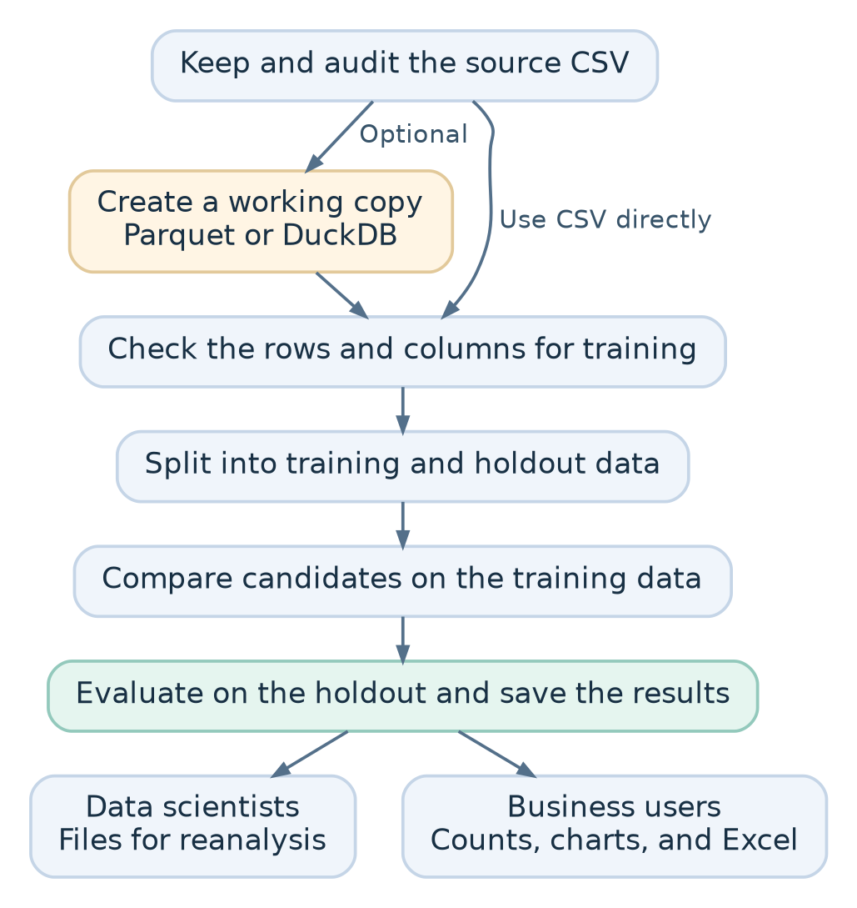

I ran five classifiers on Iris and selected an SVM. The held-out macro F1 was 0.967, with a conditional 95% interval of 0.898 to 1.000. To decide what that result is worth, I want to know which data went in, how the candidates were compared, and which rows produced the final score. DIY AutoML saves those details from the initial audit through the evaluation.

I tried the workflow on a Windows PC with 16 GB of RAM using a Python 3.13.17 virtual environment. The core uses pandas to read tables, scikit-learn to train and compare the classifiers, and openpyxl to write the Excel reports. The bundled Iris CSV has four numerical measurements and a species label per row, so the example runs on a CPU. [Setup](https://github.com/okamasaya/DIY_AutoML/blob/64b17f120dad1ead6256d963b779c13630457898/README.en.md#try-it-on-iris)

## Trace the result back to the input



The audit records issues such as missing values and duplicate rows. If a dataset will be read and filtered several times, a Parquet or DuckDB working copy can make that preparation easier to repeat. After extracting the training data, check the row count, missing values, and label counts again. For the 150-row Iris example, the original CSV is small enough to use directly. [Workflow in Figure 1 of the full paper (Japanese)](https://github.com/okamasaya/DIY_AutoML/blob/64b17f120dad1ead6256d963b779c13630457898/docs/papers/DIY_AutoML_Full_Paper_20261119/DIY_AutoML_Full_Paper_20261119.pdf)

## Inspect Iris and compare five classifiers

Run these PowerShell commands from the repository root with Python 3.13 installed. The recorded species is in `target`. Use a fresh output directory when repeating the commands.

```powershell
$python = ".\.venv\Scripts\python.exe"
$work = "runs/dev-note-01-iris"
py -3.13 -m venv .venv
& $python -m pip install -e .

& $python -X utf8 -m diy_automl audit-data --csv data/reference/iris.csv --target target --row-unit "One iris plant" --output "$work/audit"
& $python -X utf8 -m diy_automl select --csv data/reference/iris.csv --target target --output "$work/selection"
```

The audit found 50 rows for each of the three classes and one exact duplicate across all columns. An identical row prompts a check of the original records to see whether two rows describe the same observation. I kept all 150 rows for this walkthrough.

The split put 120 rows on the training side and reserved 30 for the final test. A decision tree, random forest, logistic regression, support vector machine (SVM), and k-nearest neighbors all used the same five cross-validation splits on the 120 rows. Standardization was fitted on the training portion of each fold. Candidate scores use macro F1, which averages the F1 scores of the classes with equal weight.

| What I checked | Result |
| --- | --- |
| Selected model and mean cross-validation macro F1 | SVM, 0.967 |
| Performance on the 30 held-out rows | 29 correct, macro F1 of 0.967 |
| Conditional 95% interval for held-out macro F1 | 0.898 to 1.000 |

The two F1 values round to the same number and come from different rows. The cross-validation average selects the candidate. The held-out score evaluates that candidate after refitting it on all 120 training rows. The interval shows how the score varies when the evaluation rows are resampled within their recorded classes with the fitted model held fixed. [Evaluation guide](https://github.com/okamasaya/DIY_AutoML/blob/64b17f120dad1ead6256d963b779c13630457898/docs/DATA_SCIENCE_GUIDE.en.md#interpret-an-uncertainty-estimate)

## Hand off the same result in two ways

For data scientists, `report.xlsx` holds the scores, `arrays.npz` holds the splits and predictions, and `manifest.json` records the settings and input hash. The Windows preview shows the number evaluated, the correct and incorrect counts, and charts from the same evaluation. It also opens a workbook with summary sheets and class-level errors. [Data science guide](https://github.com/okamasaya/DIY_AutoML/blob/64b17f120dad1ead6256d963b779c13630457898/docs/DATA_SCIENCE_GUIDE.en.md) · [Business user guide](https://github.com/okamasaya/DIY_AutoML/blob/64b17f120dad1ead6256d963b779c13630457898/docs/BUSINESS_USER_GUIDE.en.md)

A team may choose a model lower in the ranking for operational reasons. The scores from the same cross-validation folds give the team a way to quantify what it is trading off.

## What I want to measure next

The next experiments cover library cross-checks, reusable data preparation, feature selection, reading errors in Excel, and time-series forecasting.

For date-ordered classification, I want to estimate how uncertain the gap between a model and a simple rule is when nearby days are dependent. Then I want to see how results change with the amount of training data and when the entire selection process is repeated. The longer-term goal is to make the same evaluation reproducible from a Python package and readable in a Windows interface for people who work in Excel. [Project roadmap (Japanese)](https://github.com/okamasaya/DIY_AutoML/blob/64b17f120dad1ead6256d963b779c13630457898/docs/ROADMAP.md)

*AI assistance was used to adapt the project's development notes and experiment records into this English article.*
