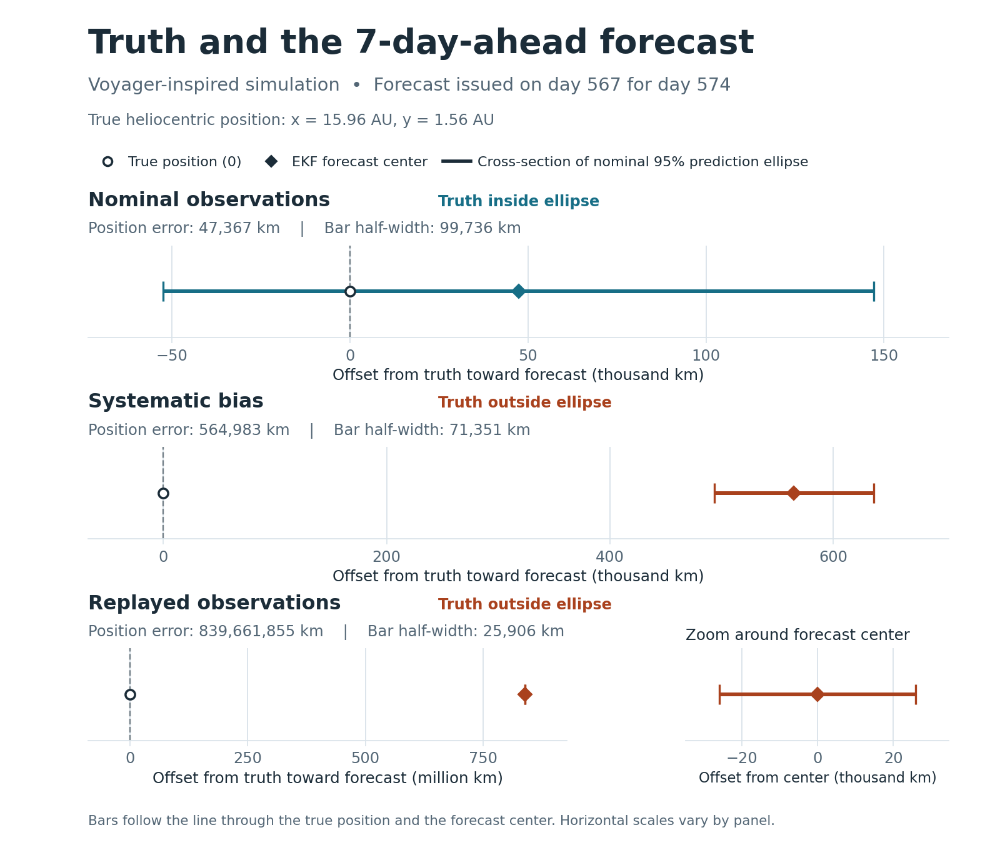
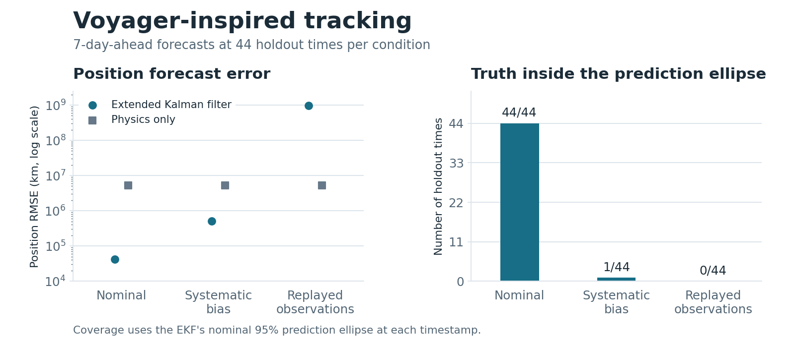

On two public time series, forecasting the last observed value beat the local level-and-trend Kalman filter I tested. With a synthetic spacecraft trajectory, the extended Kalman filter brought the position error down sharply under nominal observations. A change in the observations then made its position forecasts and uncertainty estimates much less useful.

These experiments ask when to keep a filter and what to inspect when its predictions start to miss. I used the same rule as in the date-ordered classification example: choose the method on earlier data and evaluate it on a later holdout. [Japanese development note](https://github.com/okamasaya/DIY_AutoML/blob/64b17f120dad1ead6256d963b779c13630457898/articles/diy-automl-development-note-06-time-series.md)

## Give the filter a simple baseline

I tested a one-month-ahead forecast on AirPassengers and a 30-minute-ahead forecast on NYC Taxi. Each series was divided chronologically into a setup period, a selection period, and a final holdout. Each new prediction could use observations available at its forecast origin, including observations that had already arrived during the holdout. [AirPassengers dataset](https://stat.ethz.ch/R-manual/R-devel/library/datasets/html/AirPassengers.html) · [NYC Taxi dataset](https://github.com/numenta/NAB/blob/master/data/realKnownCause/nyc_taxi.csv)

For this run, DIY AutoML's `kalman-track` kept the filter if it reduced selection-period RMSE by at least 5% relative to **persistence**, which predicts the last observed value. It chose persistence on both series. I also ran a separate experiment that added seasonal candidates, and compared AutoGluon Tabular and H2O AutoML using lag and calendar features on the same holdouts. [Candidate settings, splits, and reproduction steps](https://github.com/okamasaya/DIY_AutoML/blob/64b17f120dad1ead6256d963b779c13630457898/experiments/seasonal_forecast_crosscheck/README.md)

| Method | AirPassengers RMSE (thousands of passengers, 48 points) | NYC Taxi RMSE (passengers, 6,288 points) |
| --- | ---: | ---: |
| Continue the Kalman filter | 65.69 | 1,962.19 |
| DIY AutoML's selected method: persistence | 48.04 | 1,708.36 |
| DIY experiment with seasonal candidates | 27.89 | 1,708.36 |
| AutoGluon Tabular | 27.49 | 1,115.22 |
| H2O AutoML | 42.34 | 1,171.83 |

For AirPassengers, the seasonal experiment selected the same month a year earlier multiplied by an estimated growth factor. It was close to AutoGluon on RMSE and had the lower mean absolute error: 22.09 versus 22.61 thousand passengers. For NYC Taxi, both tabular AutoML workflows had lower overall RMSE than persistence. Comparing absolute errors timestamp by timestamp, persistence still beat H2O at 2,056 of the 6,288 holdout points. Saving the per-timestamp predictions made that comparison possible. [Timestamp-level comparison record](https://github.com/okamasaya/DIY_AutoML/blob/64b17f120dad1ead6256d963b779c13630457898/docs/development-notes/time-series-crosscheck-draft.md)

## Put one forecast next to the known position

In the Voyager-inspired experiment, a simulator supplied a true two-dimensional trajectory and synthetic measurements of range and range rate from Earth. The extended Kalman filter (EKF) used the same form of dynamics as the simulator. It predicted the spacecraft's heliocentric position seven days ahead. I ran three observation conditions along the same trajectory: nominal measurements, a systematic sensor offset, and earlier observations replayed at later timestamps. [Experiment and reproduction steps](https://github.com/okamasaya/DIY_AutoML/blob/64b17f120dad1ead6256d963b779c13630457898/experiments/voyager_crosscheck/README.md)

Day 574 is near the middle of the holdout. The forecasts were issued on day 567. The open circles in the figure put the true position at zero, and the diamonds show the forecast centers. Each error bar shows the cross-section of the nominal 95% prediction ellipse along the line through the forecast center and the true position. This lets you read the two-dimensional containment test directly from the bar. Each panel uses its own horizontal scale.

| Day 574 | Distance from forecast center to truth (km) | Error bar half-width (km) | Truth inside |
| --- | ---: | ---: | --- |
| Nominal observations | 47,367 | 99,736 | Yes |
| Systematic bias | 564,983 | 71,351 | No |
| Replayed observations | 839,661,855 | 25,906 | No |

## Check the errors, the ellipses, and the inputs

I repeated the check over 44 held-out timestamps. Position RMSE summarizes the distance between each forecast center and the known position. Coverage counts the number of timestamps at which the prediction ellipse contains the true position. The observation check compares the recorded change in range with the change implied by the range-rate measurements.

| Holdout result | Nominal | Systematic bias | Replayed observations |
| --- | ---: | ---: | ---: |
| EKF position RMSE (km) | 41,982 | 502,682 | 964,714,784 |
| Physics-only position RMSE (km) | 5,240,893 | 5,240,893 | 5,240,893 |
| Truth inside the EKF ellipse | 44/44 | 1/44 | 0/44 |
| Timestamps flagged by the range check | 2/44 | 6/44 | 42/44 |

Under nominal observations, the EKF improved on the physics-only forecast. With systematic bias, its RMSE rose roughly twelvefold while the average ellipse semi-major axis stayed near 300,000 km. The range check flagged 42 of 44 timestamps under replay, but only 6 of 44 under bias. All these counts describe one simulated trajectory.

This is what I want error evaluation in DIY AutoML to help with. If forecasts start missing their prediction regions, I can look at the point errors, how often the regions contain the realized values, and whether the inputs agree with each other. Those checks point to different follow-up questions, including whether to inspect timestamps, review sensor measurements, or revisit the model assumptions. The next evaluation task is to estimate uncertainty in performance differences while accounting for dependence between nearby timestamps. [Uncertainty design notes](https://github.com/okamasaya/DIY_AutoML/blob/64b17f120dad1ead6256d963b779c13630457898/docs/UNCERTAINTY_DESIGN.md)

*AI assistance was used to adapt the project's development notes and experiment records into this English article.*
