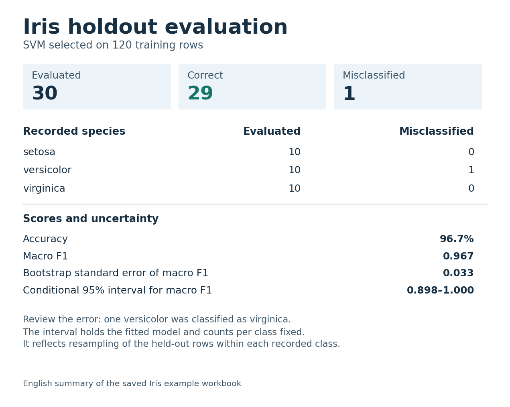
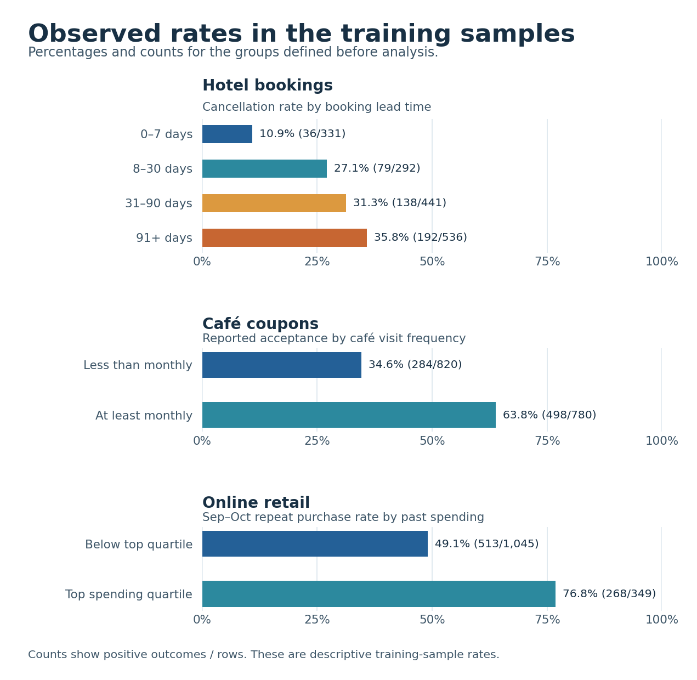
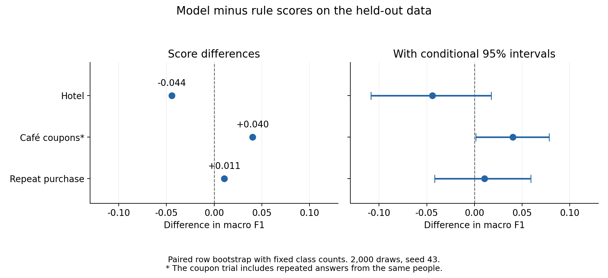

Suppose you want to flag hotel bookings likely to cancel or decide which customers to contact. A model report should help you ask which mistakes it made, how precisely you measured its performance, and how closely the test matches the decision you want to make.

I built an example Excel report with DIY AutoML and tried three small public-data experiments. The workbook shows what a reader can take away from one run. The experiments show how the choice of evaluation unit and the costs of different errors change the questions worth asking. [English article index](https://github.com/okamasaya/DIY_AutoML/tree/main/docs/dev_community)

## Open the report and find the mistake

The example starts with Iris, a 150-row dataset with measurements of sepals and petals and a label for one of three species. I compared five classifiers using the training pool of 120 rows, chose an SVM there, and scored it on the 30 rows I had set aside. The overview article uses a separate MLP experiment.

*English view prepared from the saved evaluation. The downloadable workbook has a Japanese summary and retains the underlying numeric sheets and figures.* [Workbook](https://raw.githubusercontent.com/okamasaya/DIY_AutoML/64b17f120dad1ead6256d963b779c13630457898/validation/business-output-20261112/iris/iris_business_report.xlsx) · [Summary PDF in Japanese](https://raw.githubusercontent.com/okamasaya/DIY_AutoML/64b17f120dad1ead6256d963b779c13630457898/validation/business-output-20261112/iris/summary.pdf) · [Input CSV](https://raw.githubusercontent.com/okamasaya/DIY_AutoML/64b17f120dad1ead6256d963b779c13630457898/validation/business-output-20261112/iris/input.csv)

| Where to look in the workbook | What you can find |
| --- | --- |
| まず読む (Start here) | The result, the uncertainty interval, and what to check next |
| 間違えた行 (Misclassified rows) | The original CSV row, the recorded label, and the model's prediction |
| 入力と条件 (Inputs and conditions) | Row counts, missing values and duplicates, the selection and evaluation procedure, and open questions |

The SVM correctly classified 29 of 30 test rows. One flower labeled versicolor was predicted as virginica. The workbook points to row 79 of the input CSV, so you can look at its measurements and label. A disagreement is a reason to inspect the record and the labeling procedure.

Accuracy was 96.7%. Macro F1, a separate metric that gives each class equal weight, was 0.967, with a bootstrap standard error of about 0.033 and a conditional 95% interval of about 0.898–1.000. The interval describes the precision of the score under this fitted model and the observed evaluation conditions. A probability for an individual prediction would answer a separate question.

An Iris-specific script added the summary sheets for this article by calling the existing evaluation code. The workbook shows how a reader can move from scores to rows and conditions. [How the sample workbook was made and checked](https://github.com/okamasaya/DIY_AutoML/blob/64b17f120dad1ead6256d963b779c13630457898/docs/BP_OUTPUT_EXAMPLE.md)

## Ask three questions about uncertainty

| What to look at | Question to ask |
| --- | --- |
| The mistakes | How many of each type did the model make, and which ones matter in the intended decision? |
| The precision of the score | How much information did the held-out data provide about performance? |
| The match between the data and the use case | Could repeat observations, the label definition, or a change in population or period affect the result? |

A thousand rows from a handful of repeat respondents provide a different kind of evidence than a thousand rows from independent respondents. A precisely calculated score can still reflect a shared labeling convention that deserves checking. The data-science companion in **DIY AutoML Evaluation** explains how the intervals were calculated.

## Three small experiments on public data

I used up to 2,000 rows per dataset and the same pool of five classifiers. I chose a model on the training side and evaluated it on a holdout. I also included a predefined reference rule for each task.

*These are observed rates in the training data. Prediction scores and intervention effects require their own evaluations.*

| Dataset | What I observed on the training side |
| --- | --- |
| Hotel bookings | The cancellation rate was 10.9% with 0–7 days of lead time and 35.8% at 91 days or more. |
| Coffee coupons | 34.6% of responses in the less-than-monthly visit category indicated acceptance, compared with 63.8% in the at-least-monthly category. |
| Online retail | 76.8% of customers in the top spending quartile bought again in the following two months, compared with 49.1% of the remaining customers. |

These patterns suggest features or reference rules worth checking. Applying them to individual bookings, answers, or customers makes the kinds of mistakes visible.

## Hotel bookings and the cost of missing a cancellation

I sampled 2,000 bookings from two hotels in Portugal. There were 111 cancellations in the 400-row holdout. The selected decision tree flagged 34 of them, missed 77, and incorrectly flagged 73 bookings that went ahead. [Hotel booking demand dataset](https://pmc.ncbi.nlm.nih.gov/articles/PMC6297060/)

The reference rule predicted cancellation at a lead time of 49 days or more, the median calculated on the training side. It flagged 72 cancellations, missed 39, and incorrectly flagged 123 bookings that went ahead. The rule scored higher on this split. Its practical value would depend on the relative costs of missed cancellations and false alarms.

The decision tree had 62.5% accuracy. Predicting that every booking would go ahead would have given 72.3% accuracy and caught zero cancellations. The error counts make clear why the metric needs to match the purpose.

The first follow-up question is when the prediction would be made. The source describes extracting information on the day before arrival. I removed fields that revealed the outcome. A booking-time evaluation would also have to check that each remaining field was already known when the booking was made.

## Coffee coupons and the difference between reach and targeting

The Coffee House responses came from a survey about whether someone would accept a coupon in a described situation. On the training side, 284 of 820 respondents' answers in the less-than-monthly category and 498 of 780 in the at-least-monthly category indicated acceptance. The acceptance rates were 41.4% for two-hour expiry and 58.5% for one-day expiry. The published study also illustrates short rules based on habits and context. [UCI dataset](https://archive.ics.uci.edu/dataset/603/in+vehicle+coupon+recommendation) · [Wang et al.](https://jmlr.org/papers/v18/16-003.html)

| Method on the same 400 held-out survey rows | Acceptances caught | Acceptances missed | Rejections predicted as acceptances |
| --- | ---: | ---: | ---: |
| Selected logistic regression | 139 | 57 | 66 |
| Fixed reference rule based on the study | 98 | 98 | 37 |

The model caught more stated acceptances and also produced more false positives. Accuracy was 69.3% for the model and 66.3% for the rule. The counts help when deciding whether to reach a wider audience or send fewer offers.

The dataset includes repeated answers from individuals and lacks respondent IDs, so this experiment split rows. To evaluate performance for new people I would need data that support separating respondents across splits. Measuring effects on visits or sales would require observing those outcomes. The label here is a stated survey answer.

## Online retail and a small difference in score

I aggregated the UK online retailer's transaction data to one row per customer. The 1,743 UK customers had positive purchases in the observation period. The input summarizes June–August 2011 and the label records a positive purchase in September–October. The aggregation excludes cancellations and uses positive sales. [UCI Online Retail](https://archive.ics.uci.edu/dataset/352/online+retail)

In the training pool, 344 of 795 customers with one purchase and 437 of 599 with at least two bought again. In the top spending quartile, 268 of 349 customers bought again and 81 had no later purchase in the two-month window. This is related to the recency, frequency, and monetary-value perspective used in retail analysis. [RFM research](https://link.springer.com/article/10.1057/dbm.2012.17)

There were 196 repeat buyers among 349 held-out customers. The selected random forest caught 127 and missed 69. It scored 0.624 macro F1. A rule that predicts a repeat purchase after at least two prior invoices scored 0.613, a difference of about 0.011. Another fixed rule targeted only the top spending quartile. Of those it flagged, 80.2% bought again, while it caught 37.2% of all repeat buyers. The useful trade-off depends in part on how many customers can be contacted.

The split used different customers from the same observation and follow-up periods. I would move the evaluation window to check whether the result carries over to a later period. The label describes purchase records at this retailer during the specified window.

## Add an interval to the difference

Each point is the model's macro F1 minus its reference rule's macro F1 on the same holdout. A positive value favors the model on that metric. The three tasks measure different decisions and targets.

*Article-specific paired bootstrap with 2,000 draws and seed 43. It resamples corresponding rows for the fixed model and rule, holding observed class counts fixed. After checking the full −1 to +1 range, I zoomed both panels to −0.13 to +0.13.*

| Dataset | Model minus rule | Conditional 95% interval |
| --- | ---: | ---: |
| Hotel | −0.0442 | −0.1085 to +0.0175 |
| Coffee coupon | +0.0403 | +0.0013 to +0.0784 |
| Online retail | +0.0105 | −0.0416 to +0.0590 |

The hotel and retail intervals span both signs. They leave the ordering uncertain on this evidence. An equivalence claim would need a predefined margin and an evaluation designed for that question. Coffee coupon has a positive row-level interval under the row-resampling assumptions. That analysis leaves within-respondent dependence unmodeled, just as the hotel calculation leaves dependence among bookings from the same customer or party unmodeled.

These intervals describe reweighting the observed evaluation rows with the fitted models and reference rules held fixed. Retraining, a different period or population, and the economic benefits of taking action each require additional evidence. I calculated the intervals from saved predictions for this article. [Saved calculations](https://github.com/okamasaya/DIY_AutoML/blob/64b17f120dad1ead6256d963b779c13630457898/validation/business-output-20261112/comparison/comparison.json) · [Data preparation and evaluation settings](https://github.com/okamasaya/DIY_AutoML/blob/64b17f120dad1ead6256d963b779c13630457898/docs/BUSINESS_QUICK_RESULTS.md)

## Bring the same questions to your own data

| Check | What to discuss with the analyst |
| --- | --- |
| The decision | Do we need to reduce misses, tighten targeting, or make a different trade-off? |
| Measurements and labels | What was measured, and how was each outcome recorded? |
| The unit | Does one row mean one customer, booking, or survey answer? Can that unit repeat? |
| The timing | Which fields are available when the prediction will be made? |
| The reference | How does the result compare with the current procedure or a simple rule chosen in advance? |
| The next population | Will this be used with different customers, locations, or periods? What data could test that? |

Counts, distributions, missing data, and duplicates help decide where to investigate. An interval is one piece of that conversation. In the Iris workbook I kept enough of the input and conditions visible to start the conversation from an actual result.

## When the question depends on time

Describing a sales trend, predicting future demand, and measuring the effect of a campaign are different tasks. For forecasts, I want to record when each prediction is made, how far ahead it looks, the aggregation unit, and how coverage and interval width change across forecast horizons. A change around a campaign calls for a design that can isolate its effect.

This article documents the experiments with labeled, complete numerical classification data. A later development note shows initial time-series comparisons and prediction-region checks with separate evaluation conditions. [Time-series experiment records](https://github.com/okamasaya/DIY_AutoML/tree/64b17f120dad1ead6256d963b779c13630457898/experiments/seasonal_forecast_crosscheck) · [Reproducing the three classification experiments](https://github.com/okamasaya/DIY_AutoML/tree/64b17f120dad1ead6256d963b779c13630457898/experiments/business_quick_20261108)

*AI assistance was used to translate and edit the original Japanese manuscript for this English version.* [Japanese manuscript](https://github.com/okamasaya/DIY_AutoML/blob/64b17f120dad1ead6256d963b779c13630457898/articles/diy-automl-business-three-experiments.md) · [Zenn article](https://zenn.dev/okamasaya/articles/diy-automl-business-three-experiments)
