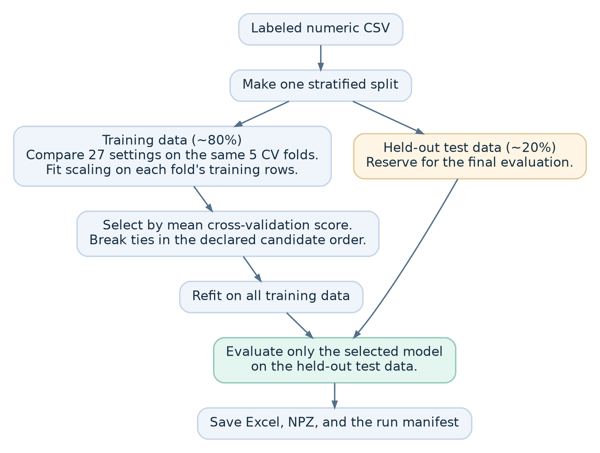
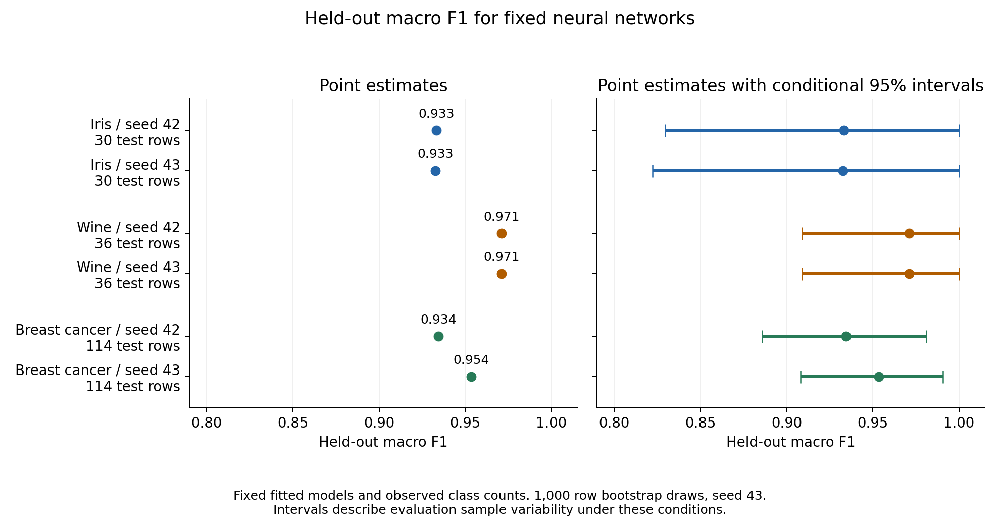
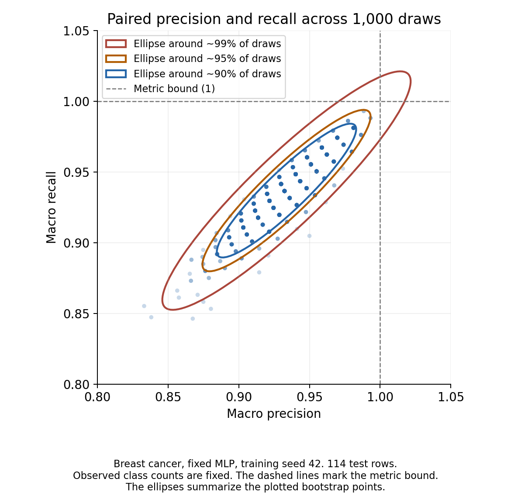
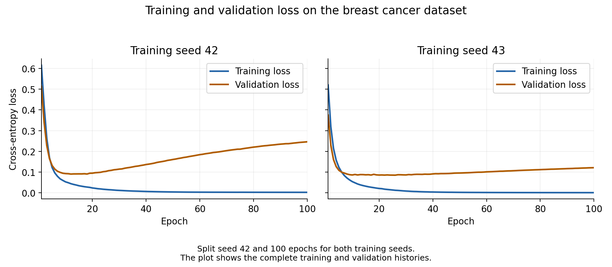

“Test macro F1 was 0.933” tells me less than “test macro F1 was 0.933, with a bootstrap standard error of 0.047 and a conditional 95% interval of 0.829–1.000.” To interpret the second result, I still need to know what was held fixed and what I varied.

The overview of **DIY AutoML Evaluation** uses scikit-learn datasets and a TensorFlow multilayer perceptron (MLP) to explain why I save uncertainty and intermediate results. The business companion starts with an Excel workbook and the observed errors. This article explains how I calculated the intervals and drew the figures, then shows how to reproduce them. The evaluation examples use DIY AutoML 0.4.0a7. [English article index](https://github.com/okamasaya/DIY_AutoML/tree/main/docs/dev_community)

## Identify what can move the result

Standard deviation (SD) describes the spread of a specified set of values. Standard error (SE) concerns the sampling variability of an estimator. To interpret an SD or SE, first identify the values it describes and the conditions under which they vary.

| Source of variation or error | Example of a check |
| --- | --- |
| Sampling uncertainty | Resample suitable units to estimate the sampling variation of a fixed model's test score. |
| Numerical error | Keep inputs, splits, and initial conditions fixed and compare precision, tolerances, or convergence. |
| Systematic bias | Check calibration or labeling against independent records. Evaluate on separate sites, groups, or periods suited to the intended use. |
| Training procedure | Vary initialization, shuffle order, training data, splits, or model selection in a defined repeat experiment. |
| Model assumptions and remaining prediction difficulty | Inspect patterns in residuals or errors, examine learning curves, and compare plausible model classes. |

Statistical, numerical, and systematic errors are useful starting points. Several can interact, and some require additional observations to distinguish. Increasing numerical precision leaves a linear model's form unchanged. Features also leave some of the outcome unexplained. The bias term in the bias–variance decomposition for expected squared regression error concerns the difference between the mean prediction over training samples and the true regression function. Instrument bias and fairness questions use their own definitions. Macro F1 calls for a metric-specific evaluation. [scikit-learn's bias–variance example](https://scikit-learn.org/stable/auto_examples/ensemble/plot_bias_variance.html)

Model benchmarks describe the settings they tested. For your use case, compare instrument calibration and units against a reference, check labels against source records or independent judgments, check repeated patient or customer IDs across splits, and confirm that every feature was available at the prediction time. A shared labeling error can persist across stable repeated splits. A model–label disagreement is a starting point for a check. Quantifying a systematic effect requires a reference, a defined change in conditions, and a description of what was compared. [Data leakage guidance](https://scikit-learn.org/stable/common_pitfalls.html#data-leakage) · [Cross-validation for groups and time series](https://scikit-learn.org/stable/modules/cross_validation.html)

## What does AutoGluon's `stddev` measure?

In the AutoGluon v1.4.0 implementation I checked, `TabularPredictor.feature_importance()` shuffles a feature among rows and measures the drop in performance of a fixed fitted model.

| Output | Meaning in this implementation |
| --- | --- |
| `importance` | Mean drop in performance across permutation replicates |
| `stddev` | SD of the permutation-importance values |
| `n` | Number of shuffle replicates |
| `p95_low` and `p95_high` | Endpoints for an interval around the mean importance at the chosen confidence level |

With mean importance `I_bar`, replicate SD `s_I`, `R` replicates, and a Student t quantile `t`, the implementation's interval has endpoints `I_bar ± t(R − 1, 1 − alpha/2) × s_I / sqrt(R)`. The calculation targets the mean across shuffle replicates. A test-score SE has its own estimand and sampling scheme, and other logs named `stddev` need their own definitions. [AutoGluon v1.4.0 API implementation](https://github.com/autogluon/autogluon/blob/v1.4.0/tabular/src/autogluon/tabular/predictor/predictor.py#L3376) · [Interval calculation](https://github.com/autogluon/autogluon/blob/v1.4.0/tabular/src/autogluon/tabular/predictor/predictor.py#L3501) · [Permutation importance in scikit-learn](https://scikit-learn.org/stable/modules/permutation_importance.html)

In a separate experiment with AutoGluon Tabular 1.6.3, I compared two fitted workflows' macro F1 values on the same Iris and Wine holdout rows. That interval targets a paired difference in test performance. [AutoGluon cross-check](https://github.com/okamasaya/DIY_AutoML/tree/64b17f120dad1ead6256d963b779c13630457898/experiments/autogluon_sl_crosscheck)

## Specify what you want to estimate

| Question | What varies |
| --- | --- |
| How precise is a fixed model's test score? | Held-out units drawn with replacement, with optional fixed class counts |
| How much does performance vary across the whole training procedure? | Training data, preprocessing, candidate selection, and refitting |
| How sensitive is the fit to a training seed? | Initialization and shuffle order, with specified data conditions held fixed |
| How sensitive is the result to numerical settings? | Data types, convergence tolerances, solvers or backends in controlled comparisons |
| Will the result carry over to the population or period of interest? | Customers, sites or periods and the corresponding measurement and labeling conditions |

The `select` and `tune` workflows include fixed-model score intervals. The `uncertainty` command adds SE, overall and class-level intervals, and the resampling arrays from saved predictions. The deep-learning and clustering workflows support specified repeated runs. `rank-sl` and `annealing-check` can check Float64 metric calculations against rational arithmetic and test sensitivity to Float32-rounded inputs. Full repeats of preprocessing, model selection and training, and assessments of input error propagation, call for separate designs. [Uncertainty design](https://github.com/okamasaya/DIY_AutoML/blob/64b17f120dad1ead6256d963b779c13630457898/docs/UNCERTAINTY_DESIGN.md)

## Choose on the training side and evaluate on the holdout

`select` compares five fixed classifiers and `tune` compares 27 declared configurations. About 20% of the rows are set aside with stratification. The remaining rows go through the same five stratified cross-validation (CV) folds for every candidate. Each fold fits its scaler only on that fold's training portion. The default metric is macro F1.



*The diagram shows the 27 configurations in `tune`. The five fixed candidates in `select` follow the same evaluation structure.*

The ranking score for candidate `j` is `mean(s_j1, …, s_j5)`, the arithmetic mean of its five fold scores. F1 is nonlinear, so calculating one F1 from pooled out-of-fold predictions can give a different value. Candidates within an absolute tolerance of 1e−12 of the maximum are recorded as tied, with relative tolerance zero. The first candidate in the declared order wins a tie. I refit the selected configuration on the entire training pool and evaluate that one fit on the reserved test rows.

The saved fold SD uses `ddof=1`. Fold training sets overlap, so inference that assumes five independent score observations needs a different justification. The maximum CV score also reflects selection among candidates. An independent holdout or an outer evaluation loop can address the performance of the selected procedure. [scikit-learn on nested cross-validation](https://scikit-learn.org/stable/auto_examples/model_selection/plot_nested_cross_validation_iris.html)

## Say exactly what an interval describes



For Iris at training seed 42, I would report this result as follows.

> Test macro F1 0.933, bootstrap SE 0.047, conditional 95% percentile interval [0.829, 1.000]. The fitted MLP and observed counts by true class were fixed. I resampled the 30 test rows with replacement within each class, using 1,000 draws and bootstrap seed 43.

The estimate, SE, and interval endpoints each carry information. The example's interval is asymmetric around the estimate. A caption can also specify the evaluation unit, model and split, rules for sampling and metric calculation, and sources of variation that would require another experiment. To compare two methods on the same test rows, apply the same sampled indices to both, then estimate the distribution of the paired difference directly.

## Calculate the conditional percentile interval

Let `I_c` contain the test row indices for true class `c`, with size `n_c`. In replicate `b`, sample `n_c` rows with replacement from every observed class, concatenate their indices into `I_b`, and compute `T_b = metric(y[I_b], prediction[I_b])`. Each index selects both the label and the prediction. A paired comparison computes the two scores on `I_b` and saves their difference for that replicate.

The 95% percentile interval uses `[quantile(T_b, 0.025), quantile(T_b, 0.975)]` with linear interpolation. The bootstrap SE uses the sample SD of the replicate scores, `sqrt(sum((T_b − mean(T))²) / (B − 1))`. Dividing that SD by `sqrt(B)` instead would estimate the Monte Carlo precision of the replicate mean. More bootstrap draws stabilize the calculation. More independent evaluation units change its information base.

Accuracy and macro precision, recall, and F1 use consistent metric definitions across the estimate and replicates. Macro F1 averages the class-level F1 values. The macro label set stays fixed and undefined divisions use `zero_division=0`. The `uncertainty` workflow also saves the class-level replicates and resampling indices to NPZ. With `--resampling ordinary`, draws come from the whole holdout and class counts can vary, including omission of a class in some draws.

For the default class-count-preserving calculation, the interval is conditional on the fitted model and the observed counts. A class absent from the test set contributes no resampled observations. Dependence among rows can call for resampling at a different unit, such as the respondent. Small or discrete samples can give a coarse or even zero-width interval. The nominal level describes the percentile procedure. The individual intervals are marginal, and the procedure's actual coverage depends on assumptions and sample size. [Selection implementation](https://github.com/okamasaya/DIY_AutoML/blob/64b17f120dad1ead6256d963b779c13630457898/src/diy_automl/selection.py) · [Uncertainty workflow](https://github.com/okamasaya/DIY_AutoML/blob/64b17f120dad1ead6256d963b779c13630457898/src/diy_automl/uncertainty_workflow.py)

## Recalculate the Iris interval from saved predictions

Run this from the repository root, with the core dependencies installed and a fresh output directory. It reads the same labels and predictions used in the overview and recomputes macro F1 with scikit-learn. Each of the 1,000 draws and scores is saved so the plotted values can be checked later.

```python
import json
from pathlib import Path

import matplotlib.pyplot as plt
import numpy as np
from sklearn.metrics import f1_score

source = Path("validation/dl-backend-preparation-0.4.0a7/iris-uncertainty")
manifest = json.loads((source / "manifest.json").read_text(encoding="utf-8"))
with np.load(source / "arrays.npz", allow_pickle=False) as saved:
    truth = saved["evaluation_0__truth"]
    prediction = saved["evaluation_0__predictions"]

classes = np.arange(len(manifest["classes"]))
groups = [np.flatnonzero(truth == c) for c in classes if np.any(truth == c)]
rng = np.random.default_rng(43)
draws = np.array([
    np.concatenate([rng.choice(g, len(g), replace=True) for g in groups])
    for _ in range(1000)
])
values = np.array([
    f1_score(truth[i], prediction[i], labels=classes,
             average="macro", zero_division=0)
    for i in draws
])
estimate = f1_score(truth, prediction, labels=classes,
                    average="macro", zero_division=0)
se = values.std(ddof=1)
lower, upper = np.quantile(values, [0.025, 0.975], method="linear")
print(f"F1={estimate:.3f}, SE={se:.3f}, 95% interval=[{lower:.3f}, {upper:.3f}]")

output = Path("runs/ds-iris-bootstrap")
output.mkdir(parents=True, exist_ok=False)
np.savez_compressed(output / "bootstrap.npz", values=values, indices=draws)
fig, ax = plt.subplots(figsize=(7, 2.5))
ax.errorbar(estimate, 0, xerr=[[estimate - lower], [upper - estimate]],
            fmt="o", capsize=5)
ax.set(xlim=(0, 1.05), ylim=(-0.5, 0.5), yticks=[],
       xlabel="test macro F1", title="Fixed Iris MLP: conditional 95% interval")
ax.grid(axis="x", alpha=0.2)
fig.tight_layout()
fig.savefig(output / "interval.png", dpi=180)
plt.close(fig)
```

The expected output is `F1=0.933, SE=0.047, 95% interval=[0.829, 1.000]`. The figure starts with the full metric range, and the saved arrays contain the indices and values from the calculation. [Saved Iris evaluation](https://github.com/okamasaya/DIY_AutoML/tree/64b17f120dad1ead6256d963b779c13630457898/validation/dl-backend-preparation-0.4.0a7/iris-uncertainty)

## Show the joint variation of two metrics



Each point `z_b = (precision_b, recall_b)` comes from one set of indices. I compute its squared Mahalanobis distance from the replicate mean, `d_b² = (z_b − mean(z))ᵀ S⁻¹ (z_b − mean(z))`, using the sample covariance matrix `S`. It is invertible in this example. A singular point cloud would require a different treatment.

For each contour I use the empirical quantile of these distances with NumPy's `method="higher"`, including points at the threshold. The nominal 90%, 95%, and 99% contours enclose 90.5%, 95.2%, and 99.1% of the saved replicate points. These percentages summarize the empirical cloud. The dashed lines mark the metric ceiling of 1, and the geometric ellipse can extend beyond it. After checking the full view, I zoomed both axes to 0.80–1.05 so the whole cloud and contours remain visible.

In a bivariate normal distribution, covariance-scaled radius `r` encloses probability `1 − exp(−r²/2)`. Radii of one, two, and three standard deviations enclose about 39.3%, 86.5%, and 98.9%. The corresponding one-dimensional probabilities are 68.3%, 95.4%, and 99.7%. This article-specific plot uses empirical distances. Its tilt describes co-movement, and the points show variation along the long axis as well as discreteness. [Figure script](https://github.com/okamasaya/DIY_AutoML/blob/64b17f120dad1ead6256d963b779c13630457898/scripts/render_evaluation_article_figures.py) · [Figure values and input hashes](https://github.com/okamasaya/DIY_AutoML/blob/64b17f120dad1ead6256d963b779c13630457898/docs/figures/evaluation-article-data.json)

## Separate training-seed variation from numerical checks

`repeat-dl` holds the split and training-fitted scaler fixed and varies the learning seed. `repeat-ul` checks initialization sensitivity for K-means and Gaussian mixtures on fixed data. `subsample-ul` changes the data and fits preprocessing again for each subset. For clustering I report both target ARI (adjusted Rand index against labels) and assignment ARI (agreement between cluster assignments). Pairing ten seeds gives 45 comparisons that share the same ten fits. An uncertainty calculation would need to account for that dependence. Useful clustering also depends on the application.

Changing numeric precision or solver tolerance calls for a controlled comparison of objective, convergence, predictions, and metrics. Different solvers can reach different solutions. The development and independent wheel environments were checked for agreement in saved arrays, which addresses reproducibility within the compared environments. Precision and common systematic effects require their own checks. [PyTorch v2.9.0 numerical accuracy notes](https://github.com/pytorch/pytorch/blob/v2.9.0/docs/source/notes/numerical_accuracy.rst)



The curves use the training and validation splits. For seed 42 validation loss reached approximately 0.090 at epoch 12 and rose to 0.246 by epoch 100, while training loss kept falling. That pattern gives me a reason to investigate overfitting. Loss responds to probabilities, while F1 is calculated from class decisions. This is a history over epochs. Measuring performance as a function of training-set size would be a separate learning-curve experiment. I kept the original 100-epoch runs. Comparing early stopping would require defining the stopping rule on training and validation data, then evaluating the resulting procedure.

## Check that the evaluation unit fits the use case

| Public-data example | Condition to revisit |
| --- | --- |
| Hotel | The source describes extraction on the day before arrival. A booking-time assessment needs features available then and may need splits by site or period. |
| Coffee coupon | Respondents can answer repeatedly and the CSV lacks respondent IDs. Evaluating new respondents needs a respondent-level design. Evaluating sales needs actual sales outcomes. |
| Online retail | There is one row per customer and one observation and follow-up window. Check the definition of positive purchases and repeat evaluation at later forecast origins. |

The coffee-coupon classifier scored 0.692 macro F1 with a conditional row-bootstrap interval of 0.647–0.739. That statement describes the row-based calculation. New respondents are a different evaluation target. [Business experiments and evaluation conditions](https://github.com/okamasaya/DIY_AutoML/blob/64b17f120dad1ead6256d963b779c13630457898/docs/BUSINESS_QUICK_RESULTS.md)

## Use the same evaluation from the CLI or a notebook

The original checks used a Python 3.12 Linux CPU environment. This setup pins the repository snapshot used in the DEV examples. The core lock supports classification and clustering. To train the TensorFlow examples, see the setup for optional dependencies. [English setup guide](https://github.com/okamasaya/DIY_AutoML/blob/64b17f120dad1ead6256d963b779c13630457898/README.en.md)

```sh
git clone https://github.com/okamasaya/DIY_AutoML.git
cd DIY_AutoML
git switch --detach 64b17f120dad1ead6256d963b779c13630457898
python3.12 -m venv .venv
.venv/bin/python -m pip install -r requirements-core.lock.txt
.venv/bin/python -m pip install --no-deps -e .
.venv/bin/python -m pip check
```

Use fresh output directories. The report reads the saved evaluation to build an illustrated workbook. The uncertainty command can also start from that saved evaluation and writes its own workbook and arrays.

```sh
.venv/bin/python -m diy_automl select --csv data/reference/wine.csv --target target --output runs/ds-select
.venv/bin/python scripts/validate_selection_run.py runs/ds-select
.venv/bin/python -m diy_automl report --run runs/ds-select --output runs/ds-select-figures
.venv/bin/python scripts/validate_excel_report.py runs/ds-select-figures
.venv/bin/python -m diy_automl uncertainty --run runs/ds-select --output runs/ds-uncertainty
.venv/bin/python scripts/validate_uncertainty_run.py runs/ds-uncertainty
```

With the same environment as your notebook kernel and the repository root as the working directory, call the function used by the CLI.

```python
from diy_automl import select_csv

result = select_csv(
    "data/reference/wine.csv", target="target", output="runs/ds-select-notebook",
    seed=42, metric="F1", bootstrap_repeats=1000,
    bootstrap_seed=43, confidence=0.95,
)
```

In this version, `select` produces a schema 3 result with a seven-sheet workbook, split and fold indices, test predictions, scaler data, and a manifest of settings and hashes. The `report` command creates a separate schema 8 result and keeps the numeric source. The validators check consistency of saved results. Run them with assertions enabled. The executed local comparison notebook also includes exploratory classification, clustering, and deep learning runs through their respective entry points. [Example notebook](https://github.com/okamasaya/DIY_AutoML/blob/64b17f120dad1ead6256d963b779c13630457898/notebooks/Local_Comparison.ipynb)

## Hold the fit budget fixed when comparing feature searches

`annealing-check` holds the classifier fixed and compares simulated annealing with random search. Annealing proposes adding, removing, or swapping columns and can accept worse CV scores with a temperature-dependent probability. Random search draws allowed subsets without replacement. Both use the same starting subset, training folds, and budget of distinct evaluated subsets. [Simulated annealing paper](https://research.ibm.com/publications/optimization-by-simulated-annealing)

On Windows with Python 3.13.17 I used an SVM, split seed 42, two repeats of five training folds, and search seeds 44–53. I refit each selected subset and the full-feature model on the full training pool before evaluating on the common holdout.

| Dataset | Per-method budget at each seed | CV result |
| --- | --- | --- |
| Iris | 8 candidates, 80 fits | The best score among all 15 subsets was 0.9707. Annealing reached it in 3 of 10 runs and random search in 8 of 10. |
| Wine | 32 candidates, 320 fits, at most six columns | Each search beat the other on CV in five of the ten runs. |

At seed 44, the five-feature Wine annealing fit and the 13-feature fit agreed on all 36 holdout predictions and both scored 0.9710. Annealing minus random search was +0.0558 with a paired interval of 0.0000–+0.1419. Every seed's interval for Iris and Wine included zero. These repetitions describe search sensitivity on the same split, with class counts and fitted models fixed for each comparison.

Float32-rounded inputs at seed 44 changed zero predicted labels in either dataset. An assumed +0.5 cm shift in Iris petal width changed 8 of 30 predictions for the annealing-selected model and 6 for the full-feature model. The latter example measures sensitivity to the specified shift.

```powershell
.\.venv\Scripts\python.exe -X utf8 -m diy_automl annealing-check --csv data/reference/wine.csv --target target --budget 32 --max-features 6 --shift 'alcohol=0.5' --output runs/ds-annealing-wine
.\.venv\Scripts\python.exe -X utf8 scripts/validate_annealing_check.py runs/ds-annealing-wine
```

The workbook records proposals, temperatures and acceptance in `Search_History`, chosen columns in `Selected_Features`, and held-out differences in `Test_Differences`. I can check the search history and difference intervals from saved predictions. QUBO formulations and quantum annealing are subjects for future investigation. [Experiment results and Iris reproduction steps](https://github.com/okamasaya/DIY_AutoML/blob/64b17f120dad1ead6256d963b779c13630457898/docs/ANNEALING_CHECK.md)

## Extend the same questions to time-series evaluation

A prediction interval for an observation seven days ahead and an interval for estimated forecast RMSE address different quantities. A prediction interval targets a future observation under specified conditions. Uncertainty in MAE or RMSE concerns the precision of a performance estimate. Neighboring forecast errors and errors for overlapping forecast windows can be dependent.

I would record forecast origin, horizon, time resolution, series and available inputs. Rolling-origin evaluation moves the training-to-test boundary forward in time. For each horizon, I would report errors together with empirical coverage and interval width. Wider intervals can improve coverage at the cost of precision. Pointwise coverage and simultaneous coverage of a full trajectory are separate targets. For uncertainty in performance itself, a block bootstrap is one option, with block length, dependence, stationarity and the amount of available history to check.

The later time-series experiments demonstrate forecast errors and empirical coverage for selected conditions. Estimating uncertainty in performance differences while accounting for time dependence remains a follow-up investigation. The row bootstrap in this article is for the classification example. [Public time-series experiments](https://github.com/okamasaya/DIY_AutoML/tree/64b17f120dad1ead6256d963b779c13630457898/experiments/seasonal_forecast_crosscheck) · [Synthetic Voyager experiment](https://github.com/okamasaya/DIY_AutoML/tree/64b17f120dad1ead6256d963b779c13630457898/experiments/voyager_crosscheck)

## Record the scope of what you verified

The original article checked all 1,000 Iris bootstrap indices and metric replicates against the saved result and checked the CLI and Python API examples. The figure record identifies the source files and hashes. The next questions for unfamiliar data include provenance, labels, groups, timing, training-set size and training-procedure variation. If predicted probabilities will be used in a decision, evaluate calibration and the judgment threshold under the intended conditions. Brier score and log loss reflect aspects of probability quality beyond calibration alone. [Evidence and verification record](https://github.com/okamasaya/DIY_AutoML/blob/64b17f120dad1ead6256d963b779c13630457898/docs/DS_UNCERTAINTY_EVIDENCE.md) · [Probability calibration](https://scikit-learn.org/stable/modules/calibration.html) · [Classification thresholds](https://scikit-learn.org/stable/modules/classification_threshold.html)

This development snapshot was installed from GitHub for the examples. A future package release should make the same inputs, outputs, validation tools and scope available from a clean environment. The business interface and the Python entry points share the evaluation core. [Project roadmap](https://github.com/okamasaya/DIY_AutoML/blob/64b17f120dad1ead6256d963b779c13630457898/docs/ROADMAP.md)

In a separate CPU experiment, TensorFlow and PyTorch trained an MLP with shared initial weights and row order on Iris and Wine. Class predictions and macro F1 agreed across the three training seeds in each dataset. The maximum predicted-probability differences were 0.03053 for Iris and 0.00211 for Wine. I want to carry that same attention to splits, data types, optimizer settings and evaluation units into future backend comparisons, including any experiments with JAX or implementations in Julia or Rust. [Backend experiment and reproduction steps](https://github.com/okamasaya/DIY_AutoML/tree/64b17f120dad1ead6256d963b779c13630457898/experiments/dl_backend_crosscheck)

*AI assistance was used to translate and edit the original Japanese manuscript for this English version.* [Japanese manuscript](https://github.com/okamasaya/DIY_AutoML/blob/64b17f120dad1ead6256d963b779c13630457898/articles/diy-automl-ds-uncertainty.md) · [Zenn article](https://zenn.dev/okamasaya/articles/diy-automl-ds-uncertainty)
