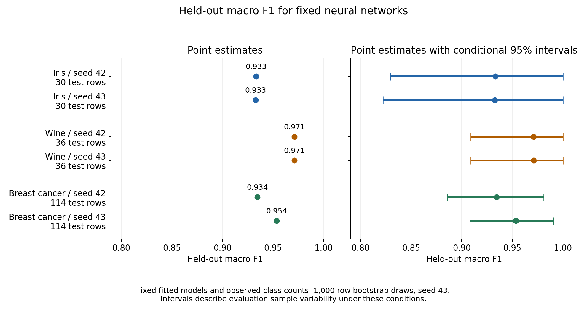
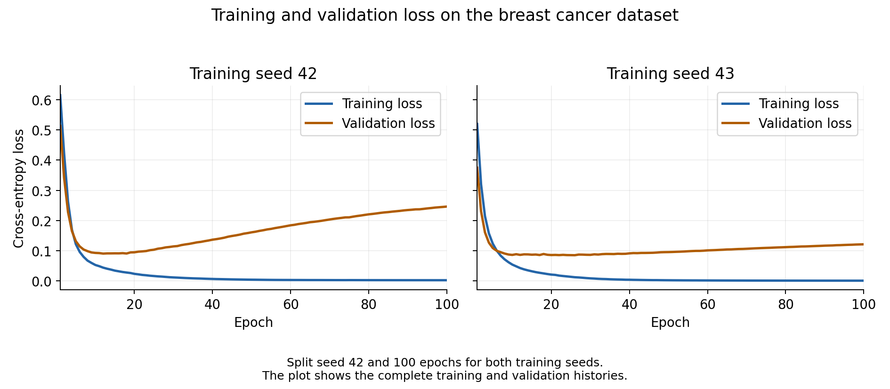
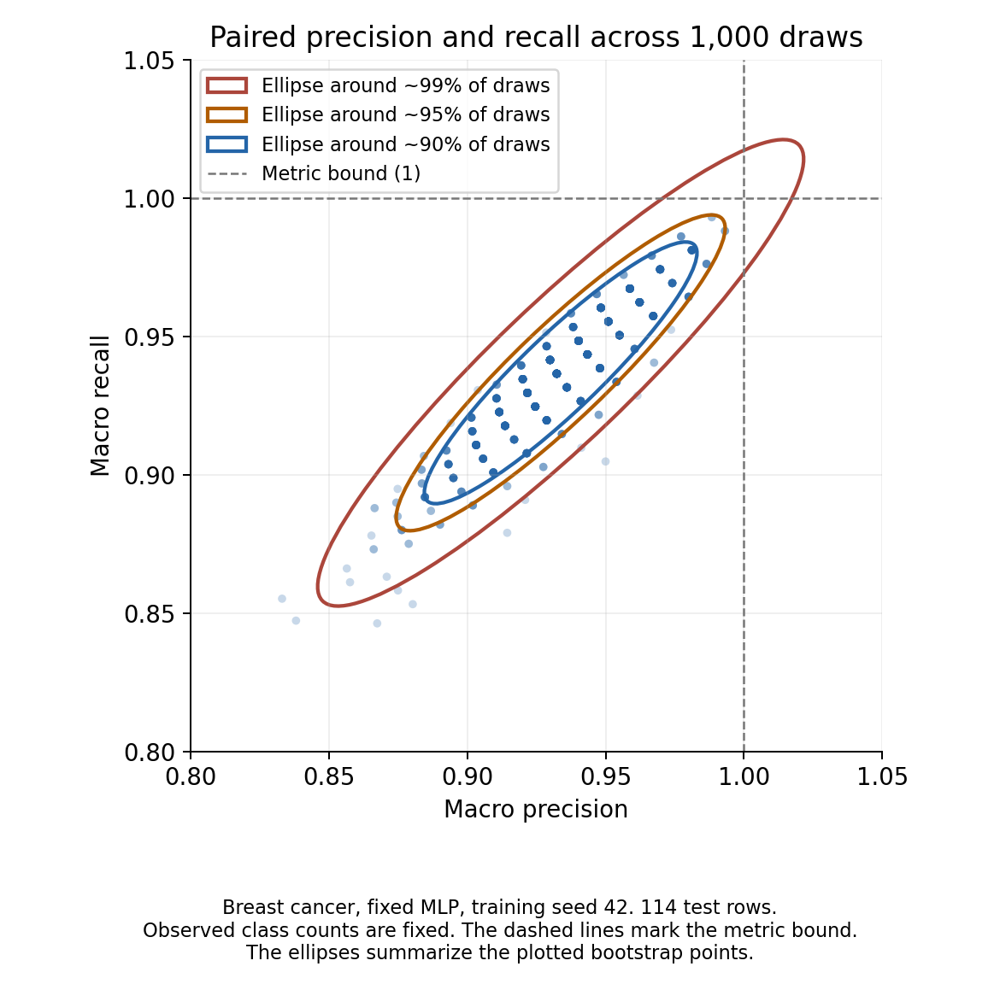

An Iris classifier scored 0.933 macro F1 on 30 held-out flowers. Reporting three decimal places makes the result look precise. Resampling those same 30 predictions gave a conditional 95% interval of 0.829 to 1.000. I wanted an evaluation workflow that saved both numbers and let me trace them back to the predictions.

Think of reading a measurement from a particle physics experiment. Along with the measured value, you would want the statistical uncertainty, the systematic effects, and the conditions of the measurement. I started asking similar questions when I compared models on scikit-learn datasets. How much would the score vary with a different evaluation sample? What happens if I retrain? Could rounding, a stopping condition, or a shared labeling convention change what I conclude?

I started with familiar datasets to check the workflow. The longer-term goal is to work with data whose provenance, labels, and reliability I still need to understand. I am building DIY AutoML to save results, uncertainty estimates, and the steps that produced them. I started from notebooks and worked with Codex to turn that workflow into a Python package. The experiments here use the 0.4.0a7 development snapshot. [Source and setup](https://github.com/okamasaya/DIY_AutoML/tree/64b17f120dad1ead6256d963b779c13630457898)

## The source of uncertainty determines what to check

The number of wrong predictions and the precision of a performance estimate answer different questions. A low score can be estimated precisely. A high score from a small evaluation set can leave considerable sampling uncertainty.

| What may affect the result | What to check |
| --- | --- |
| Sampling uncertainty in the evaluation score | Independent evaluation units, counts by class, and the standard error or interval for the metric |
| Variation from the training procedure | Repeated runs that record changes to initialization, order, splitting, or model selection |
| Numerical error | Sensitivity to comparable precision and tolerance settings, and evidence of convergence |
| Systematic bias | Calibration records, independent labeling or measurement, and evaluation across periods or sites |

The tolerable size of an error depends on the decision. Repeated answers from one person can add many rows while adding limited independent information. More data can narrow a sampling interval while a measurement or labeling bias persists. The current workflow estimates sampling uncertainty for fixed predictions and supports specified repeat runs for deep learning and clustering. Classification ranking can also check sensitivity to Float32-rounded inputs or a specified measurement offset. Evidence about actual systematic bias comes from sources such as calibration records or independent measurements.

## Save enough to trace a result

The records depend on the workflow. I want to be able to start at a score and work back to the inputs and choices that produced it.

| Stage | Examples of saved information |
| --- | --- |
| Input and preprocessing | CSV hash, feature names, split indices, and scaler means and scales where applicable |
| Comparison and selection | Candidate configurations, fold scores, and the rule used to choose a model |
| Training | Seeds, epoch-by-epoch training and validation histories, weights, and statuses for failed or skipped runs |
| Evaluation | True and predicted labels, per-class metrics, resampling indices, and replicate scores |

I use Excel to read the results, NPZ files to work from the saved arrays, and a manifest to check settings and file hashes. If a prediction and its label disagree, I can inspect the original row and the basis for the label. The disagreement is a place to start investigating.

Other AutoML tools also expose records and uncertainty estimates. H2O documents how to examine cross-validation metrics, and AutoGluon TimeSeries produces forecast quantiles. For this project I want the source of each uncertainty estimate, the intermediate records, and the open questions to be traceable in one workflow. [H2O cross-validation](https://docs.h2o.ai/h2o/latest-stable/h2o-docs/cross-validation.html) · [AutoGluon TimeSeries](https://auto.gluon.ai/stable/tutorials/timeseries/forecasting-quick-start.html)

## Three datasets, two training seeds

I tried five scikit-learn classifiers, clustering, and a small TensorFlow/Keras multilayer perceptron (MLP) on three familiar datasets. The figures use all the saved MLP runs, with both training seeds shown. [scikit-learn datasets](https://scikit-learn.org/stable/datasets/toy_dataset.html)

| Dataset | Rows | Features | Target |
| --- | ---: | ---: | --- |
| Iris | 150 | 4 | Three iris species |
| Wine | 178 | 13 | Three wine classes |
| Breast Cancer Wisconsin | 569 | 30 | Malignant or benign in the diagnostic dataset |

The MLP had hidden layers of 32, 16, and 8 units. The split seed was 42, with about 64% for training, 16% for validation, and 20% for testing. Scaling was fitted on training data. The two runs used training seeds 42 and 43 and trained for 100 epochs each. Training rows fitted the weights, validation rows tracked the course of training, and held-out rows supplied the final scores. These familiar datasets serve as development examples. The Breast Cancer Wisconsin example illustrates evaluation reporting.

## Put an interval alongside the point estimate

Macro F1 gives each class equal weight by averaging its F1 score. Both panels below display the same test predictions. The right panel adds sampling intervals.

*95% percentile intervals from 1,000 row bootstrap draws, with bootstrap seed 43. The fitted MLP and the observed counts by class are fixed.*

For training seed 42, Iris scored 0.933 with a conditional 95% interval of about 0.829–1.000 on 30 test rows. Wine scored 0.971, with an interval of around 0.909–1.000 on 36 rows. The intervals show how much detail the observed evaluation supports. The datasets answer different classification questions, so each score belongs to its own task and evaluation sample.

Breast Cancer Wisconsin scored 0.934 and 0.954 for seeds 42 and 43, with intervals of about 0.886–0.981 and 0.908–0.991. For a difference between those fits, I would resample the same test rows for both and calculate a difference in every replicate. These two fixed runs illustrate how to report sampling uncertainty. Estimating variability across training runs calls for additional repetitions.

In each replicate I draw with replacement within each true class and keep the true label and prediction together. The bootstrap standard error for Iris at seed 42 is about 0.0472, the sample standard deviation of the replicate scores. Increasing the number of draws reduces Monte Carlo variability in the resampling calculation. Collecting more independent test observations changes the information available for the evaluation. This interval addresses sampling variation conditional on the model, split, and observed class counts.

## Read the training history as well as the final score

Both Breast Cancer Wisconsin runs ended with test macro F1 above 0.93. The saved training and validation curves show what happened during those 100 epochs.

*Both seeds use the same split. The curves contain training and validation loss.*

For seed 42 the validation loss reached about 0.090 at epoch 12 and rose to about 0.246 by epoch 100, while training loss fell to about 0.0017. The later rise in validation loss also appeared for seed 43. This is a reason to investigate overfitting. Loss reacts to predicted probabilities, while F1 uses class decisions, so the curves and the final score can tell different parts of the story.

I kept the original 100-epoch runs. An early-stopping comparison would define the rule on training and validation data and evaluate the resulting procedure with a separate holdout. Examining the full probability distribution on the original test rows would also require saving the full test probabilities in this workflow.

## Look at how two metrics vary together

For the fixed Breast Cancer Wisconsin MLP at seed 42, I computed macro precision and macro recall from the same resampled rows in each replicate. Plotting the pairs shows whether high values of one metric tend to come with high values of the other.

*The ellipses use empirical quantiles of covariance-scaled distances. After checking the full view, I zoomed both axes to 0.80–1.05. The dashed lines mark the metric ceiling of 1. The geometric contours extend beyond it in places.*

The tilt shows how the metrics move together, and the spread along the long axis is still substantial. Here “95%” describes the share of the saved replicate points enclosed by the contour. The scatter also shows discreteness that a smooth ellipse can hide. For comparison, a radius of one standard deviation in a bivariate normal covariance ellipse encloses about 39.3%. The familiar 68.3% is the one-dimensional figure. This plot uses the observed replicate distances and was produced for the article from saved data. [Plotting script](https://github.com/okamasaya/DIY_AutoML/blob/64b17f120dad1ead6256d963b779c13630457898/scripts/render_evaluation_article_figures.py) · [Values and source hashes](https://github.com/okamasaya/DIY_AutoML/blob/64b17f120dad1ead6256d963b779c13630457898/docs/figures/evaluation-article-data.json)

## Ask whether the evaluation unit fits the decision

Three small public-data exercises used five classifiers to predict hotel cancellations, survey answers about accepting a coffee coupon, and repeat purchases. Each selected model was assessed on a holdout after the comparison on five training-side folds.

In the hotel example, the model scored 0.527 macro F1 and a reference rule scored 0.571. A paired resampling calculation using the saved predictions gave a conditional 95% interval of about −0.109 to +0.018 for model minus rule. The interval includes both signs. An evaluation designed to establish equivalence would need a specified equivalence margin and its own decision rule. The difference interval was an analysis of the saved predictions for the article. [Review and calculation notes](https://github.com/okamasaya/DIY_AutoML/blob/64b17f120dad1ead6256d963b779c13630457898/docs/REVISION_POLICY_20261110.md)

The coupon data contain multiple answers from the same people, and the CSV lacks respondent IDs. The row-level calculation concerns the observed survey rows. Assessing performance for new people calls for a respondent-level split, and claiming an effect on visits would call for actual visit records. [Three business experiments](https://github.com/okamasaya/DIY_AutoML/blob/64b17f120dad1ead6256d963b779c13630457898/docs/BUSINESS_QUICK_RESULTS.md)

## Check what happens when I use fewer columns

The `annealing-check` workflow gives simulated annealing and random search equal candidate budgets and compares feature subsets on training-side folds. I evaluate their selected subsets on common held-out rows, alongside the full-feature model.

In Wine, the five columns chosen by simulated annealing at the default search seed gave the same predictions as all 13 columns on all 36 holdout rows. This exact match occurred in one of ten search runs. At the default seed, the macro F1 difference versus random search was about +0.056, with a paired 95% interval of 0.000 to +0.142. All ten intervals included zero. Candidate scores and fit counts let me revisit what each search tried. [Annealing experiments, including exhaustive search on Iris](https://github.com/okamasaya/DIY_AutoML/blob/64b17f120dad1ead6256d963b779c13630457898/docs/ANNEALING_CHECK.md)

## Use the records to decide what to check next

The classification workflow in this snapshot accepts labeled CSVs with complete numerical features. It provides five fixed supervised candidates in `select`, 27 declared configurations in `tune`, 54 clustering candidates, TensorFlow MLP runs, and configured repeats for clustering and deep learning. The `uncertainty` and `report` commands read saved results to produce uncertainty estimates and illustrated Excel reports. Supervised scores and clustering metrics have their own evaluation paths. [English setup and examples](https://github.com/okamasaya/DIY_AutoML/blob/64b17f120dad1ead6256d963b779c13630457898/README.en.md)

The saved Breast Cancer Wisconsin workbooks show the history in `DL_History` and the estimate, bootstrap SE, and interval endpoints in `Metric_Uncertainty`. The accompanying figure record documents the checks against the source arrays, including independent scikit-learn calculations for selected draws. [Training workbook](https://github.com/okamasaya/DIY_AutoML/blob/64b17f120dad1ead6256d963b779c13630457898/validation/dl-backend-preparation-0.4.0a7/breast_cancer/report.xlsx) · [Uncertainty workbook](https://github.com/okamasaya/DIY_AutoML/blob/64b17f120dad1ead6256d963b779c13630457898/validation/dl-backend-preparation-0.4.0a7/breast_cancer-uncertainty/report.xlsx)

The five-classifier exercises cover a limited set of candidates. Larger tabular benchmarks show how results can depend on the dataset and the compute budget. Tree ensembles performed well on many medium-sized benchmark datasets, and later studies report competitive deep ensembles and strong results from foundation models on small datasets. Comparing these approaches would require a study with matched evaluation and search budgets. [Grinsztajn et al.](https://arxiv.org/abs/2207.08815) · [TabArena](https://proceedings.neurips.cc/paper_files/paper/2025/hash/1697e3fb412da11dc9488249f9e7bbc9-Abstract-Datasets_and_Benchmarks_Track.html) · [TabPFN](https://www.nature.com/articles/s41586-024-08328-6)

For unfamiliar data, I want to start with provenance, units, label definitions, and the time and unit of prediction. Then I can use counts, distributions, missing values, and duplicates to identify where to investigate. Testing how an input measurement error propagates through a model takes a different experiment from resampling fixed predictions. The results of both can inform a decision about collecting more data, checking the labels, or redesigning a split. [Evaluation design](https://github.com/okamasaya/DIY_AutoML/blob/64b17f120dad1ead6256d963b779c13630457898/docs/UNCERTAINTY_DESIGN.md)

The two companion articles in **DIY AutoML Evaluation** cover the bootstrap calculation and the three business exercises. The **DIY AutoML Development Notes** series shows the individual workflows, including feature selection, the Windows preview, and later time-series experiments. [English article index](https://github.com/okamasaya/DIY_AutoML/tree/main/docs/dev_community)

*AI assistance was used to translate and edit the original Japanese manuscript for this English version.* [Japanese manuscript](https://github.com/okamasaya/DIY_AutoML/blob/64b17f120dad1ead6256d963b779c13630457898/articles/diy-automl-evaluation-framework.md) · [Zenn article](https://zenn.dev/okamasaya/articles/diy-automl-evaluation-framework)
