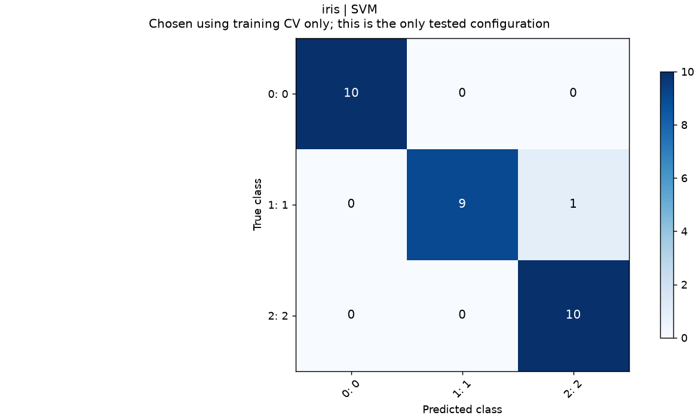

When I compare classification models, I want to be able to trace the final score back to the rows that produced it. I started DIY AutoML to keep that record, from checking the input CSV to saving the holdout predictions and their score intervals. The Python package is called **UC_AutoMaiL**.

This walkthrough uses the public `0.4.1a0` alpha on TestPyPI. We will turn Iris into a CSV, compare five classifiers on a CPU, and open an Excel workbook that shows how the model was selected and how it performed on held-out data. [UC_AutoMaiL on TestPyPI](https://test.pypi.org/project/uc-automail/0.4.1a0/)

## Install the alpha

Use Python 3.12 or newer. Work in a new folder and create a virtual environment. On Windows PowerShell, run the following commands.

```powershell
python -m venv .venv
.\.venv\Scripts\Activate.ps1
```

On macOS or Linux with bash or zsh, use these commands.

```sh
python3 -m venv .venv
source .venv/bin/activate
```

Download the project wheel from TestPyPI. Install that local wheel with its dependencies from the regular PyPI index. [Python Packaging User Guide](https://packaging.python.org/en/latest/guides/using-testpypi/#using-testpypi-with-pip)

```sh
python -m pip --isolated download --index-url https://test.pypi.org/simple/ --no-deps --only-binary=:all: uc-automail==0.4.1a0
python -m pip --isolated install --index-url https://pypi.org/simple/ ./uc_automail-0.4.1a0-py3-none-any.whl
python -m pip check
python -m uc_automail --version
python -c "import uc_automail as uc_al; print(uc_al.__version__)"
```

The CLI prints `UC_AutoMaiL 0.4.1a0` and the Python import prints `0.4.1a0`. The distribution name used by `pip` is `uc-automail`. In Python, import `uc_automail` and use `uc_al` as its alias. If PowerShell blocks the activation script, use `.\.venv\Scripts\python.exe` wherever the commands below use `python`.

## Audit Iris and compare five classifiers

Iris has 150 rows, four measurements per row, and three species labels. Save the following as `iris_demo.py`. Each run gets a timestamped folder that keeps its input CSV, audit, model evaluation, and detailed report together. [Iris dataset in scikit-learn](https://scikit-learn.org/stable/modules/generated/sklearn.datasets.load_iris.html)

```python
from datetime import datetime
from pathlib import Path

import uc_automail as uc_al
from sklearn.datasets import load_iris

run = Path("runs") / datetime.now().strftime("iris-%Y%m%d-%H%M%S-%f")
run.mkdir(parents=True)

iris_csv = run / "iris.csv"
load_iris(as_frame=True).frame.to_csv(iris_csv, index=False)

audit = uc_al.audit_data_csv(iris_csv, output=run / "audit", target="target")
selection = uc_al.select_csv(
    iris_csv,
    target="target",
    output=run / "selection",
    seed=42,
    progress="both",
)
report = uc_al.render_excel_report(selection, run / "report", charts="detail")

print(audit / "report.xlsx")
print(report / "report_with_figures.xlsx")
```

```sh
python iris_demo.py
```

`audit_data_csv` records checks such as missing values, duplicates, and class counts. `select_csv` compares a decision tree, random forest, logistic regression, SVM, and k-nearest neighbors. With `progress="both"`, you can follow the 25 candidate-fold evaluations in the terminal and read them later in `selection/progress.jsonl`.

## Read the workbook

Start with `audit/report.xlsx` for the input checks. Open `report/report_with_figures.xlsx` for the scores and figures.

| Sheet | What to look for |
| --- | --- |
| `SL_CV_Mean` | Mean cross-validation scores on the training side, used to choose a candidate |
| `SL_Test` | Scores and the confusion matrix for the held-out rows |
| `SL_Test_Intervals` | Point estimates and bootstrap intervals for the holdout scores |
| `Progress` | Fit progress, fold scores, and elapsed times |

In the Windows run with Python 3.13.17 and scikit-learn 1.9.1, the workflow used 120 rows for training and selection and held out 30 rows. The SVM had the highest mean cross-validation macro F1 and got **29 out of 30** holdout rows right. Its holdout macro F1 was **0.967**, with a conditional 95% bootstrap interval of **0.898 to 1.000**.



Macro F1 gives each class equal weight. The interval comes from resampling the held-out rows within their observed classes, keeping the fitted model and class counts fixed. To study variation from a new split or a new round of training, rerun the evaluation under those conditions. [DIY AutoML evaluation design](https://github.com/okamasaya/DIY_AutoML/blob/main/docs/UNCERTAINTY_DESIGN.md)

Keep `selection/arrays.npz` if you want to inspect the splits, labels, and predictions later. The settings and file hashes are in `selection/manifest.json`.

## Try your own data

Set `iris_csv` to the path of a CSV with complete numeric features and set `target` in both calls to the name of its label column. Keep each run's input and output together so you can check which rows and settings produced its score.

The alpha also includes Kalman and particle filters, EKF and UKF diagnostics, and graph node classification. A small EKF example shows how to inspect a run with a missing observation. [Run the EKF example](https://github.com/okamasaya/DIY_AutoML/blob/6b0f360950cd8650743136fbc0a555db04d44c22/docs/dev_community/06-time-series.md#try-the-filter-with-the-testpypi-package) · [DIY AutoML on GitHub](https://github.com/okamasaya/DIY_AutoML)

*AI assistance was used to translate and adapt my Japanese walkthrough and experiment notes for this English article.*
