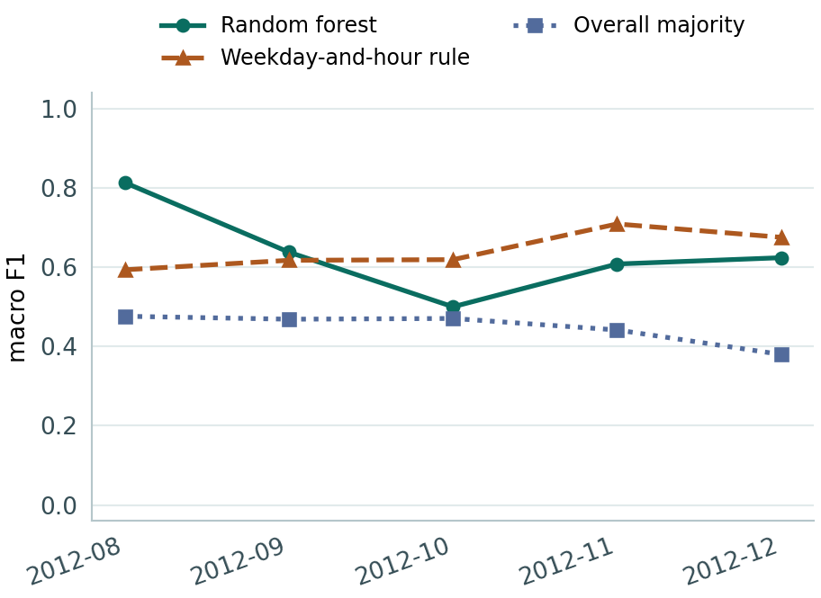

# Reviewing DIY AutoML Results in Excel and Charts

I want someone unfamiliar with Python to be able to open a CSV, run a model comparison, and check the results on their PC. The Windows preview brings those steps together, including an audit before training and an Excel workbook and charts afterward. [Series index](README.md) · [Japanese original](../../articles/diy-automl-development-note-05-bp-preview.md)

## Open Iris and compare five models

Use Python with Tcl/Tk and install DIY AutoML in `.venv`. From the repository root, run this PowerShell command to open the preview with Iris selected. The preview currently uses Japanese labels, which are shown alongside their English meanings below. [Setup and complete walkthrough](../BUSINESS_USER_GUIDE.en.md#try-the-windows-preview-with-iris)

```powershell
.\.venv\Scripts\python.exe -X utf8 -m diy_automl bp-preview --csv data/reference/iris.csv
```

1. Select `target` as the outcome column and click **点検する** (*Inspect data*). Check missing values, duplicates, and class counts. To load another UTF-8 CSV, use **CSVを選ぶ…** (*Choose CSV*).
2. Click **使う列を選ぶ…** (*Choose columns*), keep the four Iris measurements, and click **抽出して再点検** (*Extract and inspect again*). The preview saves a separate training CSV with the selected columns and the outcome. With the optional storage dependencies, **作業用Parquetも保存** (*Save a working Parquet copy*) can save a reusable copy for larger inputs.
3. Click **5モデルを比較する** (*Compare five models*). For Iris, the preview used 120 rows to select an SVM and 30 held-out rows to test it.

Model comparison requires finite numeric features, complete values, and recorded class labels. Before inspection, select **IDでまとめる** (*Group by ID*) to keep a customer's repeated rows together, or **日付順で分ける** (*Split by date*) to evaluate later observations. [Input and split options (Japanese)](../DATA_AUDIT.md#画面からのモデル比較)

## Look at the counts behind a score

On Iris, the result showed **30 evaluated, 29 correct, and one error**. **評価Excelを開く** (*Open evaluation workbook*) opens `bp_report.xlsx`. Start with **まず読む** (*Start here*) for the totals and **ラベル別** (*By outcome*) for missed cases and false alarms. The model comparison bar chart under **グラフを見る…** (*View charts*) shows training-side validation scores. Holdout scores appear on the results screen and in the workbook. [How to read the workbook](../BUSINESS_USER_GUIDE.en.md#read-the-evaluation-workbook)

Date-ordered evaluations add a monthly holdout chart. In Bike Sharing, I defined 200 or more rentals in a recorded hour as busy, and anything below that as regular. I held out the latest fifth of observed dates, which gave 582 rows from August 7 to December 31, 2012. I compared the selected random forest with a simple rule that predicts the most frequent training label for the same day of the week and hour. [Bike Sharing dataset](https://archive.ics.uci.edu/dataset/275/bike%2Bsharing%2Bdataset) · [Data preparation and split (Japanese)](../DATA_AUDIT.md#日付順の分割)



*The overall majority rule always predicts the most frequent label in the training period. Macro F1 gives the busy and regular classes equal weight.*

Across the full period, the weekday-and-hour rule scored **0.656** macro F1 and the random forest scored **0.638**. The random forest caught 80 of the 109 regular cases, and the rule caught 72. The model scored higher in August and September, and the rule scored higher from October through December. These numbers describe the held-out period. Intervals that account for time dependence remain a research task. In Excel, the simple-rule comparison, monthly breakdown, and monthly breakdown by outcome let you go back to the counts for each period. [Monthly comparison details (Japanese)](../DATA_AUDIT.md#月別の成績と単純ルール)

## Take the saved tables into a charting tool

The built-in charts read saved evaluation tables when reopened. To choose your own axes or combine results with another report, open a worksheet in your preferred tool or export it to CSV. These tools have free options with different saving and sharing conditions.

| Tool | Use and sharing considerations |
| --- | --- |
| Tableau Desktop Free Edition | Read Excel and save charts locally, including for business use. Workbook sharing and online publishing are restricted. [Official FAQ](https://help.salesforce.com/s/articleView?id=005316652&language=en_US&type=1) |
| Tableau Desktop Public Edition | Practice with public data and save locally or publish to Tableau Public. Published charts are visible to anyone. This edition is for non-commercial use. [Edition comparison](https://help.tableau.com/current/pro/desktop/en-us/desktop_comparison.htm) · [Tableau Public FAQ](https://help.tableau.com/current/pro/desktop/en-us/public_faq.htm) |
| Power BI Desktop | Build and save reports locally on Windows. Sharing through the service depends on licenses and capacity. [Power BI FAQ](https://learn.microsoft.com/en-us/power-bi/personas/business-user/end-user-faq) |
| Google Data Studio, formerly Looker Studio | Build browser-based dashboards using sources such as Google Sheets. Check how the cloud data source and report are shared. [Data Studio overview](https://docs.cloud.google.com/data-studio/welcome) |
| RAWGraphs | Open a CSV and export a chart as an image. The browser processes the input data. [RAWGraphs](https://rawgraphs.io/) · [CSV input guide](https://rawgraphs.io/learning/how-to-load-and-format-your-data-for-rawgraphs) |

For example, connect Tableau to the Iris evaluation workbook and choose the `SL_CV_Mean` worksheet. Make a bar chart using `Model` and `F1` to see the mean training-side validation score by candidate. [Connect Tableau to Excel](https://help.tableau.com/current/pro/desktop/en-us/examples_excel.htm)

## Give the preview a way to open custom charts

One idea is to put PyGWalker inside Streamlit so a user can choose the chart type, axes, and series from the saved tables. In the local test with Python 3.14.7 and PyGWalker 0.5.0.1, an Iris evaluation table produced an HTML file for local viewing. [PyGWalker Streamlit documentation](https://docs.kanaries.net/pygwalker/api-reference/streamlit) · [Prototype log (Japanese)](../THREAD_SUMMARY_20261119.md)

The proposed Windows workflow uses an initial batch file on a PC with Python already installed. The batch would create a charting environment, get the dependencies over the network, and start the viewer. After that, a button in the preview could reuse the environment and open the current evaluation in a local browser. The Streamlit integration, initial setup, and button launch still need to be tested together. [Charting roadmap (Japanese)](../ROADMAP.md#bp向けの詳細グラフto-do)

Across these five notes, the goal has been to keep the path back from a score to its evidence. That includes the original data, the evaluation conditions, and the individual successes and errors someone needs to discuss a result.
