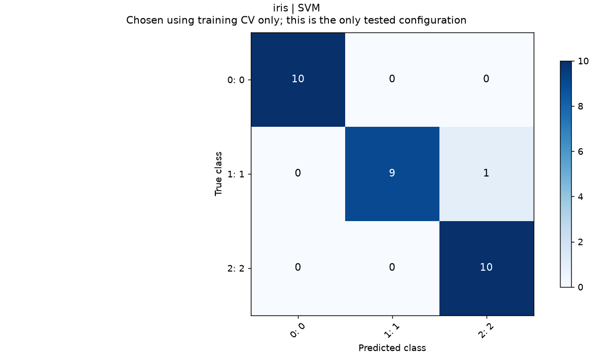

# UC_AutoMaiL α版でIrisを分類し、評価結果をExcelに出す

CSVで分類モデルを比べるとき、採用したモデルのスコアに加えて、選定に使ったデータや評価値の区間も手元に残したいことがあります。DIY_AutoMLとして開発してきたPythonパッケージを、**UC_AutoMaiL** の名前で試験配布しています。今回はIrisを使い、CSVの点検から、分類モデルの比較と図付きExcelの出力までを実行します。

手順はTestPyPIで配布中のα版 `0.4.1a0` を対象にしています。 [UC_AutoMaiL 0.4.1a0の配布ページ](https://test.pypi.org/project/uc-automail/0.4.1a0/)

## インストールする

Python 3.12以降を使います。空の作業フォルダーを開き、使うOSに合わせて仮想環境を作ります。Windows PowerShellでは、次のように実行します。

```powershell
python -m venv .venv
.\.venv\Scripts\Activate.ps1
```

PowerShellで `Activate.ps1` の実行が制限されている場合は、仮想環境を作った後、以降の `python` を `.\.venv\Scripts\python.exe` に置き換えます。

macOS・Linuxのbashまたはzshでは、次のように実行します。

```sh
python3 -m venv .venv
source .venv/bin/activate
```

TestPyPIからUC_AutoMaiLのwheelをダウンロードし、インストールに必要な依存ライブラリはPyPIから取得します。 [Python Packaging User GuideのTestPyPI手順](https://packaging.python.org/en/latest/guides/using-testpypi/#using-testpypi-with-pip)

```sh
python -m pip --isolated download --index-url https://test.pypi.org/simple/ --no-deps --only-binary=:all: uc-automail==0.4.1a0
python -m pip --isolated install --index-url https://pypi.org/simple/ ./uc_automail-0.4.1a0-py3-none-any.whl
python -m pip check
python -m uc_automail --version
```

最後に `UC_AutoMaiL 0.4.1a0` と表示されます。

## IrisのCSVを点検し、5モデルを比較する

Irisは、がく片と花弁の長さ・幅から3種類のアヤメを分類する150件のデータです。scikit-learnの同梱データをCSVにし、正解ラベルの列として `target` を指定します。 [scikit-learnのload_irisリファレンス](https://scikit-learn.org/stable/modules/generated/sklearn.datasets.load_iris.html)

以下を `iris_demo.py` として保存します。最初に入力CSVを点検し、分類モデルを比較した結果から図付きExcelを作ります。出力先には実行時刻が付くため、同じスクリプトを繰り返し試せます。

```python
from datetime import datetime
from pathlib import Path

from sklearn.datasets import load_iris
import uc_automail as uc_al

run = Path("runs") / datetime.now().strftime("iris-%Y%m%d-%H%M%S-%f")
run.mkdir(parents=True)

iris_csv = run / "iris.csv"
load_iris(as_frame=True).frame.to_csv(iris_csv, index=False)

uc_al.audit_data_csv(iris_csv, output=run / "audit", target="target")
selection = uc_al.select_csv(
    iris_csv,
    target="target",
    output=run / "selection",
    seed=42,
    progress="both",
)
report = uc_al.render_excel_report(selection, run / "report", charts="detail")

print(report / "report_with_figures.xlsx")
```

```sh
python iris_demo.py
```

`progress="both"` を指定しているので、5候補×5分割の交差検証が進む様子を端末で確認でき、`selection/progress.jsonl` にも記録されます。実行が終わると図付きExcelのパスが表示されます。

## Excelで選定と評価を確認する

出力フォルダーの `audit/report.xlsx` で入力列や欠損の状況を確認できます。モデル比較の結果は `report/report_with_figures.xlsx` を開きます。

| シート | 確認すること |
| --- | --- |
| `SL_CV_Mean` | 学習側の交差検証で、モデルを比較したときの平均スコア |
| `SL_Test` | 選んだモデルを保留データで評価したスコア。混同行列で取り違えたクラスも確認できる |
| `SL_Test_Intervals` | 保留データで計算した評価値と区間 |
| `Progress` | 候補・分割ごとのスコアと経過時間 |

Python 3.13.17、scikit-learn 1.9.1で実行した例では、150件のうち学習側の120件で5モデルを比べ、平均macro F1でSVMを選びました。保留した30件では29件正解で、macro F1は **0.967**、95%の条件付きブートストラップ区間は **0.898〜1.000** でした。



`SL_Test` に入る混同行列です。縦が正解、横が予測です。対角線の10件、9件、10件が正解で、対角線の外にはクラス1をクラス2と予測した1件が見えます。

macro F1は、クラスごとのF1を同じ重みで平均した値です。ここでの区間は、学習済みのSVMと保留データのクラスごとの件数を固定し、保留データ内で行を復元抽出して求めています。学習やモデル選定をやり直した場合のばらつきは、データの分割や学習条件を変えた実験で評価します。 [DIY_AutoMLの評価設計と条件付き区間](https://zenn.dev/okamasaya/articles/diy-automl-ds-uncertainty)

`selection/manifest.json` に実行設定と入力・出力のハッシュ、`selection/arrays.npz` に分割、正解ラベル、予測が残ります。元のCSVと同じ実行フォルダーに保管しておくと、条件や予測まで後から確認できます。

## 手元のCSVで試す

数値の特徴量列と正解ラベル列のある、欠損のない分類CSVから試せます。サンプルのCSV生成部分を削り、`iris_csv = Path("手元のCSV.csv")` とし、`audit_data_csv` と `select_csv` の `target` を正解ラベルの列名に合わせます。

Irisは使い方を確認するための例です。手元のデータでは、保留データの対象や時期が実際に予測したい対象と合っているかも確認してください。ソースと開発記録はDIY_AutoMLリポジトリで公開しています。 [DIY_AutoMLのGitHubリポジトリ](https://github.com/okamasaya/DIY_AutoML)

α版を試して気づいた点があれば、OS、Pythonのバージョン、実行した手順を添えて教えてもらえると再現しやすいです。 [不具合や改善点の報告先](https://github.com/okamasaya/DIY_AutoML/issues)
