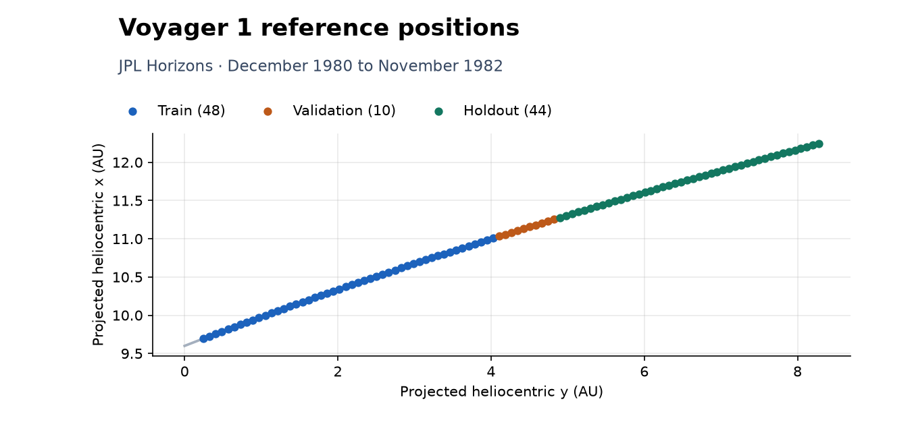

# UC_AutoMaiLをAutoGluon・H2Oと比べる　Irisの分類とVoyager 1の軌道予測

Irisのような小さな分類データと、力学モデルを使える探査機の軌道予測では、モデルを選ぶときに何を見ればよいでしょうか。DIY_AutoMLとして開発してきたUC_AutoMaiLの評価手順を使い、AutoGluonとH2O AutoMLとの比較を2つ試しました。Irisでは同じ保留データでの分類性能を、Voyager 1では7日先の位置誤差とEKFが出した予測楕円を見ます。

## Irisを同じ30件で比べる

Irisは4つの数値特徴量から3種類のアヤメを分類する150件のデータです。120件をモデルの学習・選定に使い、残る30件を3方式共通の保留データにしました。各方式はそれぞれの候補と選定手順を使いました。表は開発版 `0.4.0a7` で行った比較で、使用した分割と予測を保存しています。 [Irisのデータ](https://scikit-learn.org/stable/modules/generated/sklearn.datasets.load_iris.html) · [AutoGluonとの比較条件](https://github.com/okamasaya/DIY_AutoML/blob/main/experiments/autogluon_sl_crosscheck/README.md) · [H2Oとの比較条件](https://github.com/okamasaya/DIY_AutoML/blob/main/experiments/h2o_sl_crosscheck/README.md)

| 方式 | 選ばれたモデル | 正解数 | macro F1 |
| --- | --- | ---: | ---: |
| UC_AutoMaiLの分類機能 | SVM | 29/30 | 0.9666 |
| AutoGluon Tabular | k近傍法 | 30/30 | 1.0000 |
| H2O AutoML | GLM | 30/30 | 1.0000 |

UC_AutoMaiLとの差は、AutoGluonとH2Oでいずれもmacro F1が `+0.0334` でした。同じ保留行を両モデルで対にして、クラス別件数を固定したブートストラップを行うと、差の95%区間はいずれも `[0.0000, +0.1023]` です。今回の点数差は保留1件の分類から生じています。別の分割でも差が続くかは、この1回の比較では分かりません。 [比較結果の記録](https://github.com/okamasaya/DIY_AutoML/blob/main/experiments/autogluon_sl_crosscheck/README.md)

## NASA/JPLの公開軌道を参照してVoyager 1を予測する

NASA/JPLのHorizons APIから、1980年12月1日から1982年11月29日（TDB）まで7日間隔で、Voyager 1と地球の太陽中心の位置・速度を取得しました。各105時点です。Horizonsの公開軌道は推定された位置・速度で、ここでは初日の探査機の位置と速度で定めた平面に射影して参照位置にします。モデルに入力する距離・距離変化率は、この平面内の探査機と地球の位置・速度から計算し、正規乱数でノイズを加えました。したがって、以下の誤差はシミュレーション入力で公開軌道の射影をどこまで再現できたかを表します。 [NASA/JPL HorizonsのAPI](https://ssd-api.jpl.nasa.gov/doc/horizons.html) · [Horizonsの軌道データの説明](https://ssd.jpl.nasa.gov/horizons/manual.html)

学習48時点、検証10時点、保留44時点を時間順に取り、保留は1982年2月1日から11月29日までです。AutoGluonとH2Oは、現在と前回の観測、現在の時刻、地球の位置・速度から、7日先の2つの座標を別々に回帰します。UC_AutoMaiL `0.4.1a0` の拡張カルマンフィルタ（EKF）には、太陽の重力を使う運動モデル、距離・距離変化率の観測モデル、公開軌道の初日に一定のずれを加えた初期状態を与えます。EKFは観測を時系列順に取り込み、次の観測を使う前の予測を採点しました。

比較には、EKFと同じ初期状態から観測を取り込まずに運動モデルだけで進めた予測と、学習期間の位置を時刻で線形外挿した予測も入れました。表形式モデルは同じ検証期間で選び、AutoGluon Tabular `1.6.3` は両座標に加重アンサンブル、H2O AutoML `3.46.0.12` は両座標にGLMを選びました。 [AutoGluonの学習API](https://auto.gluon.ai/stable/api/autogluon.tabular.TabularPredictor.fit.html) · [H2O AutoMLの設定](https://docs.h2o.ai/h2o/latest-stable/h2o-docs/automl.html)

## 7日先の位置誤差と、予測楕円の当たり方

表は、予測位置と参照位置の平面上の距離を使ったRMSEです。「過去観測の混入」では、保留期間の予測に使う距離と距離変化率を学習期間の観測ペアで置き換え、地球の状態と参照位置は共通にしました。

| 方式 | 通常の模擬観測（km） | 過去観測の混入（km） |
| --- | ---: | ---: |
| UC_AutoMaiL EKF | **884,611** | 586,329,238 |
| AutoGluon Tabular | 34,519,748 | 259,246,727 |
| H2O AutoML | 28,085,138 | 248,018,816 |
| 力学モデルのみ | 5,951,389 | **5,951,389** |
| 時刻の線形外挿 | 28,046,525 | 28,046,525 |

通常の模擬観測では、初期状態と力学モデルを共有する2手法のうち、観測を取り込むEKFで誤差が小さくなりました。過去の観測を混ぜると、観測を使う3方式すべてで誤差が増え、力学モデルのみの予測が最小でした。表の順位はこの1本の軌道と、ここで与えた情報や候補モデルに対応します。

EKFについては、7日先の位置の予測共分散から、二変量正規近似で各時点の公称95%予測楕円も計算しました。通常の模擬観測で公開軌道の参照位置が楕円に入ったのは **0/44時点** です。楕円の平均短半径は約2.3万km、平均長半径は約19.6万kmでした。この保留区間では、点予測の誤差が5方式で最小のケースでも、EKF自身が推定した不確かさは位置のずれを捉えきれていませんでした。

公開軌道を取得するクエリ、分割、各方式のバージョン、RMSEと楕円の被覆率を保存しています。 [再実行手順](https://github.com/okamasaya/DIY_AutoML/blob/main/experiments/voyager_crosscheck/README.md#jpl-horizonsの公開軌道を参照した比較) · [集計結果のJSON](https://github.com/okamasaya/DIY_AutoML/blob/main/experiments/voyager_crosscheck/horizons-results.json)

Irisでは比較の根拠を30件の予測と差の区間までたどれます。Voyager 1では、力学と観測を使った点予測の改善に加えて、観測が崩れた場合の誤差や、予測楕円がどの程度当たったかまで確認できました。モデルの選定と評価を記録しておくと、採用する手法と、次に見直すべき仮定を具体的に議論できます。 [UC_AutoMaiLの試験配布版](https://test.pypi.org/project/uc-automail/0.4.1a0/)
