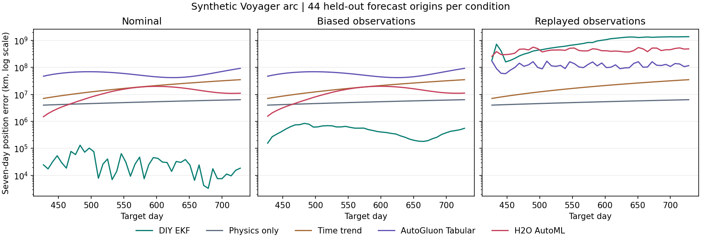

# AutoMLの途中経過をSeedsとVoyagerで比較する

実施日 2026年11月26日（日本時間）

## 1. 目的

AutoGluon TabularとH2O AutoMLが学習時に記録する内容を確認する。UCI Seedsの分類と、Voyagerを題材にした合成軌道の7日先予測で、学習や観測更新の途中記録から保留評価までをたどれる形にする。

## 2. 各ライブラリで取得できる記録

| ライブラリ | 学習時の記録 | 学習後に見る場所 |
| --- | --- | --- |
| AutoGluon Tabular | `TabularPredictor` の `verbosity` で詳細度を設定し、`log_to_file` と `log_file_path` でログを保存できる | `fit_summary()`、`leaderboard()` のモデル別検証スコアと時間 |
| H2O AutoML | `H2OAutoML(verbosity="info")` でバックエンドのメッセージを表示できる | `event_log` に学習時のイベント、`training_info` に実行時刻など、拡張leaderboardにモデル別の計測値 |
| DIY AutoML | `select --progress both` で候補、fold、選定指標、経過時間を表示して記録する | `progress.jsonl`、Excelの `Progress`、詳細図と保留結果 |

今回、AutoGluonのコンソールログと各fitのleaderboardを保存した。H2Oではサーバーが稼働している間に `event_log`、`training_info`、`get_leaderboard(automl, extra_columns="ALL")` を書き出す設定を使った。H2Oの `training_time_ms` はクロスバリデーション用モデルの学習時間を除く。個別モデルの反復履歴の例はH2Oの `model.score_history()` にもある。 [AutoGluon TabularのAPI](https://auto.gluon.ai/stable/api/autogluon.tabular.TabularPredictor.html) · [H2O AutoMLのログと時間の仕様](https://docs.h2o.ai/h2o/latest-stable/h2o-docs/automl.html#automl-log) · [H2Oのモデル別履歴](https://docs.h2o.ai/h2o/latest-stable/h2o-docs/faq/python.html) · [DIY AutoMLの途中経過](../../docs/SL_TUNING_GUIDE.md#select-と-tune-の途中経過を残す)

## 3. 評価条件

- **Seeds**は同梱の210行・7特徴量を使った。学習168行、保留42行は3方式で共通。DIYとAutoGluonは学習側の5分割を2反復し、H2Oはその最初の1反復を使う。各方式の候補と内部の学習方法は既存の比較実験の設定に従う。保留データは最終モデルを選んだ後に採点した。 [Seedsの出典](https://archive.ics.uci.edu/dataset/236/seeds) · [AutoGluonとの比較設定](../autogluon_sl_crosscheck/README.md) · [H2Oとの比較設定](../h2o_sl_crosscheck/README.md)
- **Voyager**は前回の合成軌道と観測を使った。予測対象日による分割は学習48行、検証10行、保留44時点。AutoGluon TabularとH2Oは太陽中心の位置を軸ごとに回帰し、EKFは近似した初期状態と力学・観測モデルを使って観測を逐次更新する。通常観測、系統バイアス、過去観測の混入の各条件で7日先の位置を採点した。 [Voyager比較の入力と手順](../voyager_crosscheck/README.md)

AutoGluon Tabular 1.6.3、H2O 3.46.0.12、DIY AutoML 0.4.0a8の開発版を使用した。AutoGluonとH2OはCPU 1スレッド。H2OのWindows一時フォルダーにURIで扱えない記号が含まれていたため、起動時は短い相対パスに変更した。サンドボックス内では起動待ちがタイムアウトし、検証では `127.0.0.1` 限定で再実行した。

## 4. Seedsの結果

| 方式 | 選定モデル | 保留macro F1 | 正解／保留 |
| --- | --- | ---: | ---: |
| DIY AutoML | ロジスティック回帰 | 0.8731 | 37／42 |
| AutoGluon Tabular | ロジスティック回帰 | 0.8731 | 37／42 |
| H2O AutoML | GLM | 0.9277 | 39／42 |

学習・保留行と参照したCVの分割を照合し、全方式の保留F1を保存した予測から再計算した。DIYとAutoGluonの保留予測は42行すべてで一致した。H2OとDIYの差は+0.0547で、同じ保留行をクラスごとに再標本化した1,000反復の条件付き95%区間は0.0000〜+0.1359だった。この1分割でH2Oの正解が2件多く、区間はゼロを含んだ。 [集計値](results-2026-11-26.json)

AutoGluonは外側の10 foldと最終学習の合計11回で、内部検証スコアとfit時間のleaderboardを保存した。外側のfoldでの評価値は比較Excelにある。H2Oでは66件のイベントを取得し、指定したfold列の使用、学習行数、候補の学習、停止時刻を確認できた。前回のDIY `select` の進捗ログは、今回と学習行・保留行・選定モデル・保留予測が一致する実行。 [AutoGluonの内部leaderboard例](log-examples/seeds-autogluon-fold1.csv) · [H2Oのイベント](log-examples/seeds-h2o-events.csv) · [DIYの進捗と報告](../sl_report_validation/README.md#5-途中経過)

## 5. 合成Voyager軌道の結果

保留44時点での7日先位置RMSEをkm単位で示す。前回比較の入力CSVはSHA-256が一致し、予測位置から計算した誤差とRMSEを前回の集計と照合した。

| 方式 | 通常 | 系統バイアス | 過去観測の混入 |
| --- | ---: | ---: | ---: |
| DIY EKF | 41,982 | 502,682 | 964,714,784 |
| 力学モデルのみ | 5,240,893 | 5,240,893 | 5,240,893 |
| 時刻の線形外挿 | 21,536,437 | 21,536,437 | 21,536,437 |
| AutoGluon Tabular | 60,110,119 | 60,077,242 | 121,361,610 |
| H2O AutoML | 13,461,984 | 13,575,428 | 439,672,766 |



EKFでは各条件104回の観測更新を記録し、評価した点ごとの予測と共分散も保存した。公称95%予測楕円に真値が入ったのは通常44/44、系統バイアス1/44、過去観測の混入0/44。AutoGluonでは両軸で加重アンサンブル、H2Oでは両軸でGLMを選定した。H2Oは各軸62件のイベントを取得した。学習48行に対して `min_rows=100` のGBM候補が必要とする200行に達せず、両軸でその候補の学習が成立しなかった記録も確認できた。 [EKFの更新ログ](log-examples/voyager-ekf-progress.jsonl) · [H2O x軸のイベント](log-examples/voyager-h2o-x-events.csv) · [H2O y軸のイベント](log-examples/voyager-h2o-y-events.csv)

## 6. 考察

Seedsでは、最終スコアから同点だった2方式について、同じ保留行で実際に予測が一致したところまで確認できた。VoyagerではH2Oのイベントに候補の学習が成立しなかった理由が残り、最終採点に使われた候補の範囲を説明できた。

Voyagerで通常観測に対するEKFの誤差が小さかった結果は、合成軌道に対応した力学・観測モデルを与えた条件での実測である。過去観測が混ざった場合には力学モデルのみの予測が最も小さく、観測を更新に使う手法では入力の品質も一緒に見る必要がある。今回の3条件と1本の合成軌道に範囲を置いて解釈する。

## 7. 再実行と保存先

リポジトリのルートで、設定済みのコア環境、AutoGluon環境、H2OとJavaの環境を使う。以下では新しい出力先を指定する。 [比較環境の設定](../voyager_crosscheck/README.md#再実行と出力)

```powershell
$root = 'runs/automl-progress-repeat'
$voyager = "$root/voyager"
$python = '.\.venv\Scripts\python.exe'
$ag = '.\.venv-autogluon\Scripts\python.exe'
New-Item -ItemType Directory -Path $root | Out-Null
& $python -X utf8 -m diy_automl rank-sl --csv data/reference/seeds.csv --target target --cv-repeats 2 --output "$root/seeds-reference"
& $python -X utf8 -m diy_automl select --csv data/reference/seeds.csv --target target --cpu-threads 1 --forest-jobs 1 --progress both --output "$root/seeds-select"
& $python -X utf8 scripts/make_voyager_demo.py --seed 42 --output "$root/voyager-source"
& $python -X utf8 -m experiments.voyager_crosscheck.run prepare --run $voyager --source "$root/voyager-source"
& $python -X utf8 -m experiments.voyager_crosscheck.run diy --run $voyager --capture-progress
& $ag -X utf8 -m experiments.autogluon_sl_crosscheck.run --csv data/reference/seeds.csv --reference "$root/seeds-reference" --output "$root/seeds-autogluon" --capture-progress *> "$root/seeds-autogluon.log"
& $ag -X utf8 -m experiments.voyager_crosscheck.run autogluon --run $voyager --capture-progress *> "$root/voyager-autogluon.log"
$env:JAVA_HOME = (Resolve-Path 'runs/h2o-temurin17-runtime/jdk-17.0.21+9-jre').Path
$env:PYTHONPATH = (Resolve-Path src).Path
python3.14 -X utf8 -m experiments.h2o_sl_crosscheck.run --csv data/reference/seeds.csv --reference "$root/seeds-reference" --output "$root/seeds-h2o" --capture-progress *> "$root/seeds-h2o.log"
python3.14 -X utf8 -m experiments.voyager_crosscheck.run h2o --run $voyager --capture-progress *> "$root/voyager-h2o.log"
& $python -X utf8 -m experiments.voyager_crosscheck.run report --run $voyager
```

今回の全出力は `runs/automl-progress-20261126`。SeedsのExcelは `seeds-autogluon/report.xlsx` と `seeds-h2o-local/report.xlsx` にある。AutoGluonのコンソールログはルートの `.log`、モデル別leaderboardは `seeds-autogluon/progress` と `voyager/autogluon-progress` に保存した。H2OのCSV・JSONは `seeds-h2o-local/progress` と `voyager/h2o-progress` にある。Voyagerの時点別結果は `voyager/predictions.csv`、評価結果は `voyager/metrics.csv` と `voyager/ekf_uncertainty.csv`。このレポートと一緒に、見本ログの原本と同じSHA-256を集計JSONへ残した。 [集計とハッシュ](results-2026-11-26.json)
