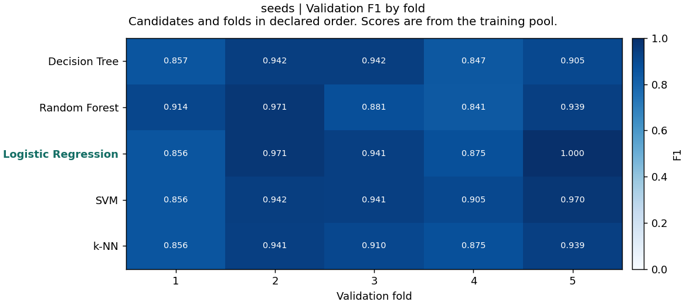
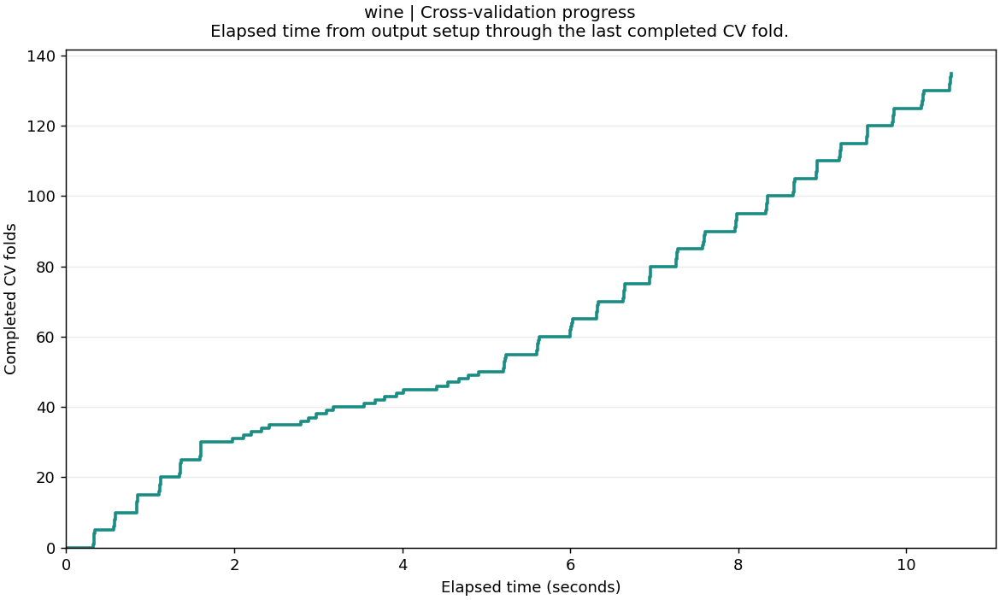

# 標準分類データで学習の途中経過と詳細レポートを確認する

実施日 2026年11月26日（日本時間）

## 1. 目的

RaisinとIrisで確認した途中経過の保存と詳細図を、Wine、Seeds、Breast Cancer Wisconsinの3データでも再現する。固定した5モデルを比較する `select` と、設定を探索する `tune` を同じ分割で実行し、どの候補が選ばれ、保留データでどんな結果になったかを記録する。表示用Excelの数値、図の入力、途中経過を元の評価結果と照合する。

## 2. 使用データ

| データ | 行数 | 数値特徴量 | 正解ラベルと件数 | 出典 |
| --- | ---: | ---: | --- | --- |
| Wine | 178 | 13 | 3クラス（59、71、48件） | [scikit-learnのWine](https://scikit-learn.org/stable/modules/generated/sklearn.datasets.load_wine.html) |
| Seeds | 210 | 7 | 小麦3品種（各70件） | [UCIのSeeds](https://archive.ics.uci.edu/dataset/236/seeds) |
| Breast Cancer Wisconsin (Diagnostic) | 569 | 30 | 悪性212件、良性357件 | [scikit-learnのBreast Cancer Wisconsin](https://scikit-learn.org/stable/modules/generated/sklearn.datasets.load_breast_cancer.html) |

リポジトリに収録済みのCSVを使った。WineとBreast Cancer Wisconsinでは、特徴量と正解ラベルをscikit-learnの同梱データと照合した。SeedsはUCIの配布データをCSVに変換したものを使った。 [CSVと変換記録](../../data/reference/README.md)

## 3. 実行方法

1. `audit-data` 相当の処理でCSVを点検し、入力のハッシュと点検結果を照合する。
2. `select` で固定5モデル、`tune` で既定の27設定を比較する。約2割を層化して保留し、残りの共通5分割で得たmacro F1の平均で候補を選ぶ。採用候補を学習側全体で再学習してから保留データを採点する。
3. 両コマンドに `--progress both` を指定し、候補・fold・スコア・経過時間を保存する。保存済み結果を `report` の `none`、`summary`、`detail` で出力し、各モードのファイルを検証する。

分割とモデルのseedは42、保留予測のブートストラップはseed 43、1,000反復。各反復では保留データをクラスごとに再標本化し、固定したモデルのmacro F1の95%区間を求めた。CPUスレッド上限とランダムフォレストの並列数はそれぞれ1。Windowsのローカル環境で各実行を順に行った。 [選定と評価の仕様](../../docs/SL_TUNING_GUIDE.md) · [図の検証方法](../../docs/EXCEL_REPORT_GUIDE.md)

環境はWindows 11、Python 3.13.17、DIY AutoML 0.4.0a8の開発版、scikit-learn 1.8.0。入力CSVのSHA-256と依存ライブラリの版を数値結果と一緒に記録した。 [実行条件と集計値](results-2026-11-26.json)

## 4. 結果

`select` と `tune` の学習行、保留行、保留行の正解ラベルと、各foldの学習・検証行は全データで一致した。以下のCVは候補を選ぶための学習側5分割の平均。保留macro F1と正解数は、保存した予測から別に計算してExcelと照合した。

| データ（学習／保留） | 手順 | 選定モデル | CV macro F1 | 保留macro F1（95%区間） | 正解／保留 |
| --- | --- | --- | ---: | --- | ---: |
| Wine（142／36） | `select` | SVM | 0.9865 | 0.9710（0.9089〜1.0000） | 35／36 |
| Wine（142／36） | `tune` | SVM、`C=10`、RBF | 0.9927 | 0.9407（0.8384〜1.0000） | 34／36 |
| Seeds（168／42） | `select` | ロジスティック回帰 | 0.9286 | 0.8731（0.7532〜0.9521） | 37／42 |
| Seeds（168／42） | `tune` | ロジスティック回帰、`C=10` | 0.9517 | 0.9007（0.8150〜0.9762） | 38／42 |
| Breast Cancer Wisconsin（455／114） | `select` | ロジスティック回帰 | 0.9764 | 0.9812（0.9526〜1.0000） | 112／114 |
| Breast Cancer Wisconsin（455／114） | `tune` | ロジスティック回帰、`C=0.1` | 0.9811 | 0.9716（0.9337〜1.0000） | 111／114 |

3データ×2手順×3出力モードの18点を検証した。図は `none` で0枚、`summary` で2枚、`detail` で `select` は4枚、`tune` は5枚。数値Excelのコピー、図付きExcelに残る元のセル、図に使った配列、埋め込んだ画像を照合した。Seedsの `select` では、`none` のExcel本体は30,893バイト、`detail` は173,885バイトだった。



## 5. 途中経過

各実行は読込、分割、CV開始、各foldの完了、再学習、保留評価、区間計算、Excel保存開始の順に記録した。各foldのログにあるmacro F1は元の評価表と一致した。CVの経過時間は `cv_start` から `refit` まで。`tune` のfit時間合計には各foldで計測した学習区間を足し、候補の途中保存を含む経過時間とは別に記録した。

| データ | `select` のCV完了数／経過秒 | `tune` のCV完了数／経過秒 | `tune` のfit時間合計（秒） |
| --- | ---: | ---: | ---: |
| Wine | 25／0.897 | 135／10.714 | 2.337 |
| Seeds | 25／0.585 | 135／10.653 | 2.171 |
| Breast Cancer Wisconsin | 25／1.460 | 135／11.540 | 2.698 |

たとえばWineの `tune` では、出力先準備後0.013秒でCVを始め、10.727秒で再学習、10.858秒で保留評価、11.005秒で区間計算、12.802秒でExcel保存に進んだ。時間はこの端末で各1回の記録。プログラム起動から保存完了までの時間も集計ファイルに残した。 [段階ごとの実測記録](results-2026-11-26.json)



| データ | `select` の生ログ | `tune` の生ログ |
| --- | --- | --- |
| Wine | [25 fold](progress-2026-11-26/wine-select.jsonl) | [135 fold](progress-2026-11-26/wine-tune.jsonl) |
| Seeds | [25 fold](progress-2026-11-26/seeds-select.jsonl) | [135 fold](progress-2026-11-26/seeds-tune.jsonl) |
| Breast Cancer Wisconsin | [25 fold](progress-2026-11-26/breast_cancer-select.jsonl) | [135 fold](progress-2026-11-26/breast_cancer-tune.jsonl) |

## 6. 考察

探索後のCV平均は全データで上がった。保留データでは、Seedsで正解が1件増え、WineとBreast Cancer Wisconsinではそれぞれ1件減った。Wineの混同行列を見ると、クラス2をクラス1へ誤分類した件数が1件から2件に増えている。Seedsでは品種1の正解が9件から10件に増え、品種2と3は両手順で全件正解だった。平均、保留スコア、誤分類の件数を残したことで、選定の根拠と保留結果の差を追えた。

今回は保留分割1回での記述的な比較。95%区間の対象は、固定した各モデルと観測した保留クラス件数でのスコアである。データを変えたときの傾向を調べるには、分割や観測条件を変えて評価する必要がある。

## 7. 再実行と保存先

リポジトリのルートから、新しい出力先を指定して実行する。

```powershell
.\.venv\Scripts\python.exe -X utf8 -m experiments.sl_report_validation.run --output runs/sl-standard-report-repeat
```

各データのフォルダーに `audit`、`select`、`tune` ができる。各ワークフローの直下に `report.xlsx`、`manifest.json`、`arrays.npz`、`progress.jsonl` を保存する。コンソールの標準出力と標準エラー出力はそれぞれ `<ワークフロー>.stdout.txt` と `<ワークフロー>.stderr.txt` にある。図付きExcelは `<ワークフロー>-detail/report_with_figures.xlsx` で開ける。

今回の全出力の保存先は `runs/sl-standard-report-20261126`。このレポートと一緒に、集計JSON、6本の進捗JSONL、見本図2枚を保存した。進捗ログは実行時のファイルと同じSHA-256で、再実行時は経過時間が変わる。
